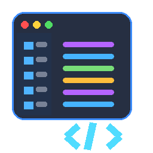

# codeView v1.1



codeViewは、WindowsとmacOSでソースコードを読むための軽量な読み取り専用ビューアです。
ファイルツリーとタブでコードを開き、検索・定義ジャンプ・参照検索・ジャンプ履歴で読み進められます。

C/C++では、ビルド設定がなくてもフォルダの定義タグを作成してF12で検索できます。Native AOTビルドには、意味解析用のRoslynとclangdを同梱します。

## 変更履歴

### v1.1

- 対応する `()`・`[]`・`{}` を入れ子の深さごとに3色で表示し、複数行にまたがる括弧に同じ色の細い縦ガイド線を追加しました。
- `.md`・`.markdown` の整形表示を追加しました。コードブロックの構文色とMermaidに対応し、ローカルのPlantUMLを設定するとPlantUMLの図も表示できます。
- Markdown表示と原文表示を Windows の `Ctrl+P`、macOS の `Cmd+P` で切り替えられるようにしました。
- Markdown内のローカルファイルリンクから、codeViewで読めるファイルを別タブで開けるようにしました。すでに開いているファイルはそのタブを選択します。

### v1.0

- Windows・macOS向けの初版です。読み取り専用のソース閲覧、構文色分け、ファイルツリーとタブ、Sticky Scroll、ファイル内・フォルダ横断検索を搭載しました。
- C#・C・C++の定義ジャンプと参照検索、ジャンプ履歴を搭載しました。C/C++の定義タグはビルド設定がなくても作成できます。Native AOT配布物にはRoslynとclangdを同梱しました。

## 機能一覧

| 機能名 | 概要 | ショートカット |
| --- | --- | --- |
| ファイルを開く | ファイル選択ダイアログやドラッグ＆ドロップから、単体または複数のファイルを開きます。 | Windows `Ctrl+O` ／ macOS `Cmd+O` |
| 最近開いたもの | 初期画面に最近開いたファイル・フォルダを最大6件表示します。各項目を開き直したり、履歴から削除したりできます。 | 選択中の項目を開く `Enter` |
| フォルダを開く | 作業フォルダを開き、左側のファイルツリーとフォルダ横断検索を利用します。フォルダはドラッグ＆ドロップでも開けます。 | — |
| ファイルツリー | フォルダを展開し、言語アイコン付きのファイルを選んで開けます。「表示」メニューで開閉し、右端で幅を調整できます。 | ツリー内で `←`／`→`、`Enter` で開く、`F5` で再読込 |
| タブ | 複数のファイルを開き、タブごとにカーソルやスクロール位置を保持します。タブがない状態で閉じる操作をするとアプリを終了します。 | 次へ `Ctrl+Tab`、前へ `Ctrl+Shift+Tab`（両OS）。閉じる Windows `Ctrl+W` ／ macOS `Cmd+W` |
| ソースコード閲覧 | 読み取り専用の本文に行番号と現在行を表示し、対応言語は構文色分けします。対応する `()`・`[]`・`{}` を入れ子の深さごとに3色で表示し、複数行の括弧には同色の縦ガイド線を表示します。原文を選択してコピーできます。 | コピー Windows `Ctrl+C` ／ macOS `Cmd+C` |
| Markdown閲覧 | `.md`・`.markdown` を開くと本文を整形して表示します。コードの構文色とMermaidに対応します。ローカルファイルへのリンクは別タブで開きます。「表示 → ソースを表示」で原文に戻れます。PlantUMLはローカル設定がある場合に表示します。[対応範囲と設定](docs/detailed-design/04-documents-tabs.md#52-markdown表示と埋め込み図) | Windows `Ctrl+P` ／ macOS `Cmd+P` |
| Sticky Scroll | C#・C・C++で、いま読んでいる型や関数の宣言を、行番号・構文色付きで本文上端に最大2行固定します。既定はオンです。「表示 → Sticky Scroll」で切り替え、次回起動時も設定を引き継ぎます。[C#の対応範囲](docs/detailed-design/02-runtime-ui.md#74-sticky-scroll-の設計案)・[C/C++の対応範囲](docs/detailed-design/02-runtime-ui.md#75-ccのsticky-scroll対応案) | — |
| 再読込・文字コード指定 | 開いているファイルを読み直せます。自動判定のほか、UTF-8、UTF-16、UTF-32、Shift_JIS（CP932）を指定できます。 | — |
| ファイル内検索 | 検索語と条件をタブごとに保持します。文字列、大小文字の区別、単語単位、正規表現に対応します。[検索仕様](docs/detailed-design/05-search.md#74-ファイル内検索の実装) | Windows `Ctrl+F` ／ macOS `Cmd+F`。次へ `Enter`、前へ `Shift+Enter`、閉じる `Esc` |
| フォルダ横断検索 | 作業フォルダ内のテキストを検索します。大小文字の区別、単語単位、正規表現に対応します。検索語の上限はファイル内検索と共通で16,384 UTF-16単位です。 | 開く Windows `Ctrl+Shift+F` ／ macOS `Cmd+Shift+F`。検索欄で `Enter`、検索欄・結果一覧で取消 `Esc` |
| 検索結果パネル | 右側にファイル名・行と列・一致の抜粋を表示します。左端で幅を調整でき、閉じても検索・結果・幅を保持します。マウスを重ねるとフルパスと抜粋を確認できます。 | 閉じる Windows `Ctrl+J` ／ macOS `Cmd+J`。確定行に移動 `Enter` |
| 同じ識別子のハイライト | 識別子をクリックすると、同じタブ内で大小文字まで一致する単語を本文と縦スクロールバーに最大10,000件表示します。コメントや文字列も対象です。 | 解除 `Esc`（本文にフォーカス中） |
| 定義へジャンプ | C#・C・C++の定義へ移動します。C/C++では意味解析を利用できる場合はclangdを使い、それ以外は定義タグまたは簡易検索を使います。移動先が1件に確定すれば直接ジャンプし、複数候補や部分結果は一覧で表示します。 | `F12` |
| C/C++の定義タグ | 「検索 → C/C++のタグ → C/C++のタグを作成・更新」で手動作成し、次回も再利用できます。作成中や索引に変更がある間は簡易F12を使います。明示的な名前空間・型で候補を順位付けします。マクロ展開やオーバーロード解決は対象外です。 | — |
| 参照検索 | 識別子の参照箇所を一覧表示します。名前一致では宣言・コメント・文字列も対象です。意味解析を有効にすると型やプロジェクトの情報を使って検索します。 | `F1` |
| 意味解析の設定（C#） | Native AOT配布物に同梱のRoslynは、フォルダ直下にソリューションが1件、またはソリューションがなくプロジェクトが1件ある場合に自動で有効になります。Roslynはプロジェクトの処理を実行する場合があるため、信頼できるフォルダで利用してください。[利用条件・手動設定](docs/detailed-design/06-navigation.md#8-意味解析による定義ジャンプ参照検索) | — |
| 意味解析の設定（C/C++） | 「検索 → 意味解析の設定…」で有効にします。同梱clangdが `compile_commands.json` を使い、未指定の場合は作業フォルダ直下と `build` を探します。 | — |
| ジャンプ履歴 | 定義や検索結果へ移動した位置をたどり、ファイル・カーソル・スクロール位置を復元します。最大100件を保持し、作業フォルダの切り替えやアプリ終了で消去します。 | Windows `Alt+←`／`Alt+→` ／ macOS `Cmd+←`／`Cmd+→` |
| 除外フォルダの設定 | 「ファイル」メニューからフォルダ名を1行ずつ設定します。再起動後にツリーとフォルダ検索に適用されます。 | — |
| メニュー・ファイルパス | ☰から「ファイル」「表示」「検索」「移動」を開けます。タイトルバーのパンくずにマウスを重ねるとフルパスを確認できます。 | 開く Windows `Alt` ／ macOS `Option` を単独で押して離す |

## 必要なツール・SDK

- .NET SDK 10.0.403（許容パッチ版は[global.json](global.json)に従う）
- Python 3（通常テスト・カバレッジ計測・Native AOT発行用。macOSは`python3`、Windowsは`py`ランチャー）
- Xcode Command Line ToolsまたはXcode（macOSのNative AOT発行用。テストスクリプトも、配布物がなければ発行します）
- Visual Studio 2022以降または対応するBuild Toolsの「C++によるデスクトップ開発」（WindowsのNative AOT発行用。MSVC・Windows SDKを含み、テストスクリプトも配布物がなければ発行します）
- VS CodeとMicrosoft C#拡張機能 `ms-dotnettools.csharp`（[VS Codeでデバッグする場合](docs/build.md#vs-codeでのデバッグ)）

## ビルド・起動

リポジトリのルートで実行します。

```sh
dotnet restore codeView.slnx --locked-mode
dotnet build codeView.slnx -c Release --no-restore
dotnet run --project src/codeView/codeView.csproj --no-restore
```

## テスト

### macOS

```sh
./test-mac.sh
```

### Windows

```bat
test-windows.bat
```

## カバレッジ計測・HTMLレポート

### macOS

```sh
./test-mac.sh --coverage
open artifacts/test-results/macos/coverage/html/index.html
```

### Windows

```bat
test-windows.bat --coverage
start "" "artifacts\test-results\windows\coverage\html\index.html"
```

## 性能試験（[データ準備](docs/performance-plan.md)）

### macOS

```sh
./test-mac.sh --performance
```

### Windows

```bat
test-windows.bat --performance
```

## Native AOT発行

| 対象 | 出力先 |
| --- | --- |
| macOS（Apple Silicon・Intel） | `artifacts/publish/<RID>/codeView.app` |
| Windows x64 | `artifacts\publish\win-x64\codeView\codeView.exe` |

### macOS

```sh
./build-mac.sh
```

### Windows

```bat
build-windows.bat
```

## ドキュメント

- [ビルド・テスト・カバレッジ・デバッグの詳細](docs/build.md)
- [要件定義](docs/requirements.md)
- [基本設計](docs/basic-design.md)
- [アーキテクチャ設計](docs/architecture.md)
- [詳細設計](docs/detailed-design/README.md)
- [実装計画](docs/implementation-plan.md)
- [実装・検証記録](docs/development-log.md)
- [性能評価条件](docs/performance-plan.md)
- [外観・操作モック](docs/mockup/README.md)
- [開発ルール](AGENTS.md)
