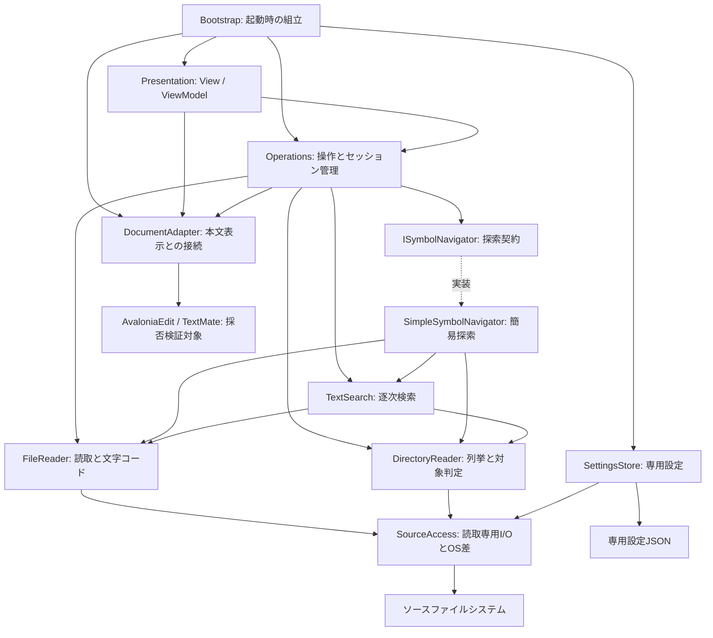
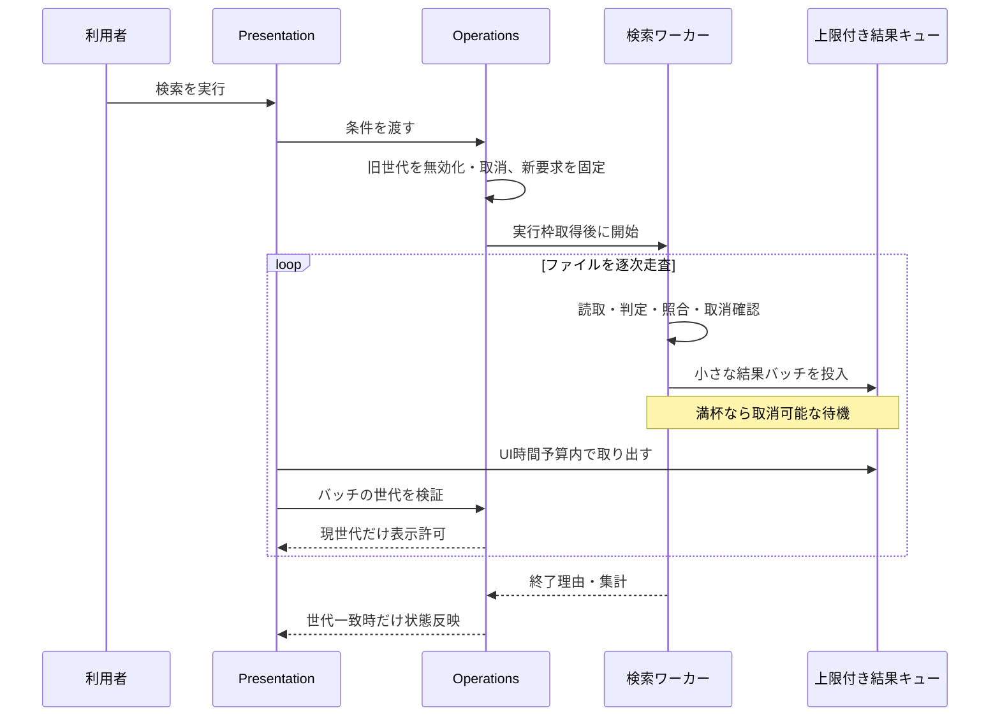

# アーキテクチャ設計書 — codeView

| 項目   | 内容                                                               |
| ------ | ------------------------------------------------------------------ |
| 作成日 | 2026-10-30                                                         |
| 状態   | 第2版・レビュー指摘を反映し実装進行中。性能の採否判定・最終受け入れは未実施 |
| 入力   | [要件定義書](requirements.md)、[基本設計書 第2版](basic-design.md) |
| 対象   | Windows / macOS向け、完全オフラインの読み取り専用コードビューア    |

## 1. 目的と設計の位置付け

本書は、要件から重視する品質特性を導き、それを実現する構造、依存関係、実行方式、資源管理、検証方法を定める。画面・操作仕様や検索条件の詳細は基本設計書を参照する。

内部契約・状態遷移・アルゴリズム・試験ケースの具体化は[詳細設計書](detailed-design/README.md)を参照する。

基本設計書2.2の責務区分を具体化するアーキテクチャ設計である。要件の【仮定】、暫定目標、ライブラリの採用保留事項は引き継ぐ。以下のコンポーネント名とデータ名は設計上の名称であり、外部公開APIではない。実装状況は[実装・検証記録](development-log.md)に対応付ける。

## 2. 品質特性と設計上の優先順位

### 2.1 要件からの導出

安全性・オフライン・読み取り専用は満たすべき制約とする。その上で性能の判断は、起動速度、読んでいる最中のUI応答と描画、メモリ効率を優先し、横断検索の完了速度はこれらを損なわない範囲で改善する。機能追加や将来拡張のために起動処理・常駐資源を増やさない。

| ID   | 重視する品質特性                       | 根拠となる要件                                     | 実現する構造・仕組み                                                                 | トレードオフ                                                   |
| ---- | -------------------------------------- | -------------------------------------------------- | ------------------------------------------------------------------------------------ | -------------------------------------------------------------- |
| Q-01 | 性能効率：起動時間                     | 要件1.2、5.1、9章の概ね1秒以内                     | 単一プロセス、最小の起動組立、初回表示とデータ読込の分離、文法の遅延初期化、索引なし | 初回に開くファイルや最初の検索には追加待ちが生じる             |
| Q-02 | 性能効率・操作性：応答と描画           | 要件5.1の数十MB・数万ファイル、非同期検索          | UIとワーカーの分離、仮想化、上限付きキュー、UI反映の時間予算、同時実行制限           | 大量結果の反映や処理全体の完了を待つ場合がある                 |
| Q-03 | 性能効率：メモリ・資源使用量           | 要件5.1の未表示本文を保持しない、閉じたタブの解放  | タブ単位の本文所有、検索のストリーム処理、結果・抜粋・待機要求の上限、資源の明示解放 | 検索の都度走査、閉じた本文の再読込が必要                       |
| Q-04 | 信頼性：処理の一貫性と障害局所化       | 要件4.2のキャンセル・逐次表示、5.1の操作継続       | 操作ごとのセッションと世代、結果採用条件、ファイル単位の失敗分離、終了理由の明示     | 外部更新の厳密なスナップショットやOSのI/O即時中断は保証しない  |
| Q-05 | 安全性・機密性：対象不変と外部送信なし | 要件4.3、5.4                                       | ソース読取経路と設定書込経路の分離、編集コマンドなし、ネットワーク機能なし、文法同梱 | 編集・クラウド連携・自動更新は提供しない                       |
| Q-06 | 使用性：閲覧と移動の一貫性             | F-01〜F-09、要件7章                                | 入力経路の共通化、共用結果モデル、共通の位置規則、タブ状態の独立、IMEへの配慮        | 定義探索は簡易候補であり意味的な正しさを保証しない             |
| Q-07 | 移植性・配布容易性                     | 要件2章、5.2                                       | Avalonia、OS差の局所化、自己完結型のOS・CPU別成果物                                  | 配布容量と署名・OS別検証の負担が増える                         |
| Q-08 | 保守性・試験容易性                     | 要件6.4の探索の分離、AGENTS.mdの単純さ・テスト方針 | 小さな責務分割、UI非依存の検索・照合、探索インターフェース、依存方向の固定           | 抽象化は変更点と試験境界に限定し、全クラスを差替可能にはしない |

Q-05を性能のために緩めない。Q-08は性能や単純さより優先しない。基本設計書8.4のL1は5万ファイル・1 GiBの必須性能評価、L2は20万・5 GiBの拡張評価、L3は100万・20 GiBの限界調査として引き継ぐ。

### 2.2 品質シナリオと判定方法

数値は要件目標または基本設計書の暫定目標であり、実測済みの保証ではない。

| シナリオ               | 刺激・実行条件                                                      | 期待する応答・測定基準                                                               | 関連構造       |
| ---------------------- | ------------------------------------------------------------------- | ------------------------------------------------------------------------------------ | -------------- |
| QS-01 起動             | Releaseの配布候補を両OSで起動。初回と再起動を区別                   | プロセス開始から初回描画まで目標1秒以内。10回以上の中央値・最大値                    | 3章、6.1       |
| QS-02 大容量閲覧       | 10 / 50 MiBを表示、100 MiBは拡張評価。長い行・CP932・複数タブを含む | 60Hzで概ね16.7ms/フレーム、100ms超の停止なしを暫定目標。読込時間とピークメモリも測る | 5.1、7章、10章 |
| QS-03 検索中の操作     | L1の全件未一致検索中に入力・タブ切替・キャンセル                    | UI応答・キャンセル表示100ms以内、通常のローカルI/Oでワーカー停止500ms以内を暫定目標  | 5.2、6.3       |
| QS-04 古い結果の拒否   | 検索・ルート・文字コードを連続切替し旧処理を遅延完了させる          | 現在の画面へ旧結果を採用しない。上限付き待機と解放を確認                             | 6.2〜6.4、7章  |
| QS-05 読取障害         | 走査中の削除、アクセス拒否、バイナリ、不正バイト                    | 他ファイル・他タブを操作でき、部分結果と停止理由を区別できる                         | 5.3、8章       |
| QS-06 安全・オフライン | 入力・貼付・ドロップ・全検索を実行。通信できない環境も使用          | 対象ファイルのハッシュ不変。通信不要で本文・文法・検索が利用可能                     | 5.4、9章       |
| QS-07 長時間利用       | 8時間連続利用、タブ開閉・検索を各1,000回                            | 同じ空状態で資源が増え続けず、最後もUI応答予算内。本文参照・ハンドル残留を追跡       | 7章、11章      |
| QS-08 OS別操作         | 別PCへのコピー、Finderドロップ、日本語IME、Gatekeeper有効           | 承認された配布手順で起動し、IME確定後に検索、本文は不変                              | 4章、9章、11章 |

本文のメモリ・読込時間予算はPhase 2開始時、L1検索の時間・メモリ予算はPhase 4開始前、長時間試験の資源許容幅はPhase 6試験前に固定する。未決の予算を合格扱いにしない。

追加の品質シナリオを以下に定める。L3は上記L1の合格基準を適用する対象ではない。

| シナリオ | 刺激・実行条件 | 期待する応答・測定基準 | 関連構造 |
| --- | --- | --- | --- |
| QS-09 L3限界調査 | 100万ファイル・20 GiBを逐次列挙・検索し、途中で取消する | 速度・全件完走・一定メモリ内での完走を保証しない。探索時間・ピーク資源・限界点を記録し、UI応答、取消、部分結果、解放を確認。未実施・未完了は明示する | 5.2、6.4、7.2、11.2 |
| QS-10 起動中の競合 | 設定読込を遅延・失敗させ、CLI・メニュー・ドロップのOpen要求を投入 | 未確定設定で実行せず、有界キューで受付順を保持。確定は1回、各要求の実行は高々1回。超過・終了・設定失敗時の結果を確認 | 6.1.1 |
| QS-11 割当と停止 | Phase 2の大容量読込・再読込、Phase 4の検索条件変更・取消を反復 | 割当速度・GC世代別回数・停止時間・LOHを測定し、UI停止との相関を記録。GC関連の予算は試験前に固定 | 7.3、11.1 |
| QS-12 キャッシュ条件別検索 | L1をCold / Warmで同一条件検索。L2・L3は拡張・限界評価 | 完了時間・初回結果・MB/秒・資源を条件別に報告。Coldを確認できない場合は未測定とし、WarmをColdの代用にしない | 11.2 |

## 3. アーキテクチャの形態と境界

### 3.1 全体方針

単一プロセスのデスクトップアプリとし、内部を小さな責務に分ける。サーバー、常駐デーモン、検索専用プロセス、データベース、メッセージブローカーは設けない。MVVMは画面状態と操作を整理するために用い、業務層を重ねる汎用フレームワークは導入しない。

| 境界           | 内側                                | 外側・許可する接続                                    |
| -------------- | ----------------------------------- | ----------------------------------------------------- |
| アプリ実行境界 | UI、読込、検索、設定、同梱文法      | ローカルファイルシステム、OSダイアログ・入力・描画    |
| ソース読取境界 | 列挙、読み取り、文字コード判定      | 利用者が指定するファイル・ルート。書込APIは提供しない |
| 設定保存境界   | 専用JSONの検証・読込・保存          | アプリ専用設定場所のみ。ソース保存先を受け取らない    |
| UI境界         | View、ViewModel、表示文書アダプター | ワーカーとは要求・結果・読取ビューだけを交換する      |

同一プロセスの責務分離はOSによる権限隔離ではない。読取専用はコードの経路とテストで保証し、任意のローカルファイルへのアクセスを防ぐセキュリティサンドボックスとは扱わない。

### 3.2 論理コンポーネントと依存関係

矢印は呼出・利用の依存方向を表す。結果の戻り値やキューによる返却は逆向きのモジュール依存を意味しない。



探索契約の点線は実装の対応関係であり、インターフェースが具体実装を参照することを表さない。Bootstrapが具体実装を生成してOperationsへ渡す。SettingsStoreの結果もBootstrapから渡し、各機能が設定ファイルを直接読むことは避ける。

SettingsStoreの読込は通常ファイルを確認する共通のSourceAccessを使う。専用設定の書込は従来どおりSettingsStoreに限り、SourceAccessへ書込機能を追加しない。FIFO等が設定パスにあると通常のOpenが待ち続けるための修正であり、同じ種類判定を二重実装しない利点がある。影響は設定の読込経路と特殊ファイル試験で、通常JSONの優先順位・保存場所・出力契約は維持する。移行は共通読取の接続、FIFO/リンク/不正設定の回帰、両OS確認の順とする。

| コンポーネント        | 責務                                                                     | 担当しない処理                                   |
| --------------------- | ------------------------------------------------------------------------ | ------------------------------------------------ |
| Bootstrap             | 必要なオブジェクトの組立、初回表示、起動引数・設定の引渡し、終了開始     | 起動時のルート全走査・文法全件読込               |
| Presentation          | メニュー・ツリー・タブ・結果・状態表示、IME状態、入力のコマンド化        | 同期I/O、C#宣言判定、検索ループ                  |
| Operations            | ワークスペース、タブ、操作世代、要求の受付と採用、処理枠管理             | 本文の照合アルゴリズム、Viewの直接操作           |
| DocumentAdapter       | 本文文書の生成・接続・切離し、位置変換、読取ビュー、可視範囲の色分け接続 | ルート走査、横断検索、本文保存                   |
| FileReader            | バイナリ・文字コード判定、逐次デコード、読込時メタデータ取得             | タブ・画面の所有、読み終えた本文の常駐キャッシュ |
| DirectoryReader       | ツリーの直下列挙、検索用の逐次走査、除外・リンク規則の共通適用           | 全プロジェクトの常駐索引                         |
| TextSearch            | 通常・単語・正規表現一致、位置計算、上限付き結果生成                     | UIコレクションの変更、候補の自動選択             |
| SimpleSymbolNavigator | C#宣言候補の字句解析、名前照合、参照検索への条件変換                     | 意味解析、オーバーロード解決                     |
| SourceAccess          | 読取用ストリーム・列挙・メタデータ・リンク解決、OSごとの差の局所化       | 汎用ファイル書込、UI通知                         |
| SettingsStore         | 保存場所の決定、JSON検証、既定値、専用設定の保存                         | 閲覧対象ファイルの保存                           |

PresentationはAvaloniaを、DocumentAdapterは本文ライブラリを利用できる。Operations、検索・探索・列挙・デコードのロジックにはAvaloniaやAvaloniaEditの型を漏らさない。エラーは構造化された結果として返し、表示文言はPresentationで決める。

### 3.3 依存ルールと組立

- 下位の処理からView / ViewModel、Operationsの具体型を参照しない。
- 検索要求と結果、位置、終了理由など小さな共有データにUI型を含めない。共有データ領域にサービスやキャッシュを集めない。
- インターフェースは要件が求める探索差替、読取I/Oの試験境界、本文ライブラリ境界に限定する。単純な純粋関数や設定データまで一律に抽象化しない。
- 初期組立はコンストラクターで依存を渡す。サービスロケーター、静的なワークスペース、汎用イベントバスは設けない。
- CPU処理と同期I/Oは制限付きのバックグラウンド実行に載せ、UIからの呼出で暗黙にUI上の処理を始めない。

### 3.4 Operationsの責務の維持と分割条件

Operationsは論理的な領域であり、全処理を1つの巨大クラスに実装する指定ではない。操作の受付・タブ・ルート・検索セッションの状態は担当を明確にし、照合やI/Oの実装をOperationsへ移さない。初期段階では小さな構成を維持し、Phase 3以降のレビューで次の兆候を確認する。

- タブの変更で検索やワークスペースの内部状態も頻繁に修正する。
- ある責務の単体試験に無関係な責務の多数の状態を準備しなければならない。
- 世代、取消、処理枠の同じ不変条件が複数箇所に重複し、修正漏れが生じる。

兆候が確認された場合は、WorkspaceCoordinator（ルート・ツリー世代）、TabManager（タブ・本文寿命・読込世代）、SearchCoordinator（検索世代・結果・検索枠）への分割を候補とする。行数や将来の機能数だけで分割を決めず、変更履歴と試験の結合度を根拠とする。

分割時もUIからの入口と所有者を明確にし、Coordinator同士の循環依存、同じ世代・取消状態の二重所有、汎用イベントバスの導入を避ける。外側の操作調整が協調を担当し、各状態の更新・破棄は1つの所有者に限る。初回レビュー時点では分割を保留した。実装段階でタブ寿命をTabManagerへ、検索の最新待機/世代/採用をSearchCoordinatorへ分離している。SearchCoordinatorの理由・利点/不利点・影響範囲・移行計画は[詳細設計02の1.1](detailed-design/02-runtime-ui.md)に記載する。層/モジュール/依存方向は維持し、今後も構造変更は理由と計画を提示して承認を得る。

検索結果からの移動はOperations内のSearchResultNavigatorが最新要求と読込/メタデータ寿命を所有し、Documents内のDocumentNavigationが位置/短い一致の検証を担当する。既存タブの再読込や全文コピーを避ける性能上の境界と、選択/本文版/入力世代で後着を不採用にする信頼性上の境界である。理由・利点/不利点・影響/移行順は[詳細設計04の6.1](detailed-design/04-documents-tabs.md)に記載する。新しい層や共有基盤は追加しない。

### 3.5 Contractsへの追加ルール

Contractsは共有が必要な小さなデータ契約の領域に限定し、全機能が参照する業務モデル・汎用サービスの集積場所にしない。新しいDomain層や共有基盤を追加する意味ではない。

| 種類 | 配置・扱い | 例 |
| --- | --- | --- |
| 複数機能の境界で共有するUI非依存契約 | Contractsへ置く候補。利用元と意味・所有者を記載する | 本文位置、対象ファイル情報、共通の終了理由 |
| 単一機能が所有する処理契約 | 原則として当該機能内へ置く | Search内の検索要求・詳細な進捗、Navigation内の解析情報 |
| UI契約・表示状態 | Presentation内へ置き、ViewModelで処理結果から変換する | 選択状態、表示文言、コマンド、表示用コレクション |

ContractsからPresentation、Operationsの具体実装、Avalonia、本文ライブラリへ依存しない。イベント通知、ローカライズ文言、UI選択フラグ、サービス、キャッシュを追加しない。共有化には実際の複数利用元があることを確認し、同名であるだけのデータや将来利用を見込んだ型を集約しない。契約変更では利用元への影響をレビューし、不要になった共有を戻す。

## 4. コード配置と配布単位

初期案は製品1プロジェクトと試験1プロジェクトとし、論理分割はフォルダ・名前空間で表す。将来の差替を理由に多数のアセンブリへ分割しない。以下は作成予定の構成であり、現時点でコードは追加しない。

```text
src/codeView/
  Bootstrap/
  Presentation/       # Views・ViewModels
  Operations/         # セッション・操作調整
  Documents/          # DocumentAdapterと読取契約
  Files/              # SourceAccess・FileReader・DirectoryReader
  Search/             # 照合・逐次走査
  Navigation/         # 探索契約・簡易C#探索
  Settings/
  Contracts/          # 小さな要求・結果・位置データ
  Assets/             # 同梱文法・テーマ等
tests/codeView.Tests/
```

外部に公開するライブラリAPIは設けず、内部型を基本とする。テストから内部型へアクセスする方法とテストランナーの採用は詳細設計で決定する。依存ルールはコードレビューと参照・名前空間の検査で維持し、1プロジェクトでコンパイラによる完全な境界強制がない点を認識する。

成果物はOS・CPU別の自己完結型とし、Windowsポータブル構成とmacOS `.app`を候補とする。SDK・ライブラリの版、対象CPU、単一ファイル化、ReadyToRun、署名・公証は基本設計書の判断手順に従う。

## 5. 主要な構造上の契約

### 5.1 本文とファイル読込

DocumentAdapterには「表示文書の構築」「読取専用ビューの取得」「行・列への移動」「破棄」の境界を設ける。要件にない編集・保存契約は設けない。本文ライブラリ固有の型はこの境界と表示側で扱い、横断検索には渡さない。

FileReaderのデコード出力は分割して受け渡し、表示文書の構築に利用する。バイト列全体・デコード済み文字列全体・表示文書を同時に常駐保持しない。文書生成をワーカーで実行できるか、UIへの接続にどの制約があるか、読取ビューを安全に共有できるかはPhase 2で検証する。安全性やスレッド制約が不明なままUI文書へ別スレッドからアクセスしない。

現在の候補が全文保持型である場合、その保持量は開いているタブ数と本文サイズに比例し得る。アダプターだけでメモリ問題が解決したとは扱わず、全文複製のないファイル内検索も含めて採否判定する。手動再読込で旧本文を失敗時に維持するため、入替前には新旧本文の一時的な重複があり、通常読込と別にピーク測定する。

DocumentAdapterは本文ライブラリを隔離する責務のまとまりであり、すべてを単一クラスに持たせる指定ではない。Phase 2で採用ライブラリのスレッド制約と文書寿命を確認した後、文書構築・接続・読取ビュー・文法資源を扱うAdapterと、行列変換・選択・スクロールを扱うDocumentNavigatorへの分離を検討できる。DocumentNavigatorは識別子探索のISymbolNavigatorとは別の責務である。

位置操作の変更が文書寿命管理へ波及する、または試験に過大な文法・文書初期化が必要になる場合を分離の判断材料とする。分離しても本文と文書版の所有者はタブ側の1つに保ち、Navigatorへ本文コピーや独立の版管理を持たせない。現時点では分離を確定せず、構造変更は評価結果と移行計画を提示して承認後に行う。

### 5.2 検索・探索

| 契約             | 受け取るもの                                       | 返すもの・保証                                           |
| ---------------- | -------------------------------------------------- | -------------------------------------------------------- |
| 直下列挙         | フォルダ、除外条件、キャンセル                     | ノード情報。子孫を先読みしない                           |
| 検索対象列挙     | ルート、除外・リンク規則、キャンセル               | 対象パスの逐次列。全件一覧を作らない                     |
| 横断検索         | 不変の検索要求、結果の返却先、キャンセル           | 上限付きの結果バッチ・進捗・終了理由                     |
| ファイル内検索   | 本文の読取ビュー、文書版、検索条件、キャンセル     | 上限付き一致位置。元の本文を変更しない                   |
| ISymbolNavigator | ルート、識別子、探索種別、条件、返却先、キャンセル | 定義候補または参照結果。UIや具体文法処理に依存しない契約 |

通常検索と参照検索で同じ照合・デコード・境界判定を使う。定義探索は逐次トークン処理を使用し、全文AST・常駐索引を作らない。対象外ファイルや解析失敗も終了情報に含め、完了した候補1件の場合だけOperationsが自動移動を判断する。意味解析版は今回実装しない。

通常文字列・単語検索はチャンク境界の一致を保持する。正規表現は有限タイムアウトと1行1Mi文字の暫定上限を適用する。結果一覧10,000件・抜粋200文字の暫定上限、行単位仕様、0文字一致は基本設計書6.1に従う。件数上限到達、未評価行、キャンセルは完全な結果と区別する。

#### 5.2.1 ファイル内検索の逐次処理と比較候補

全一致位置の生成完了を待ってから表示・次一致移動を可能にする構造は採らない。初期の評価基準方式は、確定した検索条件と文書版に対して、本文の読取ビューを先頭から時間・チャンク単位で区切って走査し、見つかった範囲と走査済み区間を逐次返す方式とする。全文の複製や一致位置の無制限保持は行わない。

入力変更はIME確定後の短い待機でまとめ、前条件を取消し新世代で再走査する。「インクリメンタル検索」はこの入力追従と段階的な結果返却を指し、旧条件の一致だけを新条件へ流用して全件性を推定する方式にはしない。次／前一致の要求は方向別に順次探索し、現在位置から必要な区間だけを走査できるようにする。折返し・検索範囲端・検索中の状態を区別する。

一致位置の保持上限後も次／前移動は必要区間の追加走査で対応する。未走査区間または破棄した位置がある間は総件数を確定値にせず、「検索中」「少なくともN件」等で示す。文書版・条件が変われば走査済み区間と位置を無効化し、古いハイライトを残さない。

| 比較方式 | 利点 | 確認する点 |
| --- | --- | --- |
| 先頭からの段階的走査 | 走査範囲と件数の状態を単純に管理できる | 末尾を閲覧中の最初のハイライトまでの遅延 |
| 可視領域と周辺を先に走査し、残りを段階的に処理 | 閲覧中の一致を早く表示できる可能性 | 区間の重複・欠落、チャンク境界、スクロールによる再優先、総件数未確定の扱い |
| 次／前の一致を必要時に探索する方式 | 全文の先行走査と位置保持を抑えられる | 次／前の応答、折返し、総件数表示の制約 |

Phase 2で読取ビューの複製量・スレッド安全性と方式の実現性を確認し、Phase 4で50 / 100 MiB・長い行・一致多発・連続入力を比較する。最初のハイライト、次／前移動、取消までの時間、CPU・割当・保持量から採用方式を決める。可視領域優先でも既存の行単位・Unicode・正規表現の上限を変えず、表示外に一致がないと誤認させない。

### 5.3 位置・更新・文字規則

内部位置は元本文に対応するUTF-16オフセット、結果表示は1始まりの行・列とする。バイト位置と文字位置を同一視しない。Unicode正規化は行わず、元のコードポイント列を対象とする。サロゲート境界、結合文字の単語境界、改行とチャンク境界は共通の照合処理で扱う。

これはコードポイント列の完全一致を意図した仕様であり、正規化を未実装のままにした暫定処置ではない。通常の大文字小文字を区別する検索で`が`と`か`＋結合濁点を同一視せず、全角・半角も同一視しない。区別なし検索の大小文字比較と正規表現の構文上の一致は別に適用する。位置の対応と変換コストを単純に保つ利点と、見た目が同じ文字でも一致しない不利な点を受け入れ、検索の説明に記載する。将来の正規化検索は既存仕様の修正ではなく、位置対応とコストを評価する追加仕様として扱う。

検索結果はパス・行列・一致長・短い抜粋・サイズと更新日時を保持し、元本文への参照は持たない。ジャンプ時はタブの版とファイル情報・一致文字列を確認する。更新日時だけで完全な変更検出ができるとは扱わず、自動監視なし・手動再読込のみとする。

### 5.4 読取と設定書込の分離

SourceAccessの利用者に任意パスへの書込機能を渡さない。SettingsStoreは内部で専用保存場所を決め、操作要求からソースパスを保存先として受け取らない。設定JSONとその一時ファイルの書込だけを許す設計案を引き継ぎ、要件の書込禁止との解釈はPhase 1で確認する。承認なしにソース更新や本文の永続キャッシュへ用途を広げない。

## 6. 実行構造と主要シーケンス

### 6.1 起動

1. Bootstrapは最低限の設定既定値、ウィンドウ、画面状態、軽量な依存を組み立てる。サービスのコンストラクターで走査・本文読込を始めない。
2. 最初のウィンドウを描画する。ここを起動時間の計測終点とする。
3. 小さな設定JSONを読み込み・検証し、設定スナップショットを確定する。この処理を初回表示の必須待ちにしない。
4. 設定が確定してから引数・保留中の「開く」要求を処理する。設定に依存する列挙・検索は確定まで開始せず、失敗時は既定値と通知で継続する。
5. 対象言語の初回表示時に必要な文法だけを初期化する。

設定待ちも画面の応答を止めず、起動指標とは別に引数指定ファイルが操作可能になるまでの時間を記録する。全タブ復元・最近使ったファイル収集・全言語文法の準備は起動処理に追加しない。

#### 6.1.1 設定確定前のOpen要求の調停

Operationsが設定準備状態とOpen待機キューを所有し、Bootstrapは設定読込の結果をOperationsへ渡す。CLI・メニュー・ドロップは準備状態によらず同じ受付を通す。設定準備は「読込中→確定」または「読込中→既定値で確定」の一方向遷移とし、確定済みの要求へ遅れて届いた設定結果を上書きしない。

受付、設定確定、キューの取り出しは同じ直列化された操作経路で行う。初期案ではUIスレッド上の短い状態更新に限り、I/Oは外で実行する。確定前に設定依存のOpen処理を開始せず、確定後に受付順で取り出し、要求識別子によって二重実行を防ぐ。設定確定中に届いた新要求も同じ順序へ並べ、設定依存処理は要求実行時に固定したスナップショットだけを見る。

キューは件数・要求内パス数・保持量に上限を設け、超過した要求は黙って破棄せず未受付を通知する。受け付けたOpen要求を検索の「最新1件」規則で置換しない。設定読込が通常の失敗または起動用の待ち時間上限へ達した場合は、既定値で一度だけ確定して通知し、旧読込結果を不採用にする。設定読込を無制限に再起動せず、遅延I/Oが残る場合も追跡する。終了時は待機要求を破棄し、遅れた設定完了・Open完了を採用しない。

キュー予算と待ち時間上限はPhase 1で固定する。設定を意図的に遅延させ、確定直前・直後の受付、失敗・時間超過、過剰な複数パス、終了との競合を試験する。

### 6.2 ファイルを開く・閉じる・再読込する

入力経路はPresentationから共通のOpen操作へ集約する。Operationsはパスと既存タブを確認し、新規タブの世代を作って読込枠へ要求を渡す。FileReaderが読取・判定・デコードし、DocumentAdapterが文書を構築する。UIへ採用する直前にタブの存在・世代・キャンセル状態を検査する。

タブ閉鎖はUIから直ちに取り除き、そのタブの要求を無効化して取消する。ワーカーが遅れて完成させた文書は採用せず、生成側が破棄する。再読込は同じタブの新世代として実行し、成功時だけ旧文書と入れ替える。失敗時は旧本文を維持する。

### 6.3 横断検索



UIのDispatcherへ結果1件ごとの仕事を登録しない。キューを取り出す通知自体も重複集約し、UIが遅いときにDispatcherの待機列を無制限に増やさない。エラー詳細は総数と上限付きの代表例に集約し、アクセス失敗数に比例して例外・全文パスを保持しない。

### 6.4 処理枠・取消・待機要求

| 処理                 | 初期の実行上限          | 待機・置換ルール                                                                           |
| -------------------- | ----------------------- | ------------------------------------------------------------------------------------------ |
| 本文読込             | 全体で1件               | 同じタブの旧要求を置換。別タブは開いた順に処理し、待機上限を設け、超過時は未受付を通知する |
| 横断検索・定義・参照 | 共用で1件               | 新要求が旧要求を取消。待機は最新1件だけを残す                                              |
| ツリー列挙           | 全体で1件を初期案とする | 同一ノードの要求を集約し、閉鎖・ルート切替時に取消。待機数に上限を設ける                   |
| ファイル内検索       | 全体で1件を初期案とする | アクティブタブの最新条件を優先。確定済みのタブ別結果は保持上限内で維持する                 |

ここでの枠は論理的な同時実行数であり、処理ごとに専用常駐スレッドを増やすものではない。読み込みの途中で新要求が届いても旧処理のI/Oが終わるまでは枠を再利用せず、新しいワーカーを無制限に作らない。「取消受付済み・停止待ち」を表示できるようにする。

各処理は所有者、世代、CancellationToken相当の取消状態、完了通知を持つ。ルート切替・タブ再読込・閉鎖は該当世代を無効にする。キュー投入待ちにも取消を伝え、満杯状態での終了不能を防ぐ。待機要求数・キュー容量・UIバッチ時間は内部定数として測定で決め、汎用設定UIは作らない。

## 7. データ所有権・寿命・メモリ予算

### 7.1 所有者と破棄契機

| 所有者                   | 所有するデータ・資源                                           | 解放・無効化の契機                                               |
| ------------------------ | -------------------------------------------------------------- | ---------------------------------------------------------------- |
| アプリ                   | 小さな設定、組立済みサービス、利用した文法の共有部分           | 終了。利用言語数が増える場合の文法キャッシュ上限はPhase 2で評価  |
| ワークスペース           | ルート、除外スナップショット、ツリー、ルート世代               | ルート切替。前ルートの結果・列挙を無効化                         |
| タブ                     | 文書、文字コード、表示位置、検索条件・上限付き一致位置、文書版 | タブ閉鎖・成功した再読込で旧文書を切離し                         |
| 本文読込セッション       | ストリーム、デコード状態、構築中文書、読込世代                 | 正常時は文書だけタブへ所有権移譲。失敗・取消・不採用時は全破棄   |
| 横断検索セッション       | 列挙器、現在のストリーム、チャンク、キュー、取消資源、集計     | 各ファイルの終了、処理完了・取消。画面に採用済み結果だけは残せる |
| 結果パネル               | 上限付きの小さな結果レコード                                   | 次の検索、ルート切替、明示クリア                                 |
| ファイル内検索セッション | 読取ビューの利用権、上限付き一致位置                           | 完了・取消。タブ閉鎖時は利用終了後に本文を解放                   |

所有権の移譲は一度だけとし、採用されなかった資源をUI任せにしない。ストリーム・列挙器・取消資源は正常終了でも例外時でも解放する。表示文書・読取ビューの利用終了が競合する場合は寿命を追跡し、閉じた本文を恒久保持しない。タブを捕捉するイベント購読やコールバックも切り離す。

### 7.2 使用量の増え方

概算の管理対象メモリは「基盤＋開いている本文＋展開中のツリー＋文法＋上限付きの結果・キュー・処理バッファ」として評価する。検索用の本文保持はリポジトリ総サイズに比例させない。ディレクトリ走査も全パスを先に配列化せず、深さと現在の列挙状態に応じた保持に抑える。

ただし、展開済みノードの数と開いているタブ数による増加は残る。折りたたみ済み子一覧の破棄、表示していないViewの切離し、本文複製の削減で抑える。UI仮想化はデータの上限を代替しない。長い行・正規表現・再読込の一時重複もピーク予算へ含める。

プロジェクト全体のキャッシュ、閉じた本文のLRU、全一致位置、失敗の全詳細を無制限に保存する構造は設けない。文法キャッシュやツリーの破棄条件を含む具体的な資源予算は実装前の測定計画で固定する。

### 7.3 割当・GC圧力の評価

保持メモリの小ささだけで性能を判定せず、短命オブジェクトの生成とGCによる停止を別に評価する。Phase 2は本文読込・再読込・タブ開閉・色分け、Phase 4はファイル内検索の入力追従・横断検索・結果バッチ・取消を対象とする。

| 計測 | 記録・比較する値 |
| --- | --- |
| 割当 | 操作あたりの割当バイト、割当バイト/秒、生成元。本文の重複・結果レコード・文字列生成を切り分ける |
| 世代別GC | Gen0 / Gen1 / Gen2の回数差分と頻度。試験時間と処理量も併記し、回数単独で優劣を判定しない |
| 停止 | GC停止時間の合計・最大・分布、GCに費やした時間割合。UIフレーム・入力遅延・取消応答と時刻を合わせる |
| LOH | 大規模オブジェクトの割当バイト・件数・生成元、LOHのサイズと断片化。残留量と割当量を区別する |

採用.NET版のランタイムメトリクスとGCイベントのトレースを使う。累積メトリクスだけで停止時間の分布やLOH割当を推定せず、取得できない値は未計測とする。指標の基礎は[Microsoftのランタイムメトリクス資料](https://learn.microsoft.com/en-us/dotnet/core/diagnostics/built-in-metrics-runtime)を参照し、具体的な取得手段は両OSと採用版で確認する。

計測ツールの負荷を記録し、性能予算の判定用実行と原因調査用トレースを区別する。GC・割当の予算は各Phaseの試験前に固定し、製品での強制GCによって合格値を作らない。割当が原因ならチャンク・抜粋・バッチのサイズや一時文字列を先に見直し、プールやGC設定変更は寿命管理の複雑さと実測効果を比較して判断する。

## 8. 障害・整合性・終了

| 障害範囲     | 処理                                           | 表示・継続                                                     |
| ------------ | ---------------------------------------------- | -------------------------------------------------------------- |
| ファイル1件  | 読取拒否、消失、バイナリ、デコード失敗を分類   | 開く処理は当該タブだけ失敗、横断検索は記録して続行             |
| 検索全体     | ルート読取不可、正規表現タイムアウト、処理上限 | 部分結果を残し、停止理由と未完了を表示                         |
| 色分け       | 文法失敗または負荷超過                         | プレーン表示へ落とし、本文閲覧を維持                           |
| 設定         | 破損・保存不可                                 | 既定値または現設定で閲覧継続。ソースへ代替保存しない           |
| 古い完了通知 | 世代・文書版不一致                             | 表示せず、生成資源を解放                                       |
| メモリ不足   | 当該読込を失敗として扱い可能な範囲で解放       | プロセス全体の回復を保証しない。予算と採否判定で発生防止を優先 |

部分結果、正常0件、未検出、取消、上限到達を同じ「完了」にしない。簡易定義探索は完全な走査ができた候補1件だけで移動するが、意味的な正しさは保証しない。

終了は新規要求の受付停止、世代無効化、取消、UIと文書の切離し、処理資源解放の順とする。UIスレッドでワーカーを同期的に待たない。終了待ちには上限を設け、遅いI/Oによってウィンドウを無期限に残さない。待ち時間は詳細設計で決め、OSがプロセス終了時に行う解放を通常のタブ閉鎖の解放手段にしない。

### 8.1 例外ハンドリングの原則

回復処理は、既知の正常な状態へ戻せる境界でだけ行う。下位処理は想定したI/O・デコード等の例外を分類し、操作境界で結果へ変換する。すべての例外を「ファイルなし」「結果0件」へ変換する処理や、例外を握り潰して成功を返す処理は設けない。この原則は[Microsoftの例外処理指針](https://learn.microsoft.com/en-us/dotnet/csharp/fundamentals/exceptions/index)に従う。

| 境界 | 想定内の失敗 | 予期しない例外 |
| --- | --- | --- |
| ワーカー | ファイル単位の失敗を分類して継続。検索全体のタイムアウト等は部分結果と失敗理由を返す | 結果キューを失敗として終了し、所有する処理を停止する。正常状態を保証できなければ致命的エラー経路へ渡す |
| UI操作 | 操作境界で失敗結果を受け、旧本文維持等の定義済み回復を行う | バインディング・描画・イベント処理等の未知の例外を一律に処理済みにはしない。状態の保証がなければ受付停止と終了へ進む |
| トップレベル | 起動失敗は可能なら簡潔に通知して異常終了する | 未処理例外の最終通知・終了の境界とし、閲覧を継続するための一般的な回復フックにはしない |

- 操作所有者は開始したTaskの完了・失敗を必ず観測する。追跡しないfire-and-forgetを作らず、UIイベント以外の非同期処理は待機可能な契約とする。イベントから起動する処理も例外を操作境界へ戻す。
- 取消に対応する`OperationCanceledException`は、当該操作の取消要求との対応を確認した場合にだけ正常な取消として扱う。無関係な取消例外を黙って無視しない。取消の扱いは[.NETの例外処理ベストプラクティス](https://learn.microsoft.com/en-us/dotnet/standard/exceptions/best-practices-for-exceptions)を参照する。
- 失敗時もキュー完了と処理枠解放を保証し、UIの消費側を無期限に待たせない。`using`・`finally`相当で資源を解放し、再送出時に元の発生箇所の情報を失わない。
- 例外通知・後始末自体が失敗した場合に通知を再帰させない。致命的経路では新要求の受付と設定保存を止め、可能な範囲で取消・解放して異常終了する。回復不能なメモリ不足やプロセス障害では、通知・解放の完了を保証しない。
- 実行時の診断情報は処理種別と簡潔なエラー識別を基本とし、本文・検索語・例外全文を自動で永続化・送信しない。詳細なスタックやダンプは利用者が明示して行うローカルの原因調査に限る。

トップレベルやUIの未処理例外を検出する具体的なフックは採用ランタイム・Avalonia版で確認し、検出できる障害範囲を試験する。全例外を捕捉できるとは扱わない。試験ではファイル単位の回復、ワーカー途中失敗、満杯キューでの失敗、UI更新失敗、起動失敗、後始末失敗を注入し、正常終了と区別した通知・終了を確認する。

## 9. プラットフォームと安全性

OS固有処理は入力のコマンド変換、ファイルメタデータ・リンク判定、設定場所、配布・起動処理に局所化する。ファイル名の大文字小文字は一律変換せず、パスのUnicode正規化もしない。フォルダリンクを自動走査せず、ファイルリンクは明示して開く場合だけ許可し、横断検索からは除外する。

日本語IMEの未確定入力は検索要求にせず、変換取消のEscapeを処理取消より優先する。本文は入力コマンドを持たず、選択・コピー・ナビゲーションだけを許す。ドラッグ&ドロップはパスをOpen操作に渡し、本文挿入には接続しない。

ネットワーククライアント、テレメトリ、オンライン文法取得、自動更新を製品構造に含めない。本文や検索語を含む永続ログも設けない。計測は明示的な試験で行い、配布版の自動送信機能にしない。自己完結型でもOS署名確認の挙動は別に検証し、Gatekeeper無効化を前提にしない。

## 10. 主な設計判断・代替案

| 判断                                  | 採用理由・利点                                           | 不利な点・棄却した案                                                                 | 見直す条件                                                                            |
| ------------------------------------- | -------------------------------------------------------- | ------------------------------------------------------------------------------------ | ------------------------------------------------------------------------------------- |
| AD-01 単一プロセス・製品1プロジェクト | 起動と配布を単純にし、IPCや多数の組立処理を避ける        | 障害はプロセス内に留まり、コンパイラによる層の強制が弱い。別プロセス検索は初期不採用 | 実測で障害隔離が必要になった場合、起動・メモリへの影響を示す                          |
| AD-02 都度走査・索引なし              | 起動時間と常駐メモリ、外部更新の索引同期コストを抑える   | 繰返し検索もI/Oが必要。全文索引DBは不採用                                            | L1の検索予算未達時も、まずI/O・デコード・照合・UI反映を切分け、索引導入は別の承認対象 |
| AD-03 限定並行・上限付き返却          | UIと資源の安定を優先し、過剰並行と結果通知の増大を防ぐ   | ディスクを最大並列で使う方式より検索完了が遅くなる可能性                             | UI・メモリ予算を維持できる実測根拠がある場合に限り並列数を検討                        |
| AD-04 本文ライブラリ境界を局所化      | 第一候補を利用しつつ、検索・ファイル処理への型漏れを防ぐ | 境界で覆えない表示機能の変更や本文モデル変更は残る                                   | Phase 2で第一候補が性能未達                                                           |
| AD-05 探索だけ明示的な差替契約        | 要件6.4に対応し、簡易版の内部解析へUIを依存させない      | 将来の意味解析で必要な情報が増えれば契約見直しが必要                                 | 正確版が正式な対象になった時点                                                        |
| AD-06 自動監視なし・明示再読込        | 監視資源・イベント競合を省き、読んでいる本文を安定させる | 開いた本文とディスクが一致しない期間がある                                           | 自動追従が正式な要件になった場合                                                      |

### 10.1 大容量表示方式の判断留保

AvaloniaEdit / TextMateの採否は基本設計書8.3のPhase 2評価で判断する。未達時は独自仮想テキストモデル、ストリーミング表示、読み取り専用MemoryMappedFileを使う読込を比較する。MemoryMappedFileは表示モデルの代わりではなく、デコード・行索引・ページフォルト・外部切詰めを含めた評価対象とする。

代替案は本文アダプター、タブの本文所有、ファイル内検索、位置変換、選択・コピー、色分け、資源解放へ影響する。初期段階から共通性を推測して巨大な汎用テキストモデルを設計しない。

変更が必要な場合の移行順は、同じデータによる比較試作、品質シナリオと資源予算による評価、理由・利点・不利点・影響範囲・移行計画の提示、承認、本文境界への接続、検索・ジャンプ・解放の回帰検証とする。今回、代替方式を製品へ採用したことにはしない。

## 11. アーキテクチャの検証

| 検証対象      | 方法                                                 | 主な正常・異常・境界ケース                                            |
| ------------- | ---------------------------------------------------- | --------------------------------------------------------------------- |
| 依存方向      | 参照・名前空間検査、レビュー                         | 検索にUI型なし、読取経路に書込なし、探索契約に具体実装なし            |
| 照合・解析    | UIなしの単体テスト                                   | 通常一致、候補0・1・複数、不正式、タイムアウト、Unicode・チャンク境界 |
| I/Oと対象判定 | 一時ディレクトリの結合テスト、読取境界のテスト用実装 | 空、CP932、アクセス拒否、リンク内外・循環、更新・削除                 |
| 非同期整合性  | 任意の順で完了・失敗させる制御可能なテスト           | 古い世代、タブ閉鎖後完了、キュー満杯時の取消、旧I/O停止待ち           |
| 資源所有権    | 解放の観測、ヒープ・ハンドル追跡                     | 正常完了、採用拒否、例外、再読込入替、長時間利用                      |
| 性能          | 両OSのRelease・自己完結型を固定条件で計測            | 起動、描画、CPU、メモリ、L1完走、L2・L3、単一行、50 MiB×5タブ         |
| OS・配布      | 別PC・実機受け入れ試験                               | Finder、IME、署名・隔離属性、オフライン、追加ランタイム不要           |

試験は基本設計書11章の受け入れ条件へ接続する。OSキャッシュやGCの予約領域とリークを区別し、繰返し試験では本文の強参照とハンドルの残留を調べる。通信不要と対象不変は、構造のレビューだけでなく実行時にも確認する。

記録にはビルド識別、OS・CPU・RAM・ディスク、採用ライブラリと設定、データ生成条件、計測値・予算・合否・未測定を含める。成果物の性能が未達なら、図上の構造を理由に達成済みとは扱わない。

### 11.1 追加の構造・性能試験

- Phase 3以降でOperationsの変更波及・試験結合度をレビューし、3.4の分割条件を確認する。ContractsへUI契約やサービスを追加していないかも検査する。
- 設定待ちのOpenキューは、確定と受付の順序を制御して試験する。通常・既定値確定・時間超過・上限到達・終了の各場合で、未確定設定による実行と二重実行がないことを確認する。
- ファイル内検索は先頭・中央・末尾からの次／前移動、一致大量・0件、スクロール中の条件変更、保持上限超過、文書入替・取消を試験する。採用候補ごとに、走査済み区間の欠落や件数の過大な確定表示がないことを確認する。
- Phase 2・4で7.3のGC・LOH指標を取得し、UI停止と比較する。低い保持量でも割当・停止予算を超える場合は未達とする。
- 8.1の例外注入で失敗したTask・キュー・枠・文書の所有者が残らないことを確認し、致命的エラー後に通常操作を再開しないことを確認する。

### 11.2 Cold / Warm条件の検索性能試験

検索のキャッシュ条件は起動のCold / Warmとは別に管理する。プロセスを再起動しただけではColdと見なさない。L1は両条件を必須の測定対象とし、L2・L3でも実施条件・未測定を明記する。

| 条件 | 準備と記録 | 測定 |
| --- | --- | --- |
| Cold | 検索対象がOSファイルキャッシュにない状態を意図して、専用試験機の再起動後の初回走査等の手順を固定する。事前のファイルコピー・ウイルス検査・計数で温まる可能性も記録し、物理I/O等で状態を確認する | 全件未一致検索の完了時間・MB/秒、既知の一致位置による初回結果までの時間、CPU・物理I/O・ピークメモリ・UI応答・取消 |
| Warm | 同一対象の走査を終えた後、同じ条件で反復する。対象サイズと空きRAMを記録し、全量が収まらない場合は部分的Warmと明示する | Coldと同じ指標。キャッシュによるI/O削減と照合・デコード・UI処理の負荷を分ける |

本試験の準備のために日常利用環境のOSキャッシュを無断で消去しない。Cold状態を検証できない場合はCold相当または条件不明と記録し、Cold測定完了として扱わない。1回の未一致検索で対象を温めてから、同じ状態をColdと称して一致・取消試験を続けない。試験ケースごとにキャッシュ準備条件を揃える。

同じデータ・ビルド・除外・文字コード・検索語を使い、通常文字列と正規表現の結果を分ける。上限到達は全件完走の速度測定に使わず、別の多一致試験とする。L1のCold / Warmそれぞれの時間予算はPhase 4開始前に固定し、測定は複数回行って分布・ばらつきを報告する。ストレージ種別、RAM、バックグラウンド負荷、試験順序、キャッシュ準備の再現手順を残す。L3はQS-09の限界調査であり、Cold / Warmいずれも完走性能の保証対象へ変更しない。

## 12. 要件と構造の対応

| 要件                     | 主な担当構造                                        | 品質特性               |
| ------------------------ | --------------------------------------------------- | ---------------------- |
| F-01 ファイルを開く      | 共通Open、FileReader、DocumentAdapter、タブ         | Q-02〜Q-06             |
| F-02 フォルダを開く      | ワークスペース、DirectoryReader、ルート世代         | Q-01〜Q-04             |
| F-03 ファイルツリー      | 直下列挙、仮想化View、子ノード破棄                  | Q-02、Q-03、Q-06       |
| F-04 構文ハイライト      | DocumentAdapter、同梱文法の遅延読込                 | Q-01〜Q-03、Q-07       |
| F-05 全文検索            | TextSearch、検索セッション、上限付きキュー          | Q-02〜Q-04、Q-06       |
| F-06 定義ジャンプ        | ISymbolNavigator、軽量字句解析、共用結果            | Q-03、Q-04、Q-06、Q-08 |
| F-07 参照検索            | ISymbolNavigator、共通の単語検索                    | Q-02〜Q-04、Q-06、Q-08 |
| F-08 タブ                | タブ単位の文書所有・位置・世代                      | Q-02〜Q-04、Q-06       |
| F-09 ファイル内検索      | 読取ビュー、文書版、上限付き位置、可視一致の描画    | Q-02〜Q-04、Q-06       |
| 要件5.1 性能             | 最小起動、処理枠、寿命、都度走査、Phase 2の採否判定 | Q-01〜Q-04             |
| 要件5.2 配布             | OS別の自己完結型、OS差の局所化                      | Q-07                   |
| 要件5.3 文字コード       | 共通デコード・バイナリ判定、手動再読込              | Q-04、Q-06             |
| 要件5.4 安全・オフライン | 読取と設定書込の分離、通信機能なし                  | Q-05                   |
| 要件6.4 将来の探索差替   | ISymbolNavigatorと具体実装の分離                    | Q-08                   |

## 13. 未決事項と実装への引継ぎ

| 事項                   | 判断内容                                                               | 決定時期                              |
| ---------------------- | ---------------------------------------------------------------------- | ------------------------------------- |
| SDK・ライブラリ版      | LTS、互換性、OS別の実行・配布                                          | Phase 1〜2                            |
| 設定書込の例外         | 対象不変を守り専用設定だけを書き込む解釈                               | Phase 1                               |
| 本文境界の実装         | 文書構築、読取ビューの安全性・複製量、UI接続、文法寿命                 | Phase 2                               |
| 表示方式・本文資源予算 | 第一候補の実測と代替方式比較、再読込ピークも含む                       | Phase 2開始時に予算固定、終了前に採否 |
| 処理予算               | キュー・バッチ時間・待機上限、本文内一致保持、文法・ツリーのキャッシュ | 各機能の実装前に候補固定し実測        |
| 検索予算・制限         | L1の完走時間・メモリ、正規表現タイムアウト・行長・結果上限             | Phase 4開始前                         |
| 精度と構文範囲         | 簡易C#探索の対応宣言と既知の誤検出・見逃し                             | Phase 5                               |
| 配布と継続利用         | CPU、発行形式、署名・公証、8時間試験の許容幅、終了待ち上限             | Phase 6試験前                         |

本書の範囲はアーキテクチャの設計と評価計画である。以後、レイヤ・モジュール・依存方向・公開API・データ構造を変更する場合は、AGENTS.mdに従って理由・メリット・デメリット・影響範囲・移行計画を提示し、承認後に実施する。

追加の引継ぎ事項を以下に定める。

| 事項 | 判断内容 | 決定時期 |
| --- | --- | --- |
| Operationsの規模 | 変更波及・試験結合度を観測し、分割が必要なら3.4の候補と移行を評価 | Phase 3以降のレビュー |
| 本文境界の粒度 | AdapterとDocumentNavigatorを分ける必要性、本文の単一所有維持 | Phase 2採用判断後 |
| 本文内検索方式 | 段階的走査・可視領域優先・必要時探索の比較と表示状態 | Phase 2で実現性確認、Phase 4で採用 |
| GC・LOH予算 | 指標取得手段・割当・停止時間・LOH予算と計測負荷 | Phase 2・4の試験前 |
| 検索キャッシュ条件 | Cold / Warmの準備手順・時間予算・条件検証方法 | Phase 4開始前 |
| 起動時の競合制御 | Openキュー予算・設定待ち上限・一度だけの確定と実行 | Phase 1 |
| 例外境界 | ランタイム・UIの通知フック、Taskの観測、致命的な終了経路 | Phase 1、各ワーカー追加時に再検証 |

## 14. レビュー指摘の妥当性検証と対応

検証は現行の設計文書を対象とする。コードがないため、肥大化・リーク・GC負荷・L3実現性の発生を確認したものではない。「条件付きで妥当」は将来リスクとして採用し、現時点の構造分割は行わないことを意味する。

| No | 判定 | 検証根拠と対応 | 反映箇所 |
| --- | --- | --- | --- |
| 1 | 条件付きで妥当 | Operationsの責務は多いが論理領域であり巨大クラスと確定していない。変更波及・試験結合度等を根拠にPhase 3以降の分割候補を評価する | 3.4、11.1、13章 |
| 2 | 妥当・既存規則を補強 | UI型・サービスを共有しない規則は3.3にあったが、契約の所有と配置基準は不足していた。機能所有・共通処理契約・UI契約を区別する追加ルールを定めた | 3.5、11.1 |
| 3 | 保証範囲は既定・シナリオ補強が妥当 | 2.1と基本設計8.4でL3は既に限界調査だった。DirectoryReaderの実現性は未検証であり、完走保証を付けずQS-09に限界の測定を明記した | 2.2、11.2 |
| 4 | 妥当 | 上限と可視一致の描画は既定だったが、探索順・未走査・次／前移動の戦略が不足。段階的処理の基準方式と比較候補、採用判断を追加した | 5.2.1、11.1、13章 |
| 5 | 条件付きで妥当 | 本文ライブラリ隔離として関連する責務であり、即時分割は不要。採用後に位置操作と資源寿命の結合を評価し、DocumentNavigator分離の余地を明記した | 5.1、13章 |
| 6 | 妥当 | 保持量の評価だけでは割当頻度や停止を捉えられない。Gen0/1/2、LOH割当・保持・断片化、GC停止とUI応答の相関を測る計画を追加した | 2.2、7.3、11.1、13章 |
| 7 | 妥当 | 起動キャッシュの区別はあったが検索の準備条件は不足。検索専用のCold / Warm定義と測定・未測定の扱いを追加した | 2.2、11.2、13章 |
| 8 | 仕様は既定・意図の明示が妥当 | 基本設計6.1で正規化なしと非一致例は規定済み。意図した完全一致の仕様と利点・利用者への制約を明記し、大小文字・正規表現とは区別した | 5.3 |
| 9 | 待機は既定・競合制御の具体化が妥当 | 6.1で設定確定後の開始は規定済み。キュー所有者、直列化、一度だけの確定、遅延完了・時間超過・上限を補った | 2.2、6.1.1、11.1、13章 |
| 10 | 妥当 | 障害の範囲・解放方針はあったが捕捉・回復の境界が不足。ワーカー・UI・トップレベル、取消、Task観測、回復不能時の終了を規定した | 8.1、11.1、13章 |

製品コードの構造変更と性能試験は行っていない。基本設計書にも関連する検索方式・性能評価・例外方針の参照を追記し、要件定義書の変更は行わない。
