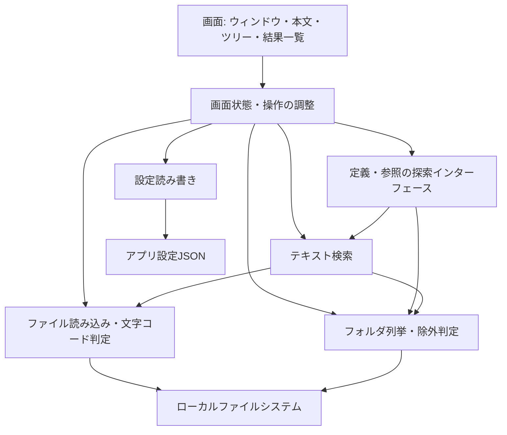

# 基本設計書 — 軽量ソースコードビューア codeView

| 項目 | 内容 |
| --- | --- |
| 作成日 | 2026-10-30 |
| 対象 | Windows / macOS 向けデスクトップアプリ |
| 要件定義書 | [requirements.md](requirements.md) |
| 状態 | 初版・設計案。未決事項と性能検証を経て詳細設計へ進む |

## 1. 目的・適用範囲

本書は要件定義書に基づき、画面、機能、処理構成、主要データ、非同期処理、性能、配布、検証の基本方針を定める。コードを書く機能は設けず、大量のソースコードを素早く読み、検索結果や識別子から移動できる体験を優先する。

現在のリポジトリには実装がないため、以下は新規実装に向けた設計案である。既存アーキテクチャの変更や公開APIの確定は行わない。メソッド署名、パッケージ構成、内部データの詳細は詳細設計で定める。

本書の「要件」は要件定義書の決定事項を示す。「設計案」は本書で補う初期仕様、「暫定目標」は実測で妥当性を確認する数値を示す。要件定義書の【仮定】は引き続き仮定として扱い、本書だけで確定事項に変更しない。

### 1.1 設計原則

- 起動時はウィンドウの表示に必要な処理だけを行い、フォルダ走査、検索、文法の読み込みは必要時に実行する。
- ファイルやツリーの読み込み、検索はUIスレッド外で実行する。
- ツリー・結果一覧・本文の表示範囲を仮想化する。ただし描画の仮想化と本文全体のメモリ保持は別に評価する。
- 未表示ファイルの本文、プロジェクト全体の索引、意味解析モデルを常駐させない。
- ソースファイルを読み取り専用で扱い、編集・保存・自動整形の経路を持たない。
- 通信、テレメトリ、文法のオンライン取得、自動更新は行わない。

### 1.2 対象外

編集・保存、アウトライン、ブックマーク、メモ、ビルド、デバッグ、Git操作、プラグイン、テーマ切り替えUI、Linux対応、Roslyn等による意味解析は対象外とする。

## 2. 全体構成

### 2.1 技術方針

| 項目 | 基本方針 | 確認事項 |
| --- | --- | --- |
| 言語・実行基盤 | C# / 実装開始時点の最新LTS .NET | 採用版とSDKを実装時に固定する |
| UI | Avalonia | Windows / macOSで入力・描画・配布を検証する |
| 本文表示 | AvaloniaEditの読み取り専用モードを第一候補とする | 数十MB、長い単一行、複数タブで性能検証する |
| 色分け | TextMate文法連携を第一候補とする | 文法は同梱し、言語ごとに遅延初期化する |
| 状態管理 | ViewとViewModelを分離する小規模なMVVM構成 | 大規模なDI基盤や汎用メッセージ基盤は導入しない |
| 設定 | 小さなJSONファイル | 保存場所の設計案は9章に記載する |

ライブラリの性能は未検証である。要件を満たせない場合は、原因と代替案のメリット・デメリット、影響範囲、移行計画を提示し、アーキテクチャ変更の承認後に対応する。

### 2.2 論理構成と依存関係

以下は責務の区分であり、区分ごとにプロジェクトやアセンブリを増やすことは要求しない。



| 責務 | 主な処理 | 保持する状態 |
| --- | --- | --- |
| 画面 | ユーザー操作受付、仮想化表示、選択・スクロール | UI部品の表示状態 |
| 操作の調整 | タブ管理、ワークスペース切替、キャンセル、結果採用の判定 | 開いているタブ、現在の処理世代 |
| ファイル読み込み | 読み取り、バイナリ判定、デコード | 実行中の読込バッファのみ |
| フォルダ列挙 | 直下の列挙、検索用の逐次走査、除外判定 | 展開済みツリーノード |
| テキスト検索 | 条件評価、結果の逐次返却、正規表現の時間制限 | 実行中の検索バッファのみ |
| 定義・参照探索 | 識別子抽出、宣言候補判定、参照一致の検索 | 実行中の候補のみ |
| 設定読み書き | JSONの検証、既定値補完、保存 | 小さな設定オブジェクト |

定義探索と参照探索は画面からインターフェース経由で呼ぶ。将来の意味解析版を追加する際も、画面が簡易版の検索パターンに依存しない構成とする。今回、実装の切替UIや汎用プラグイン機構は作らない。

## 3. 画面・操作設計

### 3.1 メインウィンドウ

```text
┌─────────────────────────────────────────────────────────┐
│ ファイル / 表示 / 検索                                   │
├────────────────┬────────────────────────────────────────┤
│ ファイルツリー │ [タブ1 ×] [タブ2 ×]                      │
│                ├────────────────────────────────────────┤
│                │ ファイル内検索欄（必要時）               │
│                │ 行番号 / 読み取り専用本文                │
│                │                                        │
├────────────────┴────────────────────────────────────────┤
│ 検索条件 / 状態 / キャンセル（検索時）                    │
│ 全文検索結果・参照一覧・定義候補（必要時）                │
├─────────────────────────────────────────────────────────┤
│ パス / 行:列 / 文字コード / 読み込み・検索状態            │
└─────────────────────────────────────────────────────────┘
```

| 領域 | 表示・操作 |
| --- | --- |
| メニュー | ファイル・フォルダを開く、タブを閉じる、終了、パネル表示切替、各検索・ジャンプ |
| ツリー | フォルダの展開・折りたたみ、ファイル選択。読込中・空・読込失敗を区別する |
| タブ | ファイル名、選択状態、閉じる操作。同名ファイルは親パス表示やツールチップで区別する |
| 本文 | 行番号、構文色、選択・コピー、カーソル、スクロール。初期案では折り返しを無効にする |
| ファイル内検索 | 入力欄、大文字小文字・単語単位・正規表現、前後移動、件数または検索中の状態 |
| 共用結果パネル | 検索条件、件数、進捗、キャンセル、相対パス・行番号・該当行、結果選択による移動 |
| ステータスバー | アクティブファイルのパス、1始まりの行・列、文字コード。文字コードの選択操作を設ける |

設計案として、初期テーマはダーク1種類とする。ツリーと結果パネルは個別に表示・非表示を切り替えられ、境界をドラッグしてサイズを調整できる。検索条件は結果パネル内に置き、全文検索操作で入力欄へフォーカスする。

### 3.2 コマンドと有効条件

| 操作 | Windows | macOS | 有効条件 |
| --- | --- | --- | --- |
| ファイルを開く | Ctrl+O | Cmd+O | 常時 |
| フォルダを開く | Ctrl+Shift+O | Cmd+Shift+O | 常時 |
| 全文検索 | Ctrl+Shift+F | Cmd+Shift+F | フォルダが開いている |
| ファイル内検索 | Ctrl+F | Cmd+F | 本文表示済みのタブがある |
| 定義ジャンプ | F12 | F12 | フォルダとC#の有効な識別子がある |
| 参照検索 | Shift+F12 | Shift+F12 | フォルダと有効な識別子がある |
| タブを閉じる | Ctrl+W | Cmd+W | タブがある |
| 次／前のタブ | Ctrl+Tab / Ctrl+Shift+Tab | Ctrl+Tab / Ctrl+Shift+Tab | タブが複数ある |
| 処理をキャンセル | Escapeまたはキャンセルボタン | 同左 | 対応する検索欄・結果パネルにフォーカスがある |

ショートカットは要件の仮定を引き継ぐ設計案とし、メニューからも全操作を実行可能にする。macOSのファンクションキーの動作は実機で確認する。

## 4. ワークスペース・ファイル・タブ

### 4.1 開く処理

1. メニュー、ドロップ、コマンドライン引数を共通の「開く」処理に渡す。引数はパスとして扱い、シェル実行しない。
2. パスの存在、種類、読取権限を確認する。通常ファイル・フォルダ以外のデバイス等は対象外とする。
3. ファイルなら既存タブを確認し、あればアクティブにする。なければ読込中のタブを作り非同期で読む。
4. フォルダならワークスペースのルートに設定し、直下だけを列挙する。
5. 起動引数の処理もウィンドウ初回表示後に開始し、起動時の大量読込で表示を遅らせない。

設計案として、ワークスペースは1ルート、ファイル引数は複数を許可する。フォルダが複数指定された場合は先頭だけを開き、残りを開かなかったことを通知する。ファイルの入力順は維持する。コマンドラインのパスに空白を含む場合はOSの引数分割に従う。

フォルダ切替時は、前の列挙・全文検索・識別子探索をキャンセルし、ツリーと共用結果をクリアする。設計案として既存タブは維持し、新ルート外のファイルも読めるようにする。以後のフォルダ横断検索は新ルートだけを対象とする。単体ファイルだけを開いた場合、フォルダ横断の機能は無効にし、ファイル内検索は利用可能とする。

### 4.2 読み取り専用・文字コード・バイナリ判定

- ファイルアクセスは読み取り専用とする。本文UIから文字入力、貼り付け、ドロップによる挿入、Undo経由の変更、保存操作を除く。ファイルパスのドロップは「開く」にだけ接続する。
- BOMを先に調べてUTF-8 / UTF-16 LE・BE / UTF-32 LE・BEを識別する。UTF-16等のNULをバイナリと誤判定しない。
- BOMがなければ厳格なUTF-8検証を優先し、失敗した場合にCP932を候補とする。CP932対応に必要なコードページの初期化は初回利用時に行う。
- 自動判定では一意に決められないことがある。判定結果をステータスバーに表示し、UTF-8、CP932、UTF-16 LE・BE等を手動選択して元ファイルを再読込できるようにする。
- BOMなしUTF-16等は誤判定の可能性があるため、表示を拒否した通知からも文字コードを指定して再試行できるようにする。
- 先頭サンプルの既知のバイナリ形式、NUL、制御文字の分布とデコード結果を組み合わせて判定する。サンプル量・閾値は詳細設計とテストで定め、先頭だけの判定を完全な識別とは扱わない。
- バイナリと判定した場合は本文を表示せず「バイナリのため表示できません」と通知する。手動文字コードでも明確なバイナリ形式は表示しない。
- 自動判定不能・不正バイトは黙って置換せず通知する。手動指定後もデコードできなければ失敗とし、別の文字コードで再試行可能にする。
- 空ファイルは正常に開く。CRLF / LF / CRを扱い、最終改行のないファイルも読めるようにする。

検索も同じ文字コード・バイナリ判定方針を使う。初期案ではタブで手動指定した文字コードは当該ファイルの検索にも適用し、それ以外は自動判定する。検索できなかったファイルは件数と理由を表示し、結果の網羅性に影響することを伝える。

### 4.3 タブ・移動位置

タブは読込中、表示済み、失敗の状態を持つ。同一の正規化済み絶対パスは同じタブを利用する。大文字小文字の同一視は一律に行わず、ファイルシステムの特性に従う。シンボリックリンクやハードリンクの別名を完全に同一視することは初期仕様では保証しない。

各タブに本文、文字コード、カーソル、スクロール位置、ファイル内検索条件を保持する。切替時に全タブの本文UIを描画し続けず、アクティブタブだけを表示する。閉じたタブは読込・検索をキャンセルし、本文、文法処理、イベント購読、ハンドルを解放する。読込完了後に閉じたタブを復活させない。

検索結果からのジャンプでは対象タブを開き、読込完了後に行・列へ移動して一致範囲を選択する。ファイルが結果取得後に更新された場合は再検索を案内する。行が範囲外なら末尾の有効位置まで移動し、結果が古いことを通知する。ファイル更新の常時監視は設けず、明示的な再読み込みを用意する。

## 5. ファイルツリー

- 起点は開いているフォルダ。初期表示時は直下だけを列挙し、子フォルダは展開時に読み込む。
- 同じフォルダの重複読込を防ぎ、読込済みの直下情報を再利用する。再読込操作で更新できるようにする。
- 折りたたみ中の大量ノードをUI部品として保持しない。論理ノードについても、メモリが増大した場合に折りたたみ済みの子一覧を破棄できる構成とする。
- フォルダを先、ファイルを後、各グループ内は名前順を設計案とする。直下の項目数が多い場合も列挙・並び替えはバックグラウンドで行い、全階層を先読みしない。
- `.git`、`bin`、`obj`、`node_modules`を既定の除外名とする。設定JSONの名前リストで変更でき、ツリーと横断検索に共通適用する。初期案ではglobや複雑な式は導入しない。
- 除外は各階層のフォルダ名に対して適用する。ユーザーが直接指定した単体ファイルは除外フォルダ内でも開ける。
- 初期案ではフォルダのシンボリックリンク・ジャンクションを再帰走査しない。ツリーにはリンクであることを示し、自動展開しない。リンク先を明示的にルートとして開く操作は許可する。
- アクセス拒否や削除済みの子フォルダは当該ノードだけ失敗として表示し、他の列挙は継続する。

## 6. 検索・定義ジャンプ・参照検索

### 6.1 共通検索処理

フォルダ走査は対象ファイルの一覧を全件保持せず逐次列挙し、読込・検索・結果返却を行う。初期案では検索ワーカーは1つとし、ディスク読込と本文表示の競合を抑える。並列化は実測で必要性を確認してから検討する。

結果は上限付きのキューを通じてUIにまとめて渡す。1件ごとのUI通知を避け、キューが満杯なら生産側を待機させる。UIの追記処理にも1回あたりの件数・時間の予算を持たせる。

| 条件 | 設計案 |
| --- | --- |
| 大文字小文字 | 通常検索は区別しない。オプションで区別する。カルチャに依存しない比較とする |
| 単語単位 | 英数字、アンダースコア、Unicodeの文字・数字・結合文字等を識別子の構成要素とする。境界判定を共通化する |
| 正規表現 | 入力時に妥当性を検証し、実行に有限のタイムアウトを設定する。タイムアウト時は停止して通知する |
| 改行 | 初期案は行単位検索とし、改行をまたぐ一致は対象外。複数行検索が必要かは未決事項とする |
| 空の検索語 | 実行しない。全位置一致による結果の大量生成を防ぐ |
| 0文字一致 | 正規表現で許可するが、次の位置へ必ず進める。全件結果上限も適用する |
| 結果表示 | 相対パス、1始まりの行・列、該当行の短い抜粋、一致範囲 |
| 上限 | 初期案は一覧10,000件、抜粋200文字。超過時は処理を停止し「上限到達・検索未完了」と表示する |
| 検索終了状態 | 完了、結果なし、キャンセル、上限到達、失敗、読めないファイルを含む完了を区別する |

行単位であっても極端に長い1行の無制限な確保は避ける。通常文字列検索は分割読込の境界で一致を失わないよう検索語の長さに応じた重なりを持たせる。正規表現は任意長の文脈を有限の重なりで保証できないため、初期案として1行1Mi文字の処理上限を設け、超える行は検索対象外として件数を通知する。この上限は正規表現検索だけに適用し、黙って切り捨てない。設定値・代替方式は性能検証で判断する。

### 6.2 全文検索（F-05）

1. ルート、検索語、オプション、除外、文字コード指定を実行開始時に固定する。
2. 以前の共用結果処理をキャンセルし、新しい処理世代で結果をクリアして開始する。
3. 除外フォルダとバイナリを避けて逐次検索する。検索対象に固定の拡張子制限は設けない。
4. 結果と走査済みファイル数を逐次表示する。全件数を調べる事前走査は行わない。
5. 完了または停止理由を表示し、検索結果から対象ファイルへ移動できるようにする。

ファイル単位のアクセス拒否、消失、デコード失敗は記録して続行する。ルートが読めない場合や正規表現のタイムアウトは検索全体を停止する。キャンセル後も返却済みの結果を残し、部分結果であることを表示する。

### 6.3 ファイル内検索（F-09）

アクティブタブの読み込み済み本文を検索し、前後の一致位置へ移動する。条件はタブごとに保持する。入力変更では短い待機時間を設けて前回処理をキャンセルする。検索中もスクロールとタブ切替を可能にする。

描画用本文を別スレッドから直接操作せず、表示ライブラリが提供する読み取り専用スナップショット等を検証して用いる。検索のために本文全体を毎回複製しない。全一致位置の無制限な保持を避け、保持上限に達した場合は件数が下限値であることを表示し、必要な範囲を追加検索する。画面上の一致だけをハイライトする。

### 6.4 定義ジャンプ（F-06）

選択が単一の識別子ならそれを優先し、未選択ならカーソル位置の識別子を取得する。空白や複数の単語を含む選択は受け付けず、識別子を選ぶよう通知する。C#の`@name`は名前比較時に`@`を除く。Unicode識別子を扱い、Unicodeエスケープ表記等の完全な字句仕様は初期版で保証しない。

開いているルート内の`.cs`を対象に、名前の完全一致と宣言の特徴を組み合わせて候補を作る。初期案では軽量な字句走査を行い、コメント・文字列を除いたトークンで判定する。全文ASTやプロジェクト全体の索引は作らない。

| 宣言種別 | 候補判定の方針 |
| --- | --- |
| 型 | `class` / `struct` / `interface` / `enum` / `record`と後続名。`record class` / `record struct`も対象 |
| デリゲート | `delegate`に続く戻り値・名前・引数列の形を調べる |
| メソッド | 型本体内の名前・引数列と本体、式形式の本体、宣言終端の組合せを調べる |
| プロパティ | 型本体内の型・名前とアクセサーまたは式形式の本体を調べる |
| フィールド | 型本体内の型・名前と代入、カンマ、宣言終端を調べる |

改行をまたぐ宣言はトークン列として扱う。型名、メソッド名等の位置を保持し、候補の行番号は名前の開始位置とする。軽量解析の状態・トークン長にも上限を設け、解析できなかったファイルは通知する。

走査完了後、候補1件ならジャンプ、複数なら共用結果パネルで選択、0件なら「定義が見つかりません」と通知する。未完了・上限到達・読込失敗を含む場合は、候補が1件でも自動ジャンプせず、部分結果と分かる一覧を表示する。

名前空間、オーバーロード、継承、型推論、条件付きコンパイル、呼出先の意味解決は行わない。呼出しと宣言の誤判定、同名候補の混在、複雑な構文の検出漏れはあり得る。C#以外の定義ジャンプは初期版では非対応とする。

### 6.5 参照検索（F-07）

定義ジャンプと同じ規則で取得した識別子を、ルート内の全テキストファイルから単語単位・大文字小文字を区別して検索する。宣言箇所も含め、コメントと文字列の一致を除外しない。結果形式、除外、キャンセル、上限は全文検索と共通にする。C#の`@name`は`name`として照合し、表示範囲は元ファイルの位置に対応させる。

## 7. 状態・非同期処理・メモリ管理

### 7.1 主要な論理データ

以下は保持範囲を明確にするための論理データであり、公開APIや実装上の型定義ではない。

| データ | 主な項目 | 寿命 |
| --- | --- | --- |
| ワークスペース | ルートパス、除外設定、世代番号 | フォルダ切替まで |
| ツリーノード | パス、種別、読込状態、直下の子 | 展開・キャッシュ維持中 |
| タブ | パス、本文、文字コード、読込状態、表示位置、検索条件 | タブを閉じるまで |
| 検索要求 | 検索種別、語、オプション、対象、世代番号 | 処理終了まで |
| 検索結果 | パス、行・列、一致長、上限付き抜粋、ファイル更新情報 | 次の検索・ルート切替・明示クリアまで |
| 処理状態 | キャンセル要求、処理世代、件数、終了理由 | 対応処理の終了まで |
| 設定 | 形式版、除外フォルダ名等 | アプリ実行中と設定JSON |

未表示ファイルの全文は保持しない。検索結果は本文への参照を持たず、小さな抜粋だけを上限付きで保持する。表示ファイルの本文も生バイト列と文字列と表示用文書の重複保持を避ける。閉じたタブの本文を履歴キャッシュに残さない。

### 7.2 実行とキャンセル

- UIスレッドは操作受付と表示更新に限定する。列挙、読み取り、デコード、検索、宣言候補抽出をUIスレッド上で待機しない。
- 本文読込と横断検索の同時実行数を制限する。初期案は本文読込1件、横断検索1件とし、同種の追加要求はキュー管理または前要求の取消で処理する。
- 読込チャンク、行、ファイル、バッチの区切りでキャンセルを確認する。OSの同期I/O自体を即時中断できるとは保証しない。
- 新しい検索やルート切替は世代番号を更新する。古い世代の結果は、UIへの反映直前にも検査して破棄する。
- タブ読込にもタブ単位の世代を持たせ、文字コード変更や閉じる操作後の古い完了通知を採用しない。
- 全文検索・参照検索・定義候補は共用パネル上で同時実行しない。ファイル内検索は別処理として共存できる。
- 終了時は全処理にキャンセルを要求し、ハンドル・購読・文法処理を解放する。長時間の探索完了をUIスレッドで待たない。

## 8. 性能設計と評価方法

### 8.1 対策とリスク

| 対象 | 設計上の対策 | 残るリスク・評価点 |
| --- | --- | --- |
| 起動 | 初回表示を先行し、文法・フォルダ・本文を遅延初期化 | ランタイム・UI初期化、設定読込、配布形式の影響 |
| 本文描画 | 表示範囲の仮想化、折り返し無効、非アクティブ本文UIの描画停止 | 長い1行、大量ハイライト、レイアウト負荷 |
| メモリ | 本文重複と無制限結果を避け、閉じたタブを解放 | AvaloniaEditの文書は全文を保持する可能性があり、仮想描画だけでは減らない |
| ツリー | 遅延列挙、UI仮想化、子情報の破棄 | 直下に大量の項目がある場合の並び替えと一括保持 |
| 検索 | ストリーム読込、上限付きキュー、まとめてUI反映 | 毎回走査するため2回目以降もI/Oが必要。CP932判定や正規表現はCPU負荷が増える |
| 定義探索 | 起動時索引なし、必要時にC#だけ走査 | 巨大プロジェクトでは結果確定まで時間を要する |

巨大ファイルや極端に長い行で構文色が性能を妨げる場合、文字コード・行番号・検索を維持したままプレーン表示に落とし、理由を通知する。無効化の閾値はPhase 2の実測で決定する。本文表示自体が要件を満たさない場合、単純なサイズ拒否で完了とせず、表示方式の代替案を提示する。

### 8.2 計測条件・暫定目標

Release・自己完結型の配布候補を使い、Windows / macOSそれぞれで測定する。CPU、RAM、ストレージ、OS、CPUアーキテクチャ、ランタイム、ビルド設定、データの総バイト数とファイル数を記録する。OSキャッシュが温かい再起動と初回起動を分け、署名確認等による初回特有の遅延も別記する。

| 項目 | 測定内容・基準 |
| --- | --- |
| 起動 | プロセス開始から初回ウィンドウ描画まで。要件目標1秒以内。10回以上測定し中央値・最大値を報告する |
| 本文読込 | 10 / 50 / 100 MiBのUTF-8、CP932、長い単一行で、最初に操作可能になるまでの時間とピークメモリを記録する |
| スクロール | 連続スクロール中のフレーム時間とUI遅延。暫定目標は60Hz環境で概ね16.7ms/フレーム、100ms超の停止なし |
| ツリー | 合計10,000 / 50,000ファイルの階層型、直下に大量のファイルがある構成で初期表示・展開時間を測る |
| 検索 | 走査MB/秒、最初の結果までの時間、UI入力遅延、キャンセル応答、上限到達時のメモリを測る |
| UI応答 | 通常のローカルディスク上の処理では入力応答・キャンセル表示を100ms以内、ワーカー停止を500ms以内とする暫定目標 |
| CPU | 起動、読込、スクロール、検索中の平均・ピークと、待機時に継続負荷がないことを記録する |
| メモリ | 起動直後、大容量1タブ、複数タブ、検索中、タブ閉鎖後を比較し、繰返し開閉で保持量が増え続けないことを確認する |

描画時間と全文読込時間は別に記録する。タブ閉鎖後の解放はOS上の使用量が即時減ることだけで判定せず、管理ヒープと参照残留も調べる。メモリの絶対上限と検索速度の合格値は、基準機・代表データを定めて確定する。現時点で性能達成済みとは扱わない。

## 9. 設定・配布・安全性

### 9.1 設定

設計案として、実行ファイルの隣に`codeview.settings.json`がある場合はそれを優先し、ない場合はOSのユーザーアプリデータ領域を使用する。macOSの`.app`内部には書き込まず、ポータブル設定はバンドル外の隣接位置とする。

初期設定項目は形式版と除外フォルダ名に限定し、未知の項目は無視する。JSON破損や不正値は既定値へフォールバックして通知する。設定は起動直後の小さな読込だけとし、履歴や本文は保存しない。設定変更は次回列挙・検索に反映し、実行中の条件は書き換えない。

設定保存に失敗しても閲覧を継続する。要件の「ファイルを書き換える処理を一切持たない」は、設定保存の要件と整合するよう、閲覧対象ファイルを書き換えない意味で扱う設計案とする。書き込みはアプリ専用設定とその一時ファイルに限定し、ソースファイルと同じパスを設定保存先に指定できないようにする。この解釈は未決事項として確認する。

### 9.2 配布

- 自己完結型を前提とし、利用者による.NETランタイムの追加インストールを不要にする。
- Windowsはexeを含むポータブル構成、macOSはコピーして起動できる`.app`バンドルを設計案とする。
- CPU別の候補はWindows x64 / Arm64、macOS Arm64 / x64とし、実際の提供対象は利用機材に合わせて確定する。
- 単一ファイルと最小構成のフォルダ配布を比較し、起動時間、配布容量、ネイティブ依存、実行時展開を測定して選ぶ。単一ファイル化だけを優先しない。
- ReadyToRunの有無を実測比較する。Native AOTやトリミングは互換性未検証のため初期設計の前提にしない。
- 文法、必要なフォント・ネイティブ依存、ライセンス通知等を配布物に含め、実行時にダウンロードしない。
- macOSの署名・公証、Windowsの署名の要否は配布範囲に応じて確定する。署名なしでOS警告が出ないとは保証しない。

### 9.3 安全性・プライバシー

認証情報やサーバーは不要とする。外部通信コードや自動更新機能を設けず、オフライン環境で動作を確認する。閲覧対象をアプリから書き込みモードで開かない。自動保存、ソースへの作業ファイル作成、内容を含む永続ログは行わない。

ローカルの不正な内容も入力として扱い、デコード失敗、巨大な行、正規表現の過大負荷、シンボリックリンク循環でUI全体を停止させない。OSが未完了のI/Oを長時間待つケースは、画面上のキャンセル受付と実際のI/O終了を区別して表示する。

## 10. エラー設計

| 状況 | ユーザーへの表示 | 継続方針 |
| --- | --- | --- |
| パスなし・アクセス拒否 | パスと簡潔な理由 | 他のタブ・他のファイル処理を継続する |
| バイナリ | 「バイナリのため表示できません」 | 自動判定が曖昧なら文字コード指定で再試行可能にする |
| デコード失敗 | 判定した文字コードと再選択案内 | 元ファイルを変更せず再読込する |
| 空フォルダ・空ファイル | 空の状態 | 正常として扱う |
| 不正な正規表現 | 検索欄に理由 | 実行を開始せず、入力修正を待つ |
| 正規表現タイムアウト | 停止理由と条件を絞る案内 | 部分結果を残して停止する |
| 検索上限到達・対象外行あり | 上限と未検索・未評価の存在 | 完全な結果と区別し、条件変更を案内する |
| 検索中の削除・アクセス失敗 | スキップ件数と理由 | 他のファイルを続行する |
| 結果の対象が更新・消失 | 結果が古いことと再検索案内 | 不正位置へのジャンプを避ける |
| 構文文法の読込失敗 | 色分けなしの表示であること | プレーンテキスト表示を継続する |
| 設定破損・保存失敗 | 既定値使用または保存失敗 | 閲覧を継続する |
| 大容量読込失敗・メモリ不足 | 対象ファイルと読込失敗 | 可能な範囲で読込資源を解放し、他タブを維持する |

通知は原則として非モーダルにし、同じエラーをファイルごとにダイアログ表示しない。キャンセルや結果なしは障害として表示しない。

## 11. 検証設計

実装時は機能と同時に単体テストを作成する。ファイルI/Oは一時ディレクトリの小さなデータで確認し、UIスレッド・描画・実機配布の確認は結合試験と性能試験で補う。

### 11.1 単体テストの観点

| 対象 | 正常系 | 異常系 | 境界値 |
| --- | --- | --- | --- |
| 文字コード・バイナリ | UTF-8 BOM有無、CP932、UTF-16/32 BOM、手動指定 | 不正バイト、既知のバイナリ、判定不能 | 0バイト、BOMだけ、読込境界の多バイト文字、BOMなしUTF-16 |
| ファイル・タブ | 新規表示、同じパスで既存タブ選択 | 消失、権限不足、閉じた後の読込完了 | 同名別パス、大文字小文字、0件・1件のタブ |
| ツリー | 直下列挙、展開、除外の共通適用 | アクセス拒否、列挙中の削除 | 空フォルダ、深い階層、リンク循環、直下大量項目 |
| 通常検索 | 大文字小文字、単語単位、CP932、結果位置 | 読取失敗、デコード失敗、途中キャンセル | 空語、0件、EOF一致、チャンク境界、改行なし、Unicode境界 |
| 正規表現 | 有効な式、複数一致 | 不正式、タイムアウト | 0文字一致、上限件数の前後、1行長上限の前後 |
| 定義探索 | 型・メソッド・プロパティ・フィールド・delegate、複数行宣言 | 未検出、不完全構文、解析失敗 | 候補0・1・複数、`record struct`、`@name`、同名宣言 |
| 参照検索 | 単語一致、宣言・コメント・文字列内の一致 | 有効でない識別子 | 部分一致を除外、Unicode、`@name` |
| 非同期状態 | 逐次結果、完了、キャンセル | 古い世代の遅延通知 | 連続検索、ルート切替直後、キュー満杯、タブ閉鎖直後 |
| 設定 | 既定値、除外リスト反映 | JSON破損、不正値、書込拒否 | 設定なし、空リスト、未知の項目 |

### 11.2 結合・受け入れ試験

- メニュー、ドロップ、CLIのすべてでファイルとフォルダを開けることを両OSで確認する。
- 入力、貼り付け、ドロップ、メニュー、ショートカットを通じて本文が変化せず、閲覧前後で対象ファイルのハッシュが変わらないことを確認する。
- ツリーからタブを開き、検索・参照・定義候補から該当行へ移動できることを確認する。
- タブごとに検索条件・表示位置が保持され、閉じたタブへの古い結果反映がないことを確認する。
- 検索中のスクロール、タブ切替、別検索、キャンセルが動作し、ルート切替後に前の結果が混ざらないことを確認する。
- 開発環境や追加ランタイムがない別のWindows / macOS環境にコピーし、オフラインで起動・色分け・検索できることを確認する。
- 8章のデータセットでCPU、メモリ、起動、描画、検索性能を測定する。数値、機材、再現手順を残し、未達を明記する。

### 11.3 要件対応表

| 要件 | 設計箇所 | 主な確認 |
| --- | --- | --- |
| F-01 ファイルを開く | 4章 | 入力経路、文字コード、バイナリ拒否、読み取り専用 |
| F-02 フォルダを開く | 4.1、5章 | ルート切替、直下だけの初期列挙 |
| F-03 ファイルツリー | 3章、5章 | 展開・折りたたみ、除外、大量項目 |
| F-04 構文ハイライト | 2.1、8.1 | 拡張子判定、文法遅延読込、大容量時の性能 |
| F-05 全文検索 | 6.1、6.2、7.2 | 検索条件、逐次表示、キャンセル、部分結果 |
| F-06 定義ジャンプ | 6.4 | C#宣言候補、単一・複数・未検出 |
| F-07 参照検索 | 6.5 | 単語一致、一覧、該当行ジャンプ |
| F-08 タブ | 3.2、4.3、7章 | 開閉・切替・重複防止・解放 |
| F-09 ファイル内検索 | 3.2、6.3 | タブ別条件、前後移動、ハイライト |
| 起動・描画・検索・メモリ | 7章、8章 | 実測と負荷試験 |
| 配布・オフライン・安全性 | 9章 | 別PC起動、通信不要、対象ファイル不変 |
| 文字コード | 4.2 | 自動判定、手動変更、不正入力 |

## 12. 実装段階と判定基準

| 段階 | 成果 | 次へ進む前の確認 |
| --- | --- | --- |
| Phase 1 骨格 | ウィンドウ、メニュー、単体ファイルの読み取り専用表示 | 起動時間、ソースへの書込経路がないこと |
| Phase 2 表示の土台 | 色分け、文字コード、大容量表示 | AvaloniaEdit / TextMateの性能、長い単一行、本文メモリ。代替が必要なら設計変更を提示 |
| Phase 3 ツリーとタブ | 遅延読込、除外、複数タブ | 数万ファイル、同一タブ選択、開閉時の解放 |
| Phase 4 検索 | ファイル内・全文検索 | 条件、逐次結果、上限、世代管理、UI応答 |
| Phase 5 識別子探索 | 簡易定義ジャンプ・参照検索 | C#の代表宣言、複数候補、制限の表示 |
| Phase 6 配布 | 自己完結型成果物、設定、OS別確認 | 別PCでの起動、署名方針、受け入れ基準と性能の再測定 |

各段階で起動・大容量本文・大規模フォルダの回帰を確認する。既存成果物が未対応の項目は未測定として記録し、仮の成功扱いにしない。

## 13. 未決事項・詳細設計への引継ぎ

| 項目 | 本書の設計案・確認内容 | 決定時期 |
| --- | --- | --- |
| ライブラリと版 | 要件の第一候補を検証し、互換性と性能を確認して固定 | Phase 1〜2 |
| 構文色の対象 | C#、JSON、XML、XAML、Markdownを初期候補とする。拡張子を言語に対応付け、不明な場合はプレーン表示 | Phase 2 |
| 性能の合格値 | 基準機、メモリ上限、検索速度、大容量での色分け閾値 | Phase 2、配布前に再確認 |
| 検索の制限 | 行単位仕様、結果10,000件、正規表現の行長1Mi文字、タイムアウト値、ファイル内一致保持上限 | Phase 4前に仕様確認・実測 |
| 簡易C#解析 | 対応する宣言構文、トークン長上限、誤検出・見逃しの代表例 | Phase 5 |
| 設定と書込禁止の整合 | ソース書込は禁止し、専用設定JSONの保存のみ許可する解釈 | Phase 1 |
| 初期操作・表示 | 単一ルート、フォルダ切替時のタブ維持、固定ダーク、折り返し無効、ショートカット | 各機能の詳細設計時 |
| 配布形式とCPU | Windowsポータブル構成、macOS `.app`を候補に実測比較。提供CPUを確定 | Phase 6前 |
| 署名・公証 | 個人利用か第三者配布かに応じて要否・手順を決める | 配布前 |

これらは要件定義書を無断で変更する決定ではなく、実装を具体化するための提案である。特に性能を伴う表示方式の変更、レイヤ・依存方向・公開API・データ構造の変更は、理由、メリット、デメリット、影響範囲、移行計画を提示して承認を得た後に実施する。
