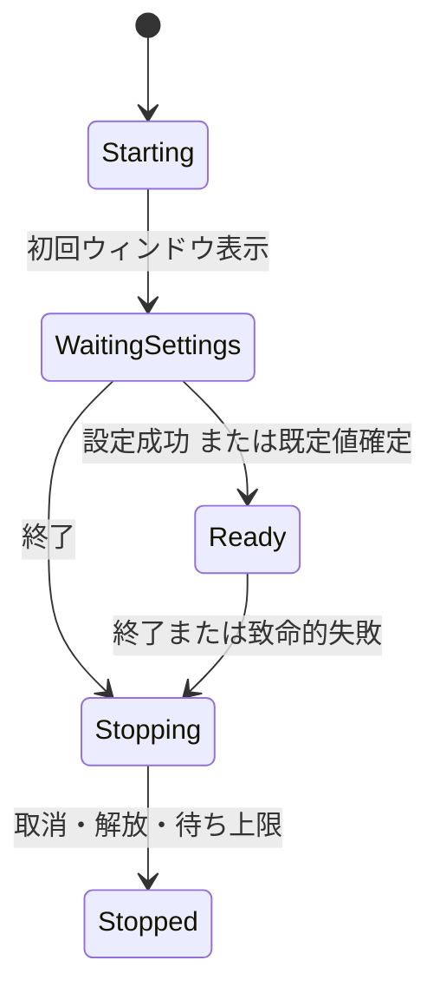

# 02 起動・操作・画面状態

[索引](README.md) / 共通：[契約・予算](01-contracts.md) / 上位：アーキテクチャ設計3・6・8章

## 1. クラスと所有範囲

| 型・配置 | 状態 | 主な操作 |
| --- | --- | --- |
| `AppBootstrap` / Bootstrap | アプリ寿命、追跡中の設定Task | `StartAsync`、`BeginShutdownAsync`、依存の組立 |
| `AppOperations` / Operations | 設定準備、Openキュー、ワークスペース、タブ、処理枠、検索セッション | `SubmitOpen`、`CompleteSettings`、`OpenFolderAsync`、`CloseTab`、`BeginSearch`、`CancelSearch` |
| `OperationSession` / Operations | RequestId、Epoch、取消、Task、停止理由 | `RequestCancel(reason)`、`ObserveCompletionAsync`、一度だけの枠解放 |
| `MainWindowViewModel` / Presentation | 表示タブ・ノード・結果・通知、パネル可視性 | コマンドをOperationsへ渡し、採用済み状態を表示用へ変換 |
| `TabViewModel`、`TreeNodeViewModel`、`SearchPanelViewModel` | 表示選択・展開・入力・件数等 | UIだけの状態。ファイルI/Oをしない |

AppOperationsは初期の内部入口とし、操作カテゴリ別のメソッド・状態を分ける。WorkspaceCoordinator等を先に導入しない。状態をすべて公開するプロパティ袋にせず、変更は操作メソッドを通す。

起動待ちの直列状態はOperations内部の`StartupOpenQueue`へ分け、AppOperationsが所有する。設定確定は一度だけ、待機要求の取出しと完了は別操作とし、実行中の要求も予算に数える。純粋な状態としてUI・Task・タイマーを持たせず競合の順序を単体試験で確認する。これは新しいCoordinatorやモジュールの導入ではない。

## 2. スレッド規約

UI上の受付・採用・世代更新・短いコレクション変更を直列化する。OperationsはAvalonia型を参照せず、Presentation / BootstrapがUIの実行文脈で呼ぶ。ワーカーの完了通知もそこで直列化して渡す。複数スレッドから任意にOperationsの可変状態を触らない。

I/O・デコード・検索・列挙・重い並び替えは制限付きのバックグラウンドTaskで実行する。UIに戻すのは小さな結果か完成した所有物だけとし、UIに戻った直後に世代を再確認する。同期`Wait` / `Result`による待機は行わない。

UI部品にアクセスする処理はUIスレッドへ戻す必要がある。実装の根拠は[Avaloniaのスレッド説明](https://docs.avaloniaui.net/docs/guides/development-guides/accessing-the-ui-thread)とし、採用版で具体的なDispatcher契約を確認する。OperationsにDispatcher依存を埋め込まない。

## 3. 起動と設定待ち

1. 最小の依存を構築し、本文や全言語文法を初期化せず初回表示する。
2. 設定TaskとSettingsWaitを開始し、CLIを含むOpenを同じ受付へ渡す。
3. `CompleteSettings(result, loadId)`はWaitingSettingsかつ現在のloadIdの場合だけ実行し、不変の設定スナップショットを一度だけ確定する。
4. 失敗・時間超過は既定値で確定して通知する。遅い設定Taskを再起動せず追跡し、遅延完了・例外も観測する。
5. Readyへ遷移後、Openキューを受付順に処理する。設定確定に伴うドレインは多重登録しない。

`SubmitOpen(paths, origin)`はキュー予算を先に検査してRequestId付き要求を原子的に受け付ける。1要求の途中だけを受け付けない。上限ならQueueFull、Stoppingなら受付終了を返す。キューから外して実行中へ移す時点を一度だけ記録し、設定通知が重複しても再実行しない。

設定更新時は新しい不変スナップショットへ入れ替える。既存処理の条件は変えず、次の操作から使用する。初期ルートの列挙も設定確定後に行う。

## 4. Open・フォルダ切替

`OpenRequest`はOperations所有で、ID、入力順のパス、入力元、受付順序を持つ。CLI引数はシェル実行せず文字列パスとして解釈する。カレントディレクトリは起動時に固定し、UIの後続操作で相対パスの意味を変えない。

- 要求内の最初のフォルダを1ルートとして開く。複数フォルダは後続を対象外と通知する。ファイルは入力順にタブへ渡す。
- 正規化・存在・種別確認はワーカーで行い、失敗は当該パス単位で通知する。パス同一性の仕様は[03](03-files-tree.md)に従う。
- `OpenFolderAsync`の開始時にWorkspaceEpochとSearchEpochを更新し、旧列挙・共用検索を取消、ツリー・共用結果をクリアする。
- 新しいルートの直下が読めない場合は失敗状態を表示し、旧ルートへ暗黙に戻さない。既存タブは維持する。
- 古いフォルダ確認が遅れて完了しても、新しいWorkspaceEpochなら採用しない。新ルートを検索条件へ採用するのは確認成功後とする。

### 4.1 ルート状態の実装境界

Operationsの`WorkspaceState`は要求パス、解決後パス、設定スナップショット、除外ポリシー、WorkspaceEpoch、ルート寿命の取消Token、直下列挙結果、失敗情報を保持する。状態はLoading/Ready/Failedで、`CanSearch`はReadyかつ取消されていない場合だけ真とする。UIや本文ライブラリの型は保持しない。直下列挙が途中で失敗した場合は取得済み項目を残すが、ルート全体の状態はFailedとし検索を許可しない。空フォルダはReadyである。

設定確定後の共通Openキューから、Filesの`InspectPathAsync`で種別を確認してファイル/フォルダの処理へ渡す。種別確認はメタデータだけを読み、通常ファイルの保証は既存の読取ハンドル検証に委ねる。ファイルとフォルダの寿命は独立させる。ルート切替は本文読込/本文保持を取り消さず、ファイル閉鎖もルートを閉じない。

ルート解決から直下列挙まではツリー処理枠1を保持する。取消できないI/Oが残っている間も解放せず、完了後の世代確認で旧結果を破棄する。再読込も新しいWorkspaceEpochで同じ処理を行う。UIからの再読込・文字コード変更等の手動処理は実行中Taskを集合で追跡し、終了時の`PendingWork`には共通キュー・遅延設定・手動処理を含める。取消受付だけで処理完了と見なさない。

現在のUI接続はルートパス/項目数/失敗表示とメニュー操作まで。ノード単位の遅延展開・待機上限・検索セッションの取消接続は各機能の実装時に追加する。SearchEpochを更新するだけで未実装の検索処理が停止するとは扱わない。

## 5. 処理枠と要求の置換

| 枠 | 同時数 | 待機方法 |
| --- | --- | --- |
| 本文読込 | 1 | 異なるタブはFIFO、同じタブの旧要求は置換。OpenQueueLimitの範囲内 |
| 共用検索・探索 | 1 | 実行中へ取消。待機は最新要求1件だけ |
| ツリー列挙 | 1 | 同ノード集約、TreeQueueLimitまで。ルート切替で旧要求を破棄 |
| ファイル内検索 | 1 | アクティブタブの最新条件だけを待機させる |

実行中のTaskが終了して`finally`で枠を解放するまで次を始めない。取消受付だけで枠を空きにせず、同期I/Oが止まらない場合は「停止待ち」とする。処理枠管理はOperations内部の小さな状態とし、汎用ジョブスケジューラーを導入しない。

起動待ちと実行待ちで同じOpenを二重に数えず、未完了要求全体に共通予算を適用する。展開要求や連続入力も無限に保持しない。

## 6. 状態採用と結果パネル

共用検索の状態は`Idle → Queued → Running → Cancelling → Terminal`を基本とし、正常完了はRunningからTerminalへ移る。Terminalは完了理由・件数・部分結果を持つ。新検索は新しいセッションで開始し、旧セッションの状態を再利用しない。

結果バッチをUIに追加する直前と、終了理由を表示する直前の両方で採用条件を確認する。旧ワーカーの完了で現検索を「完了」へ変えない。結果一覧の追加と終了状態は[05](05-search.md)のキュー終端規則に従う。

全文・参照・定義候補は同じパネルを用いるが、見出しに検索種別を表示する。取消は採用済み結果を残して部分結果を示す。パネルを隠す操作は検索取消と同一視しない。明示クリアはSearchEpochを更新して処理を取消し、結果を破棄する。

## 7. UIコマンドと入力

| コマンド | 有効条件 | 動作 |
| --- | --- | --- |
| `OpenFiles` / `OpenFolder` | Stoppingでない | OSダイアログ後に共通SubmitOpen。設定待ちなら受付状態を表示 |
| `ReloadActive` / `SetEncoding` | アクティブタブあり | 新LoadEpochで読込。旧本文は成功まで維持 |
| `ExpandNode` / `RefreshTree` | 確定ルートあり | ノードの列挙世代を確認して遅延列挙 |
| `StartWorkspaceSearch` | 確定ルート・非空の条件 | 条件を固定し共用検索を開始 |
| `FindInFile` / `FindNext` / `FindPrevious` | 本文表示済み | タブ別の条件と版で検索。欄の前後移動とEnter / Shift+Enterを対応 |
| `GoToDefinition` | ルート・C#本文・有効識別子 | 「定義へジャンプ（簡易）」を実行 |
| `FindReferences` | ルート・有効識別子 | 共用参照一覧を開始 |
| `CloseTab` / `NextTab` / `PreviousTab` | 対象タブあり | 本文・位置の独立状態を操作。最後のタブ閉鎖は空画面 |
| `ToggleTree` / `ToggleResults` | 常時 | 表示状態だけ変更 |

ショートカットは基本設計3.2に従う。検索欄への入力はIME変換中に開始しない。変換確定後150msの候補値でまとめ、旧要求を取消する。EscapeはIMEの変換取消、検索欄内の処理取消、欄を閉じる操作の順に扱い、複数操作を同時発火させない。

結果・ツリーは仮想化する。非アクティブタブの本文Viewを描画し続けない。本文ライブラリが行描画を仮想化できても、外側のScrollViewerやレイアウトで無効化していないか実測する。

## 8. 例外境界と終了

想定するI/O・不正条件は型付き失敗へ変換し、未知の例外を0件や成功へ変換しない。OperationSessionはTaskの終了を必ず観測する。対応する取消要求の`OperationCanceledException`だけを取消として扱う。

ワーカーの未知例外はキューへ失敗終端を伝えて処理停止し、状態が正常だと保証できない場合は致命的経路へ渡す。UIコマンド境界は既知の失敗を通知し、未知のUI・描画例外を一律に処理済みにしない。Bootstrapの最終境界は可能な範囲で通知・取消して異常終了するものであり、一般的な回復フックにはしない。

終了手順は次のとおり。

1. Stoppingへ一度だけ遷移し、新要求・設定保存を停止する。
2. 全Epochを無効化し、待機要求・入力タイマーを破棄する。
3. 実行Taskへ取消し、UIを文書から切り離す。
4. TaskをUIスレッドで同期待機せず、ShutdownWaitまで完了を観測して資源を解放する。
5. 通常終了または異常終了の状態を保って終了する。通知自体の失敗で再帰しない。

UI・ランタイムの最終例外フックはD-01で採用版を固定後に確認する。回復不能なメモリ不足・プロセス障害で通知や全解放が完了するとは保証しない。本文・検索語・例外全文は自動保存・送信しない。

## 9. テスト

| ID | 正常系 | 異常系・境界値 |
| --- | --- | --- |
| RT-01 | 設定成功後に受付順実行 | 確定の重複、時間超過後の成功、確定直前のOpen、上限±1、終了競合 |
| RT-02 | 各枠1件、最新検索だけ待機 | 旧I/O停止待ち、取消直後の要求、解放中の例外、同タブ置換 |
| RT-03 | ルート切替後に新結果を表示 | 旧列挙・旧検索が後着、無効ルート、単体ファイルだけの状態 |
| RT-04 | IME確定後に検索 | 変換取消、入力連打、欄を隠す、本文へのIME入力 |
| RT-05 | 通常の終了・例外の通知 | ワーカー途中失敗、UI更新失敗、設定Taskの遅延例外、後始末失敗 |
