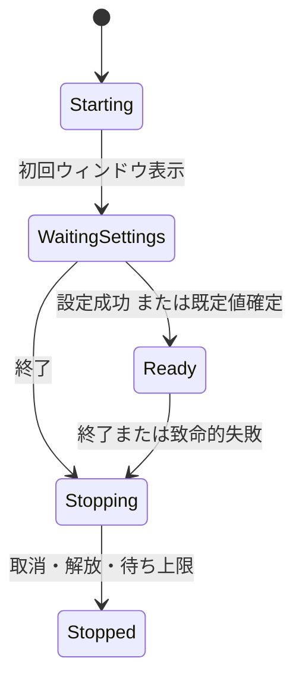

# 02 起動・操作・画面状態

[索引](README.md) / 共通：[契約・予算](01-contracts.md) / 上位：アーキテクチャ設計3・6・8章

## 1. クラスと所有範囲

| 型・配置 | 状態 | 主な操作 |
| --- | --- | --- |
| `AppBootstrap` / Bootstrap | アプリ寿命、追跡中の設定Task | `StartAsync`、`BeginShutdownAsync`、依存の組立 |
| `AppOperations` / Operations | Startup・ワークスペース・Tabs・Searchesの所有、RequestIdの共通採番 | `OpenFolderAsync`、`CloseWorkspace`、`Dispose`、Pending各処理 |
| `SearchCoordinator` / Operations | 共用検索の世代、実行1件/最新待機1件、受付・採用・停止理由 | `Start`、`Cancel`、`Clear`、`TryRead`、`TryFinalize`、`PendingWork` |
| `WorkspaceSearchOperation` / Operations | 固定要求、取消理由、Started/Completion、SearchのSession | 操作所有者だけが開始・停止・解放する |
| `MainWindowViewModel` / Presentation | 表示タブ・ノード・結果・通知、パネル可視性 | コマンドをOperationsへ渡し、採用済み状態を表示用へ変換 |
| `TabViewModel`、`TreeNodeViewModel`、`SearchPanelViewModel` | 表示選択・展開・入力・件数等 | UIだけの状態。ファイルI/Oをしない |

AppOperationsは初期の内部入口とし、操作カテゴリ別のメソッド・状態を分ける。WorkspaceCoordinator等を先に導入しない。状態をすべて公開するプロパティ袋にせず、変更は操作メソッドを通す。

起動待ちの直列状態はOperations内部の`StartupOpenQueue`へ分け、AppOperationsが所有する。設定確定は一度だけ、待機要求の取出しと完了は別操作とし、実行中の要求も予算に数える。純粋な状態としてUI・Task・タイマーを持たせず競合の順序を単体試験で確認する。これは新しいCoordinatorやモジュールの導入ではない。

### 1.1 検索受付の具体化

実装段階では、検索の最新待機/世代/明示取消と、ルート切替/終了時の取消・Task追跡を接続するため、SearchCoordinatorをOperations内部へ分離する。理由は検索の競合試験と採用規則をAppOperationsのタブ/ツリー状態から独立させ、ルート変更の全経路で同じ無効化を実行すること。利点は検索ワーカー数・最新待機・結果採用の所有者が1つになること、欠点はAppOperationsからのルート変更/終了通知とPendingWork集約が必要なこと。新たなレイヤ・モジュール・DI・イベントバスは追加しない。

影響はAppOperationsのSearches/PendingSearchWork、OpenFolderAsync/CloseWorkspace/Dispose、MainWindowViewModelの終了Task集約に限る。Openと検索のRequestIdはAppOperations所有のOperationIdentityを共有し、StartupOpenQueue単体利用時は独自の採番器を使う。SearchEpochは同じ共有値をAppOperationsとSearchCoordinatorが操作し、別の検索世代を二重に持たない。

実行中ワーカーがある場合は新要求が旧要求を取消し、待機は最後の1件だけを保持する。置換された待機のStarted=false/Completion=Cancelledを直ちに確定して取消源を解放する。実行中の枠はSearchのCompletionを実際に観測し終えるまで保持し、取消不能なI/O待ちを理由に新ワーカーを重ねない。現在は全文検索を接続し、定義/参照探索も今後この共用受付へ統合して別枠を増設しない。

Startedは物理ワーカーが開始したか、Completionはその操作のワーカー終端を表す。画面の最終確定はTryFinalizeを使い、現在の所有者/WorkspaceEpoch/SearchEpochが一致し、Task成功とチャネル排出が両方済んだ時だけ許す。イベントもTryRead/WaitForEventsAsyncを通し、受付中・現所有者・世代一致・未取消を確認する。Presentationはチャネルの別readerを起動しない。待機中はLatestProgress=nullとする。

明示CancelはCurrentとSearchEpochを維持し、CancellationCause.Userを記録して残キューを破棄する。新検索/Replaced、Clear、WorkspaceChanged、Shutdownは旧イベントと終端を不採用にする。ワーカー完了後・表示排出前のCancelでは、ワーカーがCompletedを返していてもUserの停止理由を表示へ反映し、採用されなかった結果を補充しない。既に採用した確定結果の保持と仮結果の除去は後続のUI接続で行う。

旧世代でも未知例外を成功/取消へ変換しない。受付を停止し、待機を未実行で取消し、失敗チャネルを排出して観測する。通知用Completionが旧画面に放棄されても例外を未観測にせず、PendingWorkは保持した例外を再送出する。MainWindowViewModelのPendingWorkへ検索も集約する。移行はSearch単体→Operationsの制御試験→UIドレイン/世代採用→実機性能の順とし、UI/定義/参照/本文内検索が完成したとはしない。

## 2. スレッド規約

UI上の受付・採用・世代更新・短いコレクション変更を直列化する。OperationsはAvalonia型を参照せず、Presentation / BootstrapがUIの実行文脈で呼ぶ。ワーカーの完了通知もそこで直列化して渡す。複数スレッドから任意にOperationsの可変状態を触らない。

I/O・デコード・検索・列挙・重い並び替えは制限付きのバックグラウンドTaskで実行する。UIに戻すのは小さな結果か完成した所有物だけとし、UIに戻った直後に世代を再確認する。同期`Wait` / `Result`による待機は行わない。

UI部品にアクセスする処理はUIスレッドへ戻す必要がある。実装の根拠は[Avaloniaのスレッド説明](https://docs.avaloniaui.net/docs/guides/development-guides/accessing-the-ui-thread)とし、採用版で具体的なDispatcher契約を確認する。OperationsにDispatcher依存を埋め込まない。

## 3. 起動と設定待ち

1. 最小の依存を構築し、本文や全言語文法を初期化せず初回表示する。
2. 設定TaskとSettingsWaitを開始し、CLIを含むOpenを同じ受付へ渡す。
3. `CompleteSettings(result, loadId)`はWaitingSettingsかつ現在のloadIdの場合だけ実行し、不変の設定スナップショットを一度だけ確定する。
4. 失敗・時間超過は既定値で確定して通知する。遅い設定Taskを再起動せず追跡し、遅延完了・例外も観測する。
5. Readyへ遷移後、Openキューを受付順に処理する。設定確定に伴うドレインは多重登録しない。

`SubmitOpen(paths, origin)`はキュー予算を先に検査してRequestId付き要求を原子的に受け付ける。1要求の途中だけを受け付けない。上限ならQueueFull、Stoppingなら受付終了を返す。キューから外して実行中へ移す時点を一度だけ記録し、設定通知が重複しても再実行しない。

設定更新時は新しい不変スナップショットへ入れ替える。既存処理の条件は変えず、次の操作から使用する。初期ルートの列挙も設定確定後に行う。

### 3.1 設定待ちと共通Openの結合検証

MainWindowViewModelの設定待ちは2秒を維持し、TimeProvider付きの取消タイマーとWaitAsyncで期限を扱う。通常はTimeProvider.Systemを使う。試験では内部の任意引数で時計を渡し、SettingsStoreも既存の読取専用ISourceAccessを任意に渡せるようにする。新しいレイヤ・設定ファイル項目・リトライ処理・外部公開APIを追加しない。目的は実I/O待ちとUI上の確定を別々に制御し、壁時計の待ちやOSファイルシステムの偶然に依存せず競合を再現すること。

期限トークンとアプリ寿命を連結し、待機専用のトークンに由来する取消だけを期限切れとする。設定処理自身のTimeoutExceptionや別トークンの取消は未知の失敗として扱い、既定値確定やCLIファイルの読込を開始しない。期限の継続時点で元Taskが完了済みならその結果・失敗を観測する。タイマーと連結トークンは設定待ちの完了時点でDisposeし、以後のOpen処理まで保持しない。連結CTSが起動時に1個増えるが、タイマーは従来と同じ1個で本文/検索/描画の反復経路には追加しない。起動時間・CPU・メモリの実機比較はP1-09に残し、この試験から速度やメモリ目標の達成を主張しない。

時間超過は既定値/CanSave=falseを一度だけ確定し、元の設定Taskを再起動しない。遅延成功は設定を入れ替えず、停止時は元Taskの実終了までPendingWorkに残す。遅延未知例外は既存のFatalFailureへ通知する。設定読込失敗/時間超過の警告は共通Openのドレイン完了後に状態表示へ追加し、直後の本文読込状況で消してしまわない。

[検証記録](../validation-results/2026-11-06-startup-settings/README.md)：CLI→メニュー→ドロップ、期限発火後/既定値確定前のOpen、遅延成功/未知失敗、終了前後、64要求/256パス/256 Ki文字の上限と解放を単体/結合で確認した。OSダイアログ/Finder/Explorerの受入、両OSの起動時間と終了上限は対応するP1-09/P3-06/P6へ残す。

## 4. Open・フォルダ切替

`OpenRequest`はOperations所有で、ID、入力順のパス、入力元、受付順序を持つ。CLI引数はシェル実行せず文字列パスとして解釈する。カレントディレクトリは起動時に固定し、UIの後続操作で相対パスの意味を変えない。

- 要求内の最初のフォルダを1ルートとして開く。複数フォルダは後続を対象外と通知する。ファイルは入力順にタブへ渡す。
- 正規化・存在・種別確認はワーカーで行い、失敗は当該パス単位で通知する。パス同一性の仕様は[03](03-files-tree.md)に従う。
- `OpenFolderAsync`の開始時にWorkspaceEpochとSearchEpochを更新し、旧列挙・共用検索を取消、ツリー・共用結果をクリアする。
- 新しいルートの直下が読めない場合は失敗状態を表示し、旧ルートへ暗黙に戻さない。既存タブは維持する。
- 古いフォルダ確認が遅れて完了しても、新しいWorkspaceEpochなら採用しない。新ルートを検索条件へ採用するのは確認成功後とする。

### 4.1 ルート状態の実装境界

Operationsの`WorkspaceState`は要求パス、解決後パス、設定スナップショット、除外ポリシー、WorkspaceEpoch、ルート寿命の取消Token、直下列挙結果、失敗情報を保持する。状態はLoading/Ready/Failedで、`CanSearch`はReadyかつ取消されていない場合だけ真とする。UIや本文ライブラリの型は保持しない。直下列挙が途中で失敗した場合は取得済み項目を残すが、ルート全体の状態はFailedとし検索を許可しない。空フォルダはReadyである。

設定確定後の共通Openキューから、Filesの`InspectPathAsync`で種別を確認してファイル/フォルダの処理へ渡す。種別確認はメタデータだけを読み、通常ファイルの保証は既存の読取ハンドル検証に委ねる。ファイルとフォルダの寿命は独立させる。ルート切替は本文読込/本文保持を取り消さず、ファイル閉鎖もルートを閉じない。

ルート解決から直下列挙まではツリー処理枠1を保持する。取消できないI/Oが残っている間も解放せず、完了後の世代確認で旧結果を破棄する。再読込も新しいWorkspaceEpochで同じ処理を行う。UIからの再読込・文字コード変更等の手動処理は実行中Taskを集合で追跡し、終了時の`PendingWork`には共通キュー・遅延設定・手動処理を含める。取消受付だけで処理完了と見なさない。

ツリーUIはPresentationのFileTreeViewModelで論理状態から展開中の行を投影し、VirtualizingStackPanelを使うListBoxへ接続する。ノード単位の遅延展開・要求集約・待機上限・キャッシュはOperationsのTreeSessionに置き、詳細は[03](03-files-tree.md#61-operations内の状態と寿命)に従う。ツリーからのファイルOpenは共通キューへOpenOrigin.Treeとして入力する。検索セッションの取消接続は検索実装時に追加し、SearchEpochを更新するだけで未実装の検索処理が停止するとは扱わない。

### 4.2 ドロップの入力境界

PresentationのFileDropInputがAvaloniaのIDataTransfer/DataFormat.Fileからローカルのファイル/フォルダのパスを同期的に抽出する。Text/URL/URIリストをパスとして解釈しない。Itemsを先に検査し、0件・256件超過を拒否する。ファイル値は項目順に取得し、ローカルパスを得られない項目・NUL・空白だけのパス・文字総量256 Ki文字超過があれば全体を拒否する。ファイルの存在・通常ファイル・文字コードは共通Openのワーカーで検証する。UIで本文を開かず、シェル実行・コピー・移動・削除もしない。

DragEnter/DragOverはCopy許可・件数・File形式だけを確認して効果をCopyまたはNoneにし、ファイル値/パス/メタデータ/本文を取得しない。実際のDropコールバック内でパスだけを読取専用一覧に固定し、OpenOrigin.Dropで共通キューへ渡す。設定待ちでもネイティブ転送やストレージのオブジェクトをOperationsへ保持させない。キューの残り容量も共通Submitで原子的に検査し、一部受付はしない。Stoppingでは値を取得せず拒否する。

採用版のDragDropイベントはBubbleのみで、Tunnelへの登録では先取りできない。ウィンドウはHandled済みも含めたBubbleハンドラーを持ち、本文はIsReadOnlyに加えてEnableTextDragDrop=falseにする。本文ライブラリがテキスト用ハンドラー解除時にTextArea.AllowDropをfalseへ設定するため、本文へファイルを落とせるようTextAreaのAllowDropを明示的にtrueへ戻す。テキストのドラッグによる挿入/移動を接続せず、CopyでファイルOpenだけを交渉する。未知の転送取得例外はUI例外方針へ従い異常終了し、入力エラーと偽って継続しない。

この変更は既存の入力経路を満たすPresentation内の追加で、層・依存方向・Contracts・本文モデルを変えない。利点は全入力で設定/除外/読取安全性を共有できること、不利点はOS/本文のドロップ経路を実機でも確認する必要があること。抽出境界と設定待ち/混在入力/本文不変の単体・結合試験→Finder/Explorerの実操作とハッシュ確認の順に検証する。実機受入は未完了。

参照：[Avalonia 12.1.3 DragDrop](https://github.com/AvaloniaUI/Avalonia/blob/12.1.3/src/Avalonia.Base/Input/DragDrop.cs)、[転送値の取得](https://github.com/AvaloniaUI/Avalonia/blob/12.1.3/src/Avalonia.Base/Input/DataTransferExtensions.cs)、[ローカルパス取得](https://github.com/AvaloniaUI/Avalonia/blob/12.1.3/src/Avalonia.Base/Platform/Storage/StorageProviderExtensions.cs)、[AvaloniaEdit 12.0.0のテキストドロップ](https://github.com/AvaloniaUI/AvaloniaEdit/blob/12.0.0/src/AvaloniaEdit/Editing/SelectionMouseHandler.cs)。

## 5. 処理枠と要求の置換

| 枠 | 同時数 | 待機方法 |
| --- | --- | --- |
| 本文読込 | 1 | 異なるタブはFIFO、同じタブの旧要求は置換。OpenQueueLimitの範囲内 |
| 共用検索・探索 | 1 | 実行中へ取消。待機は最新要求1件だけ |
| ツリー列挙 | 1 | 同ノード集約、TreeQueueLimitまで。ルート切替で旧要求を破棄 |
| ファイル内検索 | 1 | アクティブタブの最新条件だけを待機させる |

実行中のTaskが終了して`finally`で枠を解放するまで次を始めない。取消受付だけで枠を空きにせず、同期I/Oが止まらない場合は「停止待ち」とする。処理枠管理はOperations内部の小さな状態とし、汎用ジョブスケジューラーを導入しない。

起動待ちと実行待ちで同じOpenを二重に数えず、未完了要求全体に共通予算を適用する。展開要求や連続入力も無限に保持しない。

## 6. 状態採用と結果パネル

共用検索の状態は`Idle → Queued → Running → Cancelling → Terminal`を基本とし、正常完了はRunningからTerminalへ移る。Terminalは完了理由・件数・部分結果を持つ。新検索は新しいセッションで開始し、旧セッションの状態を再利用しない。

結果バッチをUIに追加する直前と、終了理由を表示する直前の両方で採用条件を確認する。旧ワーカーの完了で現検索を「完了」へ変えない。結果一覧の追加と終了状態は[05](05-search.md)のキュー終端規則に従う。

全文・参照・定義候補は同じパネルを用いるが、見出しに検索種別を表示する。取消は採用済み結果を残して部分結果を示す。パネルを隠す操作は検索取消と同一視しない。明示クリアはSearchEpochを更新して処理を取消し、結果を破棄する。

### 6.1 全文結果の表示モデルとドレイン

SearchPanelViewModelは共用パネルの全文検索部分を持ち、SearchCoordinatorを初回操作時に取得する。MainWindowのフォルダ検索メニュー/Ctrl・Cmd+Shift+Fから入力欄へフォーカスし、検索ボタンまたは入力欄のEnterで、確定済みの検索条件を固定する。画面下部のVirtualizingStackPanelを使うListBoxへ相対パス・原文の行/UTF-16列・抜粋の一致色・検証状態を表示する。親フォルダの切替/閉鎖では世代と共に表示モデルを破棄し、入力値/表示可否は保持する。表示メニューと×は可視性だけを変える。

ドレインTaskはパネルに1件だけ持つ。Started待ち、現操作の採用確認、結果読取、UIへ譲る処理、Task/終端の観測を直列に行う。1回は256単位または4msの協調的な処理予算で区切り、Hitsの途中ならバッチとインデックスだけを保持して再開する。各行と制御イベントを単位として数える。旧操作の残りバッチを新操作へ適用しない。通知/レイアウト等の不可分な呼出しがあるため、4msの実画面上の応答保証は実機で別確認する。

SearchResultsはスライス中の行をStageし、Publishで1回のAddRange通知へ集約する。異なるファイルを跨ぐスライスでも、確定状態を先に反映し、途中で行ごとの追加通知を発生させない。ファイル別のSearchResultFileを行間で共有し、FileCommittedで1万行の個別PropertyChangedを発生させない。実体化された行が同じIsCommitted/Statusを参照する。辞書には仮結果を持つファイルだけを保持し、0件ファイルの確定履歴は蓄積しない。保持行数は1万件以内とする。

単一ワーカーの順序により未確定ファイルの結果は末尾に並ぶ。FileInvalidatedは公開済み末尾とStage中の同ファイルだけを除く。明示取消では、終端の未確定IDだけを頼りにせず、**UIでFileCommittedを未採用の全行**を除く。ワーカーが既に確定し未確定ID=nullでも、キュー内にあった確定通知を捨てた場合はその行を残さない。採用済みの確定行だけを保持する。LimitReachedは例外的に未完了行を表示に残し、移動不可と明示する。クリア/置換は世代トークンを取り替え、同じFileScanIdの古い行も採用しない。

進捗通知用のPeriodicTimerと待機は実行操作に1件とし、結果待ちごとに未観測のDelayを残さない。最新Progressの参照が同じなら再通知せず、100ms周期で結果イベントがない場合も確認する。タイマー破棄と待機の観測は操作のスコープ内で終え、その後に現操作を再確認する。Task/Channel失敗は仮行を除き、パネルTaskから例外を伝えて既存の致命的経路へ戻す。パネルTaskもMainWindowViewModelのPendingWorkへ集約する。

理由は逐次追加・ファイル単位の確定/取消・新検索の競合を1つの表示所有者で扱うため。利点は通知と保持の上限を設け、UIのモデル試験をnative Windowなしで制御できること、欠点はStage/公開済み行とバッチ途中の所有を区別する必要があること。影響はPresentation内のモデル/画面/寿命集約に限り、層/モジュール/依存方向は維持する。モデル試験→通常画面の接続/コンパイル→結果移動/版・Stamp再検証→実機の表示/IME/性能検証の順とする。

検索欄や結果一覧にフォーカスがあるとき、Escapeで実行中のフォルダ検索を取り消せる。入力欄の変換途中はアプリ側のEnter実行とEscape取消を保留する。ファイル内検索のEscapeも本文または専用検索欄に限定する。定義候補と参照結果は種別表示と原文移動を共用する。[結果移動の仕様](04-documents-tabs.md)

パネルの境界リサイズ、入力追従、大容量入力の実画面評価は後続タスクに残す。

## 7. UIコマンドと入力

| コマンド | 有効条件 | 動作 |
| --- | --- | --- |
| `OpenFiles` / `OpenFolder` | Stoppingでない | OSダイアログ後に共通SubmitOpen。設定待ちなら受付状態を表示 |
| `ReloadActive` / `SetEncoding` | アクティブタブあり | 新LoadEpochで読込。旧本文は成功まで維持 |
| `ExpandNode` / `RefreshTree` | 確定ルートあり | ノードの列挙世代を確認して遅延列挙 |
| `StartWorkspaceSearch` | 確定ルート・非空の条件 | 条件を固定し共用検索を開始 |
| `FindInFile` / `FindNext` / `FindPrevious` | 本文表示済み | タブ別の条件と版で検索。欄の前後移動とEnter / Shift+Enterを対応 |
| `GoToDefinition` | ルート・C#本文・有効識別子 | 「定義へジャンプ（簡易）」を実行 |
| `FindReferences` | ルート・有効識別子 | 共用参照一覧を開始 |
| `CloseTab` / `NextTab` / `PreviousTab` | 対象タブあり | 本文・位置の独立状態を操作。最後のタブ閉鎖は空画面 |
| `ToggleTree` / `ToggleResults` | 常時 | 表示状態だけ変更 |

ショートカットは基本設計3.2に従う。検索欄への入力はIME変換中に開始しない。変換確定後150msの候補値でまとめ、旧要求を取消する。EscapeはIMEの変換取消、検索欄内の処理取消、欄を閉じる操作の順に扱い、複数操作を同時発火させない。

結果・ツリーは仮想化する。非アクティブタブの本文Viewを描画し続けない。本文ライブラリが行描画を仮想化できても、外側のScrollViewerやレイアウトで無効化していないか実測する。

## 8. 例外境界と終了

想定するI/O・不正条件は型付き失敗へ変換し、未知の例外を0件や成功へ変換しない。OperationSessionはTaskの終了を必ず観測する。対応する取消要求の`OperationCanceledException`だけを取消として扱う。

ワーカーの未知例外はキューへ失敗終端を伝えて処理停止し、状態が正常だと保証できない場合は致命的経路へ渡す。UIコマンド境界は既知の失敗を通知し、未知のUI・描画例外を一律に処理済みにしない。Bootstrapの最終境界は可能な範囲で通知・取消して異常終了するものであり、一般的な回復フックにはしない。

終了手順は次のとおり。

1. Stoppingへ一度だけ遷移し、新要求・設定保存を停止する。
2. 全Epochを無効化し、待機要求・入力タイマーを破棄する。
3. 実行Taskへ取消し、UIを文書から切り離す。
4. TaskをUIスレッドで同期待機せず、ShutdownWaitまで完了を観測して資源を解放する。
5. 通常終了または異常終了の状態を保って終了する。通知自体の失敗で再帰しない。

専用有界表示試作では、コピー所有者を無効化/Disposeして待機Leaseを解放し、実行中の準備/OS書込みと単一UI通知Taskを終了待ちへ集約する。既存の最大2秒を共有し、取消受付だけで完了扱いにしない。OS処理が上限を超えた場合の完了・ロールバックは保証しない。通常UIへのコピー接続は未採用。所有と例外境界は[04の6.5](04-documents-tabs.md#65-原文コピーの受付とクリップボード専用試作)を参照する。

Program.MarkFailedはプロセス内のProcessExitStatusへ失敗を保持し、Environment.ExitCodeも設定する。UIの致命的通知/後始末/未知のドロップ障害で使用する。UI終了処理が環境の終了コードを0へ戻しても、Mainは保持した失敗を1として返す。既存の明示的な非0終了コードを優先し、検出済みの失敗を正常終了へ戻さない。通常終了0と専用GUI計測失敗1は実機でも確認したが、全UI例外経路の注入試験の代用にはしない。

UI操作の未知例外も失敗を記録したうえでCloseからClosingへ入る。Avalonia 12.1.3の[Shutdown実装](https://github.com/AvaloniaUI/Avalonia/blob/12.1.3/src/Avalonia.Controls/ApplicationLifetimes/ClassicDesktopStyleApplicationLifetime.cs)は強制終了としてClosingのCancelを無視するため、非同期の終了待機の入口には使わない。状態通知が失敗してもfinallyでCloseを実行する。

Closing内のStopAndWaitAsyncはStopの例外を記録し、その後も取得可能なPendingWorkを待つ。待機専用の取消トークンを2秒で失効させ、処理自身のTimeoutExceptionや無関係な取消を正常な待機期限として扱わない。期限到達は実Taskの完了を意味しないため、期限後もfaultと無関係な取消を観測して失敗を記録する。対応する取消要求は各所有者が観測して正常に完了させており、集約Taskに残った取消を期限後だけ無視しない。待機開始前に失敗した処理、Stop/Task取得の例外、正常完了、未完了のままの期限到達と遅延失敗/取消をShutdownTestsで検証する。追加のタイマーと継続処理は終了時だけ生成し、起動・検索・スクロールの経路には追加しない。実機GUI終了の全経路の受入はP1-08に残す。

設定読込の監視Taskは、寿命トークンと一致するOperationCanceledExceptionだけを通常の終了取消として扱う。Stopping後の未知例外や別トークンの取消は再通知せずPendingWorkへ伝え、共通の終了待機が失敗を記録する。実行中はStatusの更新に失敗してもfinallyでFatalFailureを通知する。StartupSettingsIntegrationTestsでは設定待ち期限の前後それぞれで終了後の未知例外/無関係な取消を注入し、UIを再更新せず異常終了へ伝わることを確認する。既存の正常終了・遅延成功・遅延失敗も維持する。本文・検索・描画の処理量やデータ構造は変更しない。

MainWindowViewModel.StopはStoppingを最初に固定し、検索パネル停止、寿命取消、Operations破棄、タブ同期、本文解除、ツリー解除、ルート表示更新を個別に試みる。途中の通知例外で後続の取消・解放を飛ばさない。例外1件は元のスタックを保持して再送出し、複数件はAggregateExceptionで全件を保持する。共通の終了待機が失敗を記録し、元の実行Taskを引き続き待つ。2回目のStopでは通知や取消を繰り返さない。ShutdownIntegrationTestsでは正常・通知障害1件/3件、取消できないフォルダI/O、元本文のReadLease、停止後のOpen拒否を組み合わせ、解放後の旧ルート復活がないことまで確認する。この変更は終了時だけの後始末を対象とし、Operations内部の取消コールバック例外や実機GUIの受入を完了扱いにはしない。

Operations内部の取消コールバック障害はShutdownCancellationTestsで別途確認する。AppOperations.Disposeは各所有者の破棄を個別に試み、例外を集約して返す。CloseWorkspaceは結果移動・検索の無効化が失敗してもルートを取り消して解除し、ツリー取消が失敗してもそのPendingWorkを退役一覧へ移す。寿命の取消が失敗してもCTSをDisposeし、参照を解除する。ツリーとルート両方の例外も保持する。TabManagerは取消通知に失敗しても対象タブを閉じ、Disposeで残りのタブも閉じる。TreeSessionは実行要求のスナップショットへ取消を送り、各通知の失敗後も後続要求を取り消してノードを切り離す。取消による同期継続で集合が変化しても列挙を壊さない。

5ケースの注入試験では、読込中タブ+待機タブ、検索中+既存本文、ツリー展開中+待機展開とルート障害を組み合わせる。取消受付後も実I/Oが止まるまでPendingWorkを完了にせず、待機要求は新たにI/Oを始めない。通常のタブ閉鎖・ルート切替に追加のワーカーや常駐状態は導入しない。例外一覧は障害時だけ生成し、終了時のツリー要求にはスナップショット配列を使う。実機の全終了経路とCPU/メモリの終了時ピークはP1-08/P1-09の残課題として扱う。

UI・ランタイムの最終例外フックはD-01で採用版を固定後に確認する。回復不能なメモリ不足・プロセス障害で通知や全解放が完了するとは保証しない。本文・検索語・例外全文は自動保存・送信しない。

## 9. テスト

| ID | 正常系 | 異常系・境界値 |
| --- | --- | --- |
| RT-01 | 設定成功後にCLI/メニュー/ドロップを受付順実行 | 確定の重複、時間超過後の成功、確定直前のOpen、項目数/文字数上限±1、不正形式の全体拒否、転送寿命、終了競合 |
| RT-02 | 各枠1件、最新検索だけ待機 | 旧I/O停止待ち、取消直後の要求、解放中の例外、同タブ置換 |
| RT-03 | ルート切替後に新結果を表示 | 旧列挙・旧検索が後着、無効ルート、単体ファイルだけの状態 |
| RT-04 | IME確定後に検索 | 変換取消、入力連打、欄を隠す、本文へのIME入力 |
| RT-05 | 通常の終了・例外の通知 | ワーカー途中失敗、UI更新失敗、設定Taskの遅延例外、後始末失敗 |
