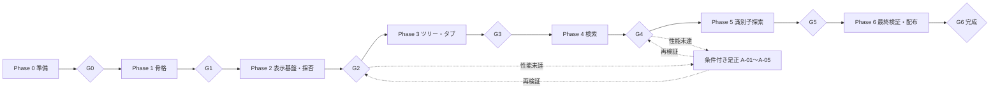

# codeView 実装計画・タスクリスト

| 項目 | 内容 |
| --- | --- |
| 作成日 | 2026-10-30 |
| 状態 | 実装進行中。実施内容・試験結果・環境制約は[実装記録](development-log.md)を参照 |
| 対象 | アプリ本体・単体テスト・文書更新・性能評価・Windows / macOS向け配布物の完成まで |
| 根拠 | [要件定義書](requirements.md)、[基本設計書](basic-design.md)、[アーキテクチャ設計書](architecture.md)、[詳細設計書の索引](detailed-design/README.md) |

## 1. 進め方と完了の定義

設計書のPhase 1〜6を維持し、その前に準備作業をPhase 0として置く。起動・UI応答・メモリを優先し、大容量表示の採否をPhase 2で判断してからツリー・検索を本格実装する。日程・工数は担当者、基準機、SDK・ライブラリ採用と試作結果が揃った時点で見積もる。

本書のチェックボックスは、各行の成果物と検証を満たした時点で完了にする。コードが書けたことだけでは完了にしない。完了日・コミット・試験結果の保存先・残課題はタスクIDに対応付けて記録する。未実施の実機試験や未定の性能予算は未完了とする。

完了状況を2026-10-31に再照合した。P1-02/P1-03/P1-04/P1-06とP4-02〜P4-05は各行の成果物・検証に基づいてチェックし、過去の先行実装記録より後の接続・検証を完了根拠へ追記した。通常Release単体試験は590件合格・失敗0・スキップ0。ゲート未通過の先行実装については、各タスクの完了確認とPhase全体の採否・受け入れを分け、G0〜G6は未完了を維持する。Windows/別PC、未測定の性能、本文モデル/文法の採否、本文内検索、定義/参照、配布物の最終受け入れは、この確認では完了にしない。

コード変更タスクには共通で次を含める。

- 正常系・異常系・境界値の単体テストを同時に追加・更新する。テストID群は詳細設計08の台帳に従う。
- 対象機能の結合試験、関連ドキュメントの更新、依存方向・資源寿命・書込経路のレビューを行う。
- 性能影響がある場合はCPU・メモリ・起動・描画・検索の適用項目を測り、未対応は未測定として記録する。
- 不要なリファクタリングや機能追加を含めず、コミットメッセージは日本語で記載する。

実装完了は、F-01〜F-09、必須の品質シナリオ、両OSの受け入れ試験、自己完結型の配布物、利用・ビルド手順が揃い、最終ゲートG6を通過した状態とする。公開サイトへのアップロードや第三者への配信は本計画に含めない。

L1（5万ファイル・1 GiB）は必須性能評価、L2（20万・5 GiB）は拡張評価、L3（100万・20 GiB）は限界調査として実施・結果を記録する。L3の高速・全件完走を完了条件に追加しない。100 MiBは本文の拡張評価であり、1 GiB級本文の調査は代替方式の評価に必要な場合だけ行う。

## 2. 依存関係とゲート

「依存」は当該作業を開始するための前提タスクを示す。ゲートG0〜G6は、そのPhaseの通常タスク全件と、必要になった是正の完了を確認する。前Phaseのゲート未通過でも、性能データ準備や配布環境の手配など、判断に依存しない作業は進められる。

環境確保・別OS実測だけが未完了の場合は、共通実装・手元でのビルドと単体試験を先行できる。対象タスクとゲートのチェックは全完了条件を満たすまで外したままにし、未検証OSと先行理由を実装記録に残す。依存する仕様判断・安全条件・本文モデルの採否や性能予算の固定を省略するためには使わない。

P3-02のFiles内部の直下/深さ優先列挙は、本文モデル・ワークスペースの状態に依存しないため共通基盤として先行検証できる。利点はGUI環境待ちでもリンク・除外・I/O資源・L1規模の問題を早期に確認できること、不利点はWorkspace/UIへ接続した時の再検証が必要になることである。層・依存は変えず、Filesの単体試験→Workspaceでの世代/設定固定→ツリーUIと実機性能の順で接続する。先行実装だけでP3-01/P3-02/G2/G3を完了にせず、本文採否や長行是正の依存は維持する。

P3-01のルート状態・設定固定・世代取消と、P3-06の共通Openへのフォルダ入力接続も本文モデルから独立した範囲だけ先行する。目的は設定競合・旧ルート採用・終了時のI/O残存を単体試験で確認すること。利点は表示方式の判断待ちでも寿命管理を検証できること、不利点は実ツリー・検索・複数タブとの接続後に再検証が必要なこと。Operations/Files/Presentationの既存依存内に追加し、新しいレイヤやCoordinatorは設けない。ルート状態→パス/項目数表示→後続のツリー/検索接続の順に進め、G2・G3およびP3-01/P3-06の完了判定は維持する。

P3-04/P3-05のタブ予約・FIFO・世代・所有・保存位置も、文書構築結果とハンドル境界を使う内部状態に限り先行検証する。利点は本文候補の採用待ちでも重複・取消・Lease寿命の不変条件を確認できること、不利点は通常UIと表示方式の統一後に同じ条件を再検証する必要があること。既存Operations内のTabManagerとし、移行順と旧単体経路の撤去条件を詳細設計04の3.1に残す。通常UI未接続の内部試験だけでP3-04/P3-05/G2/G3を完了にしない。

P4-01/P4-02は仕様・初期予算と、UI/本文候補から独立したSearchの照合コアに限り先行検証する。目的はUnicode/チャンク境界/保持量の不変条件を固めること。利点はGUI環境待ちでも通常検索の正確性とコア負荷を確認できること、不利点はファイル/ReadLease接続後の意味・取消・資源とUIで再検証が必要になること。Searchの既存責務へ実装し、語上限とL1予算を試験前に固定する。単体照合→逐次読取/有界イベント→UI/本文内方式比較の順とし、G2/G3/G4や未実装の検索方式を採用済みとは扱わない。

ゲート未達時は「未完了／理由／次の是正」を記録する。結果を見て合格予算を緩めたり、未測定を合格にしたりしない。本文モデル、モジュール、依存方向、公開API、データ構造の変更が必要なら、理由・メリット・デメリット・影響範囲・移行計画を提示し、承認後に実施する。

2026-11-07の作業優先順位：ユーザーの「性能改善よりも機能実装を優先」に従い、既存の性能是正試作はいったん後続とし、設計済みの未実装機能を先行する。依存欄の未完了ゲートは完了扱いにせず、機能実装と最終性能/統合受入を分けて記録する。

## 3. Phase 0：準備・試験条件の整備

参照：[詳細設計01](detailed-design/01-contracts.md)、[07](detailed-design/07-settings-distribution.md)、[08](detailed-design/08-validation.md)。

- [x] **P0-01：要件・品質・設計の実装対象と未決事項を台帳化する**
  依存：なし。完了条件：F-01〜F-09、Q-01〜Q-08、QS-01〜QS-12、D-01〜D-10を本計画と照合し、制限・仮定・対象外を共有できる。

- [ ] **P0-02：Windows / macOSの開発・基準機・別PC試験環境を確保する**
  依存：P0-01。完了条件：OS・CPU・RAM・ストレージ・60Hz等の表示条件・権限・オフライン環境・Gatekeeper確認手順を記録する。

- [x] **P0-03：SDK・UIの採用候補と試験ランナーを確認する**
  依存：P0-01。完了条件：実装時点の.NET LTSとAvalonia候補の互換性、ライセンス、両OSビルド可否を確認する。本文・文法版はPhase 2の採否待ちと区別する（D-01）。
  完了：2026-11-06。.NET 10が確認時点のLTS系列であること、SDK 10.0.401/latestPatchとAvalonia 12.1.3・試験ランナーの固定版/ライセンスを確認。8efffa1の両OS CIで許容パッチ10.0.403により本体/試験のReleaseビルドと通常試験が成功。[版・ライセンス・D-01の残り](detailed-design/07-settings-distribution.md#51-p0-03のsdkui試験ランナー確認2026-11-06)、[実行証跡](validation-results/2026-11-06-ci-build/README.md)。本文/文法の性能採否と最終配布はP2/P6に維持する。

  - [x] **P0-03-01：脆弱なILCompilerを選ぶ旧SDKを最低要件から外す**（2026-11-06）。最低SDKを10.0.403へ更新し、macOS arm64の実AOT発行とILCompiler 10.0.14の解決を確認。通常.NET766/Python108件と発行スクリプト7件が成功。監査/警告設定は維持し、SDK変更をWindows発行CIの起動対象へ追加。[証跡・検証範囲](validation-results/2026-11-06-aot-sdk-fix/README.md)。

- [ ] **P0-04：試験結果の記録様式とローカル計測手順を準備する**
  依存：P0-02。完了条件：ビルド・データ・設定・機材・予算・結果・未実施理由を残せる。CPU、ヒープ、GC、LOH、フレーム、I/Oの取得可否と計測負荷を確認する。
  - [x] **P0-04-01：記録テンプレートとマネージド診断の取得・負荷を確認する**（2026-11-06）。macOSの一時ホストで既存50 MiBコア試験を8実行/80操作し、通常とGC/Counterを比較。4トレースの欠落0・各20マーカー・停止対応を確認し、GC区間、LOHサンプル/保持、Counter 106行を保存した。[テンプレート・手順](diagnostic-measurements.md)、[結果・ソース・ハッシュ・限界](validation-results/2026-11-06-eventpipe/README.md)。フレーム/物理I/O・Windows側の診断・LOH生成元等はP0-04に残す。製品の構成/APIは変更しない。
  - [x] **P0-04-02：API読取量とプロセスI/Oの取得可否・負荷を確認する**（2026-11-06）。テスト専用ラッパーで検証/消費のAPI bytesを分け、macOSのdiskioとWindowsのtransfer bytesを区別する。macOSでUTF-8/CP932各50 MiBを12実行/120読取、C対照で正のカウンターとWarmの0を確認。通常.NET 677件/Python 47件成功。`0c0d200`の[両OS CI](https://github.com/m-hiroaki/codeView/actions/runs/42176021163)で追加21ケースすべて成功（macOS .NET677/Python47、Windows .NET674+既存3スキップ/Python27+既存20スキップ）。[手順](io-measurements.md)、[証跡・未実施](validation-results/2026-11-06-io-accounting/README.md)。ファイル別物理I/O・Cold・Windows専用機の計測負荷・GUI性能はP0-04に残す。

  - [x] **P0-04-03：WindowsでEventPipe/Counterの取得と負荷比較を確認する**（2026-11-06）。`f6eae8f`の[明示CI](https://github.com/m-hiroaki/codeView/actions/runs/42180488290)で50 MiB Warmを8プロセス/80操作、4トレース/Counter 232行取得し、入力/ビルド/マーカー/欠落/GC対応/ホスト合否を機械照合した。欠落/GC対応エラー0、通常とgc-verboseの構築/CPU中央値の差+0.49%/+2.16%。80操作すべて既存GC停止合計150 msに違反（155.609–212.933 ms）し、収集成立とコア失敗を分けて最終非0終了を保持。通常[両OS CI](https://github.com/m-hiroaki/codeView/actions/runs/42180488223)は成功し、追加10ケースすべて合格（macOS .NET677/Python57、Windows .NET674+既存3スキップ/Python37+既存20スキップ）。[手順](diagnostic-measurements.md#windowsの取得確認)、[原記録・環境・失敗からの是正・限界](validation-results/2026-11-06-windows-diagnostics/README.md)。専用基準機・GC予算未達の是正・GUI・物理I/Oの受入はP0-04/P2/Aに残す。

- [x] **P0-05：機能用の小さな固定データを用意する**
  依存：P0-01。完了条件：詳細設計08の期待値、文字コード、不正バイト、リンク、C#基本宣言、更新・権限失敗のデータを再現可能に作れる。
  完了：2026-11-06。9109780の[両OS CI](https://github.com/m-hiroaki/codeView/actions/runs/42166897023)で30ファイルの製品読取/文書/検索照合と、実リンク6件・循環・読取拒否/解除の生成を確認。macOSは.NET 656件/Python 37件成功、Windowsは.NET 653件成功/3件の既存Darwin専用スキップ、Python 17件成功/20件の既存POSIX専用スキップ。新規固定データ試験は両OSで成功。[生成手順](functional-fixtures.md)、[期待値・ハッシュ・環境・失敗からの是正証跡](validation-results/2026-11-06-functional-fixtures/README.md)。C#候補の正解データを探索機能の実装受入とは扱わず、GUI・大容量・性能・G0以降のゲートは未完了を維持する。

- [x] **P0-06：大容量本文・規模別リポジトリの生成手順を用意する**
  依存：P0-02、P0-04。完了条件：10/50/100 MiB・50 MiB×5、L1/L2/L3、長行・多一致の生成seed・分布・期待件数を記録。生成と性能測定を別工程にする。
  完了：2026-11-06。計測機/表示モデルから独立した[生成手順](performance-fixtures.md)を先行整備。seed 20261106でUTF-8/CP932の10/50/100 MiB・各50 MiB×5・長行・全行一致・L1とUnicode派生の計15条件（100,021ファイル/3,118 MiB）を実生成し、内容digestと独立した厳格復号/文字数/行数/一致数が一致。L2/L3各文字コードの手順・分布・全件のサイズ式/期待件数は書込みなし計画で記録。d403033の[両OS CI](https://github.com/m-hiroaki/codeView/actions/runs/42169551981)で生成器15ケースすべて成功（通常macOS .NET656/Python47成功、Windows .NET653成功+3スキップ/Python27成功+20スキップは既存OS専用）。[証跡・余分なメタデータ検出と是正](validation-results/2026-11-06-perf-data-v2/README.md)。生成手順の完了であり、P0-02/P0-04、実機性能、L2/L3の実生成/性能完走、G0以降のゲートは未完了を維持する。

- [ ] **P0-07：設定保存の例外と初期提供範囲を確認する**
  依存：P0-01。完了条件：ソース書込禁止と専用JSON保存の解釈（D-07）、初期言語・固定テーマ・単一ルート等の前提を記録。未確認なら設定保存を有効にしない。

- [ ] **G0：準備完了** — P0-01〜P0-07の成果物があり、未決事項の決定時期と未確認の機能の扱いが明確である。

## 4. Phase 1：プロジェクト骨格・読み取り専用の単体表示

参照：[詳細設計01](detailed-design/01-contracts.md)、[02](detailed-design/02-runtime-ui.md)、[03](detailed-design/03-files-tree.md)、[04](detailed-design/04-documents-tabs.md)、[07](detailed-design/07-settings-distribution.md)。

このPhaseの本文表示は第一候補の最小構成を利用する。スレッド制約・大容量性能・最終採否はPhase 2へ残し、仮採用であることを記録する。

- [x] **P1-01：製品1・試験1プロジェクトとビルド基盤を作る**
  依存：G0。完了条件：`src/codeView`、`tests/codeView.Tests`、SDK固定・依存固定・ビルド/テスト手順があり、両OSで骨格をビルドできる。
  完了：2026-11-06。[両OSの通常試験ワークフロー](../.github/workflows/test.yml)を8efffa1で実行し、製品1/試験1のlocked-mode復元・Releaseビルドと通常試験が成功。Windowsは.NET627合格/3スキップ・Python5合格/20スキップ、macOSは.NET630/Python25合格。SDKはglobal.jsonの許容パッチ10.0.403。スキップはDarwin/POSIX専用で、実機/性能/Native AOTの受入は別タスクへ維持。[実行・環境・全結果](validation-results/2026-11-06-ci-build/README.md)。G0/G1等のゲートは未完了。

- [x] **P1-02：共通値・エラー・位置・操作識別を実装する**
  依存：P1-01、P0-05。完了条件：UI非依存の型、UTF-16位置、改行、Epoch採用条件、結果区分をCT-01〜CT-04で確認する。
  完了確認：2026-10-31（`285c885`時点）。共通契約・UTF-16位置/改行境界・不正範囲・結果区分・旧Epoch拒否をContracts試験で確認。文書所有移譲と検索終端の利用側試験も追加済み。[共通基盤の記録](development-log.md#2026-10-30実装開始)、[検索終端の記録](development-log.md#2026-10-31逐次全文検索と有界イベントの接続)。

- [x] **P1-03：最小ウィンドウとMVVMの操作入口を作る**
  依存：P1-01。完了条件：メニュー・本文領域・状態表示・空画面を表示し、初回描画を計測できる。重い初期化をコンストラクターに置かない。
  完了確認：2026-10-31（`285c885`時点）。最小ウィンドウ・メニュー・本文/空画面・状態表示をmacOSの実GUIで確認し、専用計測ビルドでMain→Openedと本文接続を分離計測した。コンストラクターでは本文読込を行わない。[GUI表示](development-log.md#2026-10-31単体ファイルのgui表示)、[初回GUI計測](development-log.md#2026-10-31長行のgui未達と有界表示の比較試作)。両OSの起動10回と起動目標の判定はP1-09に残す。

- [x] **P1-04：SettingsStoreの読込・検証・既定値を実装する**
  依存：P1-02、P0-07。完了条件：保存場所優先、JSON・版・サイズ・除外名、不正時の既定値をSD-01・SD-02で確認。保存処理はまだ接続しない。
  完了確認：2026-10-31（`285c885`時点）。SettingsStore/Validatorの保存場所優先、JSON・版・サイズ・除外名、既定値、取消・特殊ファイル拒否をSettings試験で確認。共通Openへの設定確定待ち接続も実装済み。保存処理は未接続のまま。[設定検証](development-log.md#2026-10-30設定検証と起動待ち状態)、[単体表示への接続](development-log.md#2026-10-31単体ファイルのgui表示)。設定保存の承認・保護はP0-07/P6-02に残す。

- [x] **P1-05：設定待ちOpenキューと起動状態を実装する**
  依存：P1-02、P1-03、P1-04。完了条件：CLI・メニュー・ドロップを同じ受付へ接続し、設定確定の一度性・FIFO・時間超過・上限・遅延完了をRT-01で確認（QS-10）。
  完了：2026-11-06。実I/O待ちと期限を制御した結合試験でCLI→メニュー→ドロップ、既定値確定直前のOpen、2秒経過後の一度だけの確定/再起動なし、遅延成功拒否/未知例外観測、終了時の実Task追跡を検証。64要求/256パス/256 Ki文字の境界・全体拒否・実行中予算を確認し、通常630件合格。[証跡・残課題](validation-results/2026-11-06-startup-settings/README.md)。実機起動/別OS/OSドロップ受入とG1は未完了。

- [x] **P1-06：読取専用のSourceAccessと最小FileReaderを実装する**
  依存：P1-02。完了条件：通常パス・種別・存在・権限・読取前後情報を確認でき、UTF-8の小ファイルと空ファイルをUI外で読む。FT-01・FT-03の基礎ケースを通す。
  完了確認：2026-10-31（`285c885`時点）。SourceAccess/FileReaderの読取専用経路、通常パス・種別・存在・読取前後の更新情報、UTF-8小ファイル/空ファイルをFiles試験と通常Open経路で確認。アクセス拒否はmacOSの実I/O試験で確認した。[読取基盤](development-log.md#2026-10-30読取専用ioと厳格デコード)、[I/O失敗の検証](development-log.md#2026-10-31本文非依存のフォルダ列挙基盤)。全文字コード・追加I/Oの評価と別OS受入はP2/P6に残す。

- [x] **P1-07：最小DocumentAdapterと単体ファイル表示を接続する**
  依存：P1-03、P1-05、P1-06。完了条件：読込中・表示・失敗を区別し、小ファイルを表示する。DT-01の基礎ケース、入力・貼付・Undo・ドロップ挿入による本文不変を確認。
  - [x] **P1-07-01：Windowsの実コントロールで読取専用の操作経路を検証する**（2026-11-06）。`2749c1d`の[ネイティブCI](https://github.com/m-hiroaki/codeView/actions/runs/42189237117)で通常/空/Unicode境界を各3回、9プロセス/216操作すべての全文ハッシュ・文書/タブ/履歴不変を確認。9回の編集可能な対照で同じ入力/Native Clipboard貼付/削除/Undo/Redo/Dropが機能し、非空6回のCopy往復も一致。初回のCanDelete=falseを求めた試験側の仮定を是正し、実削除後の不変で判定した。起動20プロセスの回帰と通常[両OS CI](https://github.com/m-hiroaki/codeView/actions/runs/42189237167)も成功（macOS .NET689/Python73、Windows .NET686+既存3スキップ/Python53+既存20スキップ）。[原記録・失敗/是正・範囲](validation-results/2026-11-06-readonly-ui/README.md)、[手順](native-gui-validation.md#読み取り専用のコントロール結合試験)。通常製品/アーキテクチャは変更せず、実キー/IME/OSドラッグ・macOS・包括受入とP1-07/G1全体は未完了。
  - [x] **P1-07-02：macOSの実コントロールで読取専用の操作経路を検証する**（2026-11-06）。165713fの実CIで通常/空/Unicode境界を各3回、全9プロセス/216操作の原文・文書/タブ/履歴不変、編集可能な対照9回、OS形式での非空Copy往復6回、入力SHA不変/終了0を確認。初回は標準CopyのOS改行変換で失敗し、原文比較を残して実長/ハッシュとOS形式を別判定する形へ是正。Macの非空6回の原文一致false（76→71、146→145単位）は未解消の差として保持し、改行保存コピーの完成とはしない。Windowsの216操作・両OS起動各20回と通常CIも成功（macOS .NET698/Python81、Windows .NET695+既存3スキップ/Python61+既存20スキップ）。[原記録・失敗是正・残課題](validation-results/2026-11-06-macos-readonly/README.md)。専用原文コピーの通常採用、物理キー/IME/Finder・ロード/失敗画面の包括受入とP1-07/G1は未完了。

  完了（2026-11-07）。[Windows/macOSのGUI各3回](https://github.com/m-hiroaki/codeView/actions/runs/42344448525)で、読込中のステータス、空ファイルの表示、バイナリ拒否、失敗後の小ファイル表示、原文SHA-256不変を確認。入力・貼付・Undo・ドロップ挿入による本文不変はP1-07-01/02の編集可能な対照付き試験で確認済み。macOS通常.NET 976件・Python 112件が成功。物理入力とmacOSのコピー時の改行差は後続の受入に残る。

- [ ] **P1-08：セッション・処理枠・Task観測・例外・終了境界を作る**
  依存：P1-02、P1-05、P1-07。完了条件：本文枠1件、旧結果拒否、取消・停止待ち、未知例外の異常終了、設定保存停止、終了待ち上限をRT-02・RT-05で確認。
  - [x] **P1-08-01：ウィンドウ終了時の停止・待機・失敗記録を共通化する**（2026-11-06）。異常なUI操作もCloseから通常のClosingへ入り、Stop例外後も実Taskを待つ。2秒の待機期限と処理自身のTimeoutExceptionを区別し、期限後の失敗も観測する。正常・例外・期限境界をShutdownTestsの9ケースで確認し、`./test-mac.sh`で.NET 639件・Python 25件が成功。P1-08全体の完了には、設定の遅延失敗、他のUI例外経路とRT-02/RT-05の残りの受入確認が必要。
  - [x] **P1-08-02：設定Taskの終了競合と通知失敗を異常終了へ伝える**（2026-11-06）。Stopping後の未知例外をPendingWorkへ伝え、別トークンの取消を通常取消にしない。実行中のStatus通知失敗でもFatalFailureを発火する。設定待ち期限の前後×未知例外/無関係な取消の4ケースと、通知失敗1ケースを追加し、`./test-mac.sh`で.NET 644件・Python 25件成功。実機の全UI終了経路・設定保存停止などP1-08の残条件は未完了。
  - [x] **P1-08-03：設定待ち期限とワーカー自身の例外を区別する**（2026-11-06）。2秒の期限を専用取消トークンで識別し、ワーカーのTimeoutException/別トークンの取消で既定値を確定しない。2ケースを追加し、設定待ちの正常・期限・終了競合13ケースと`./test-mac.sh`の.NET 646件・Python 25件が成功。全UI終了・実機起動の受入はP1-08/P1-09に残す。
  - [x] **P1-08-04：停止時のUI通知障害後も取消・解放・実I/O待機を実施する**（2026-11-06）。MainWindowViewModelの後始末を個別に試み、単独/複数例外を失わず共通終了待機へ返す。ShutdownIntegrationTestsの正常/1件/3件の3ケースで、タブ・本文の解放、ReadLeaseの存続、旧I/O実終了待ち、停止の一度性とOpen拒否を確認し、`./test-mac.sh`で.NET 649件・Python 25件成功。Operations内部の取消コールバック障害、全UI経路の実機受入はP1-08に残す。
  - [x] **P1-08-05：取消コールバック障害後も各所有者の終了を継続する**（2026-11-06）。AppOperationsの終了/ルート解除、TabManagerのタブ閉鎖、TreeSessionの全要求取消で後続の後始末を実行し、障害を集約して返す。ShutdownCancellationTestsの5ケースで、待機I/Oの開始抑止、本文解放、ノード解除、退役ツリーTaskの実終了待ち、複数の取消障害の保持を確認。通常.NET 654件・Python 25件と50 MiB×5の既存タブ性能試験が成功。[証跡・性能・限界](validation-results/2026-11-06-shutdown/README.md)。全UI終了経路の実機受入はP1-08に残す。
  - [x] **P1-08-06：終了待機の期限後の無関係な取消も失敗として保持する**（2026-11-06）。期限前と同じく、集約Taskに残った取消を失敗として記録する。成功/fault/取消の3終端を制御時計で検証し、通常.NET 655件・Python 25件成功。実プロセス終了後の遅延完了までは保証しない。
  - [x] **P1-08-07：UI操作の通知障害後も通常の終了待ちへ進める**（2026-11-06）。同期コマンドと既存非同期境界、FileDragOverで未知例外を先に異常記録し、Status通知が失敗してもCloseと実I/Oの停止待ちを妨げない。a9c9b34の両OS通常CIで追加9ケース成功（macOS .NET698/Python79、Windows .NET695+既存3スキップ/Python59+既存20スキップ）。Windowsの起動20プロセス/読取専用216操作・AOT実発行/通常起動/終了0の回帰も成功。[修正範囲](ui-failure-boundary.md)、[原記録・照合・性能未達と限界](validation-results/2026-11-06-ui-failure/README.md)。全UIの実機異常終了とP1-08/G1は未完了。

- [ ] **P1-09：起動・安全性の初期評価と文書更新を行う**
  依存：P1-01〜P1-08。完了条件：両OSのRelease起動を10回以上測定し、初回描画・指定ファイル操作可能時刻を分離。ソースハッシュ不変・依存方向と最小起動を確認し、READMEの実装状況を更新。
  - [x] **P1-09-01：Windowsのネイティブウィンドウで起動指標を取得する**（2026-11-06）。`bcd70cd`の[明示CI](https://github.com/m-hiroaki/codeView/actions/runs/42185900241)で既存診断ビルドの空画面/日本語小ファイル各10回、正常終了・Opened/2通知・本文接続/640スクロール・入力SHA・読取専用/ドロップ無効/Undoなしを照合した。Main→Opened中央値は空1,343.998 ms/ファイル1,334.166 msで全20回が1秒超、同期本文接続も初回116.335 msで100 ms予算超。取得成立と未達を分離し、Hyper-V表示のCIを基準PCへ採用しない。収集器8ケースと通常[両OS CI](https://github.com/m-hiroaki/codeView/actions/runs/42185900152)も成功（macOS .NET689/Python65、Windows .NET686+既存3スキップ/Python45+既存20スキップ）。[手順](native-gui-validation.md)、[原記録・限界・次の検証](validation-results/2026-11-06-native-startup/README.md)。物理描画/入力、操作を試みる読み取り専用受入、通常配布物、macOS、起動/接続未達の是正とP1-07/P1-09/G1全体は未完了。
  - [x] **P1-09-02：macOSのネイティブウィンドウで起動指標を取得する**（2026-11-06）。6e12045のmacOS CIで空/小ファイル各10回、全20プロセスのOpened/通知・本文接続/640スクロール・独立した入力SHA/UTF-16/改行数・終了0を照合。Main→Openedは全20回1秒以内だが、2通知の最大は空1,429.359 ms/本文1,143.437 msで、物理描画/操作・実起動目標達成とはしない。Windows起動20回/読取専用216操作と通常両OS CIも成功（macOS .NET698/Python79、Windows .NET695+既存3スキップ/Python59+既存20スキップ）。[原記録・環境・制限](validation-results/2026-11-06-macos-startup/README.md)、[手順](native-gui-validation.md#macosの取得)。P1-07/P1-09/G1・通常配布物・実機性能は未完了。

- [ ] **G1：骨格完了** — P1-01〜P1-09が完了し、読み取り専用表示・共通Open・設定待ち・取消/例外境界が動作する。起動目標未達は原因を是正し、Phase 2で予算を固定・検証できる計測基盤が整っている。

## 5. Phase 2：本文・文字コード・大容量表示の採否

参照：[詳細設計03](detailed-design/03-files-tree.md)、[04](detailed-design/04-documents-tabs.md)、[08](detailed-design/08-validation.md)。性能面の最大の不確実性をこの段階で解消する。

- [ ] **P2-01：本文・割当・GC・描画の予算を測定前に固定する**
  依存：G1、P0-04、P0-06。完了条件：基準機、読込時間・メモリ上限・再読込ピーク・GC停止/割当・描画の合格値、文法キャッシュ評価条件を記録（D-03）。

- [x] **P2-02：バイナリ判定・厳格な文字コード準備を実装する**
  依存：P2-01、P1-06。完了条件：BOM、UTF-8、CP932、UTF-16/32、手動指定、曖昧・不正入力、チャンク・改行境界、更新検出をFT-02・FT-03で確認。

  完了（2026-11-07）。FT-02/FT-03相当の試験で、BOM、UTF-8・CP932・UTF-16/32、手動指定、曖昧な列のUTF-8優先、バイナリ・不正末尾、1バイト読取時の複数バイト文字・CRLF・末尾CR、検証後の更新・削除を確認した。Open後のパス消失は読取中の変更として扱う。macOS通常.NET 986件・Python 112件が成功。厳格検証の追加I/O評価はP2-08に残る。

- [ ] **P2-03：文書構築・所有移譲・借用チャンクを実装検証する**
  依存：P2-02、P1-07。完了条件：UI外で構築し、所有中のawaitによるスレッド移動を避け、UIへ安全に接続。全文重複・Undo履歴・未採用文書の残留をDT-01で確認（D-02）。

- [x] **P2-04：読取ビューと本文内検索の評価用走査を作る**
  依存：P2-03。完了条件：本文をUI外で安全に走査でき、毎回の全文複製がなく、読取中の閉鎖・入替でLease寿命が正しい。D-04の方式比較に必要な初期応答を測れる。
  完了：2026-10-31。候補モデルのReadLeaseとVisitChunksを、原文不変・取消・境界・AppOperationsによる走査中の閉鎖/入替・50 MiB走査の割当/初期応答で検証。[記録・証跡](development-log.md#2026-10-31本文readleaseの逐次走査)。P2-03のGUI/長行是正と本文モデル採用は引き続き未完了であり、本チェックでG2や実際の本文内検索を完了にしない。

- [ ] **P2-05：文法・テーマ同梱と遅延ハイライトを実装する**
  依存：P2-03。完了条件：C#、C（`.c`）、C++（`.cpp`）、ヘッダー（`.h`はC++文法）、JSON、XML、XAML、Markdownの文法同梱・拡張子対応、未知言語、文法失敗、文法停止・切離しをDT-04で確認。C/C++双方のヘッダーと大容量表示を評価し、オンライン取得・起動時全件初期化がない。

  追加実装（2026-11-07）。通常画面のアクティブタブに同梱文法の色を遅延適用する。対象外の拡張子はプレーン表示し、本文・長行・色範囲・時間の暫定上限や文法失敗では理由をステータスに表示する。代表言語・C/C++双方のヘッダー・本文上限を単体試験で確認した。Windows/macOSの実GUI各3回で実際の前景色、対象外への切替、長行のプレーン表示、タブ閉鎖後の結果破棄、入力SHA-256の一致を確認した。[実GUI結果](https://github.com/m-hiroaki/codeView/actions/runs/42341036053)。重い文法と大容量表示での資源評価、最終閾値の決定は残る。

- [x] **P2-06：明示再読込・手動文字コード変更を実装する**
  依存：P2-02、P2-03、P1-08。完了条件：新LoadEpoch、成功時だけ本文/版の入替、失敗時の旧本文維持、カーソル範囲補正をDT-03で確認。自動監視は追加しない。

  完了（2026-11-07）。[Windows/macOSの実GUI各3回](https://github.com/m-hiroaki/codeView/actions/runs/42341293145)で、明示操作までの旧本文維持、誤ったUTF-8指定の失敗、CP932指定での本文と版の入替、削除後の失敗と旧本文・カーソル維持、短い本文への再読込とカーソル補正を確認した。単体試験で連続再読込の旧結果破棄と旧文書の解放を確認。macOSの通常試験は.NET 971件・Python 112件が成功した。大容量再読込の資源評価はP2-07で扱う。

- [ ] **P2-07：大容量・長行・複数文書の性能を測定する**
  依存：P2-01〜P2-06。完了条件：10/50/100 MiB、50 MiB×5文書、文法有無、スクロール、再読込ピーク、Gen0/1/2・LOH・GC停止を記録し予算と比較。タブUI前は評価用の文書ハーネスを利用可。

- [ ] **P2-08：厳格な事前検証の追加I/Oを評価する**
  依存：P2-02、P0-06、P0-04。完了条件：UTF-8・CP932の検証/消費パスを含む読込時間・物理I/O・CPUをCold/Warmで記録し、D-06の本文側の可否を判断。検索側はPhase 4で再判定。

- [ ] **P2-09：本文・文法の採否と無効化条件を確定する**
  依存：P2-04、P2-07、P2-08。完了条件：D-01の本文/文法版、D-02・D-03、色分け閾値・キャッシュ予算を記録。未達ならA-01〜A-05を必要範囲で実施し再測定。無条件に第一候補を確定しない。

- [ ] **G2：表示基盤の採否確定** — P2-01〜P2-09と必要な是正が完了し、数十MiBで本文表示・スクロール・メモリ・読取ビューが成立する。100 MiBの拡張結果と未対応限界も明記する。以降の検索・タブを未採用モデルへ固定しない。

## 6. Phase 3：ワークスペース・ツリー・タブ

参照：[詳細設計02](detailed-design/02-runtime-ui.md)、[03](detailed-design/03-files-tree.md)、[04](detailed-design/04-documents-tabs.md)。

- [x] **P3-01：ワークスペースとルート切替を実装する**
  依存：G2。完了条件：単一ルート、設定スナップショット、旧列挙/検索の無効化、既存タブ維持をRT-03で確認。確定前ルートで検索しない。
  先行実装：2026-10-31、設定固定・ルート状態・世代/取消・直下列挙枠・単体ファイル保持・失敗状態と再読込を単体試験で確認。ツリー・検索・複数タブへの接続は下記のRT-03検証で確認した。[実装記録](development-log.md#2026-10-31ルート選択切替と共通openへの接続)。

  完了（2026-11-07）。[Windows/macOSのGUI各3回](https://github.com/m-hiroaki/codeView/actions/runs/42342764083)で、ルート切替時のツリー差し替えと旧行・旧検索結果の無効化、新ルートだけの検索、ルート閉鎖後の既存タブ維持を確認。制御試験で設定固定、失敗・遅着拒否、ルート解決後も直下一覧の確定前は検索を開始しないことを確認。macOS通常.NET 976件・Python 112件が成功。G2の表示基盤評価は残る。

- [x] **P3-02：DirectoryReaderの遅延列挙・対象判定を実装する**
  依存：P3-01。完了条件：直下だけの読込、共通除外、名前順、フォルダリンク非走査、ファイルリンクの明示Open、枝失敗をFT-01・FT-04で確認。

  完了（2026-11-07）。直下列挙、ツリー・検索の共通除外、フォルダ優先の名前順、枝のアクセス拒否と兄弟継続、循環・壊れたリンクをFT-01/FT-04相当の試験で確認した。[Windows/macOSのGUI各3回](https://github.com/m-hiroaki/codeView/actions/runs/42344015211)で、リンクの表示、ツリーと検索での非走査、ファイルリンクの明示Open、フォルダリンクを明示ルートにした検索と循環回避、原文不変を確認。macOS通常.NET 976件・Python 112件が成功。規模別の資源測定はP3-07で扱う。

- [x] **P3-03：ツリーUI・展開枠・キャッシュ破棄を実装する**
  依存：P3-02。完了条件：展開/折りたたみ/再読込、読込中・空・失敗の区別、仮想化、同ノード要求集約・待機上限・折りたたみ済み破棄を確認。
  先行実装：TreeSessionの論理ノード、要求集約、枠1/待機64、LRU上限10,000、子孫取消/遅着破棄、ルート切替時の終了待ちを単体検証。UIへ最大256行のバッチ反映・部分削除・選択維持を接続し、VirtualizingStackPanelを明示した。単体試験で読込中・空・失敗・待機上限の表示と旧行の破棄を確認。

  完了（2026-11-07）。[両OSのGUI各3回](https://github.com/m-hiroaki/codeView/actions/runs/42342063336)で、左右キー、ダブルクリックした行の展開、余白とボタン上のダブルクリック、Enterでの本文表示とフォーカス、F5の再列挙、303行での表示コンテナの仮想化とスクロールを確認した。macOS通常.NET 975件・Python 112件成功。規模別の性能評価はP3-07で行う。

- [x] **P3-04：複数タブとパス重複防止を実装する**
  依存：P3-01、P2-06。完了条件：表示済み/予約中の同パスを統合し、同名別パスは区別。タブ選択・閉鎖・ショートカット・0タブをDT-02で確認。
  先行実装：Operations内のタブ予約統合・別パス区別・FIFO/上限・選択/閉鎖/0タブ・遅着破棄を単体検証。通常UIのヘッダー/閉鎖/ショートカット/共通本文接続へ統一済み。

  完了（2026-11-07）。[Windows/macOSのGUI各3回](https://github.com/m-hiroaki/codeView/actions/runs/42342355872)で、同名別パスのラベル、タブ選択、同パスの本文再利用、Ctrl+Tab/Ctrl+Shift+Tabと本文フォーカス、背景タブのボタン閉鎖、Ctrl/Cmd+Wによる最後のタブの閉鎖を確認。予約中の同パスはTabManagerの制御試験で確認した。macOS通常.NET 975件・Python 112件が成功。本文寿命と規模別評価はP3-05/P3-07に残る。

- [x] **P3-05：タブごとの表示状態と本文寿命を実装する**
  依存：P3-04、P2-04。完了条件：カーソル・スクロール・検索条件を保持し、アクティブViewだけ接続。閉鎖・再読込中の旧通知、Lease・文法・購読解放をDT-01・DT-03・DT-06で確認。
  先行実装：タブ別位置/オフセット保存、再読込の版/文字コード保持、旧文書/Lease、連続変更の世代、終了待ちを単体検証。通常UIの位置補正/復元通知と表示世代を接続し、旧単体ファイル所有状態を削除した。

  完了（2026-11-07）。[Windows/macOSのGUI各3回](https://github.com/m-hiroaki/codeView/actions/runs/42342565390)で、各タブのカーソル・縦横スクロール・検索条件と一致表示の復元、閉鎖後の本文ハンドルとLease解放、文法色の切離しを確認。再読込による本文入替と旧完了の拒否はDT-03のGUIおよび世代制御試験で確認済み。macOS通常.NET 975件・Python 112件が成功。反復・大容量での資源評価はP3-07に残る。

- [ ] **P3-06：入力・パネル・ステータスの操作を仕上げる**
  依存：P3-03、P3-05。完了条件：メニュー・ドロップ・CLIのファイル/フォルダ指定、複数指定制限、ツリー表示切替、パス/行列/文字コード、コピー・フォーカス・タブ切替を両OSで確認。
  先行実装：メニュー/CLI/ツリーに加えてローカルファイル/フォルダのドロップを共通Openへ接続。設定待ち・混在指定・転送寿命・全体拒否・上限を単体/結合検証。本文のテキストドラッグ挿入は無効。Finder/Explorer、本文への各入力、コピー/フォーカス、タブ切替と両OSの受入は未完了。

  追加実装（2026-11-07）。ツリーの右境界をドラッグして幅を調整できる。非表示で本文に領域を戻し、再表示で調整済みの幅を復元する。両OSの実GUIプローブにドラッグ・表示切替を追加した。

  - [x] **P3-06-01：本文上へのファイル・フォルダドロップを検証する**（2026-11-07）。不正項目が混ざるときはDropの効果をNoneに修正。[Windows/macOSのGUI各3回](https://github.com/m-hiroaki/codeView/actions/runs/42344266515)で、ネイティブストレージ項目の本文へのルーティング、移動のみ・不正混在の全体拒否、最初のフォルダだけの採用、ファイルの読取専用表示、原文SHA-256不変を確認した。macOS通常.NET 976件・Python 112件が成功。Finder/Explorerからの物理ドロップと入力経路全体の受入は残る。

- [ ] **P3-07：ツリー規模・タブ開閉の資源を評価する**
  依存：P3-02〜P3-06、P0-06。完了条件：L1の初期表示・直下展開各1秒以内の暫定目標を評価。L2/L3のツリー、深い階層・直下大量・反復開閉・取消後の解放を記録。
  部分評価：固定ビルドで通常ViewModel経路のUTF-8 50 MiB×5タブを3回測定。構築/保持・64回の状態切替・再Openでの文書再利用・閉鎖後の弱参照解放を事前予算内で確認。[結果](performance-results/2026-10-31-tab-lifecycle/)。描画・入力・文法/検索・反復長時間・別OS・L2/L3は未確認。

- [ ] **P3-08：構造レビューと回帰・文書更新を行う**
  依存：P3-01〜P3-07。完了条件：Operationsの変更波及、ContractsへのUI混入、DocumentAdapter結合度、読取/設定書込の分離を確認。分割の根拠がある場合だけ変更提案。起動・本文性能の回帰結果を残す。

- [ ] **G3：閲覧操作完了** — P3-01〜P3-08が完了し、F-01〜F-04・F-08の対象操作、ルート切替・リンク・除外・本文解放を確認できる。L3は限界点の記録をもって評価とし、完走を保証しない。

## 7. Phase 4：ファイル内検索・全文検索

参照：[詳細設計05](detailed-design/05-search.md)、[01](detailed-design/01-contracts.md)、[08](detailed-design/08-validation.md)。

- [ ] **P4-01：検索仕様・予算・キャッシュ準備条件を固定する**
  依存：G3、P2-04、P0-04。完了条件：D-04・D-05・D-10の判断条件を明記。行単位、上限、補助平面文字、Cold/Warm、L1時間/メモリ/GC予算、UIバッチ予算を試験前に固定する。
  部分実施：通常語の比較/単語カテゴリ/不正サロゲートと16 Ki単位上限を固定し、性能評価条件14章へ照合コア/L1ワーカーの初期予算を置いた。Regexの行上限/有限タイムアウト/スカラー制約と終端集計も単体確認済み。UIへの制約伝達、Cold実I/Oの手順確定、本文内の方式比較と実UIの判断は未完了。

- [x] **P4-02：通常・単語照合と共通位置計算を実装する**
  依存：P4-01。完了条件：大小文字、Unicode非正規化、単語境界、非重複一致、チャンク持越し・CRLF・EOF・長行の有界保持をSR-01・CT-01で確認。
  完了確認：2026-10-31（`285c885`時点）。LiteralMatcherの大小文字・Unicode非正規化・単語境界・非重複一致・チャンク/CRLF/EOF境界・長行有界保持を単体検証し、FileReader/ReadLeaseと全文検索ワーカーへ接続済み。[照合コアの性能証跡](performance-results/2026-10-31-literal-matcher/)、[ワーカー接続](development-log.md#2026-10-31逐次全文検索と有界イベントの接続)。本文内の方式採用とUIはP4-07/P4-08に残す。

- [x] **P4-03：正規表現の検証・行照合を実装する**
  依存：P4-01、P4-02。完了条件：UI外での構築、不正式、有限タイムアウト、行上限、0文字一致、サロゲート内一致の扱いをSR-02で確認。制限を利用者向け説明へ記載。
  完了確認：2026-10-31（`285c885`時点）。正規表現のワーカー上構築、不正式・100msタイムアウト・1 Mi UTF-16単位の行上限・0文字/非スカラー一致をRegexLineMatcher/WorkspaceSearch試験で確認。未評価/タイムアウトを部分結果へ伝え、利用者向け制限をREADMEへ記載済み。[照合コアの性能証跡](performance-results/2026-10-31-regex-lines/)、[検索パネル接続](development-log.md#2026-10-31全文検索パネルと表示モデルの逐次反映)。本文内接続はP4-07/P4-08に残す。

- [x] **P4-04：検索用の逐次走査と全文検索ワーカーを実装する**
  依存：P4-02、P4-03、P3-02。完了条件：深さ優先列挙・除外/リンク・厳格読取・エラー代表例・進捗集約を実装。全パス一覧や索引なしでFT-05・SR-03を通す。
  完了確認：2026-10-31（`285c885`時点）。深さ優先列挙・除外/リンク・厳格読取・エラー代表例20件・進捗集約をWorkspaceSearchへ接続し、変更/読取失敗・取消・資源解放を単体/結合検証。全パス一覧や索引を作らず、Operationsと検索パネルへ接続済み。[逐次ワーカーとL1 Warm予備測定](development-log.md#2026-10-31逐次全文検索と有界イベントの接続)、[UI接続](development-log.md#2026-10-31全文検索パネルと表示モデルの逐次反映)。L1 Cold/Warmの正式評価と別OS受入はP4-10/P6に残す。

- [x] **P4-05：有界イベント・仮結果・終端処理を実装する**
  依存：P4-04、P1-08。完了条件：Hits/Committed/Invalidated、生成上限、取消可能な満杯待ち、未確定IDの終端処理、Task観測・枠解放をSR-03・SR-04で確認。
  完了確認：2026-10-31（`285c885`時点）。Hits/Committed/Invalidated、有界Channel・生成上限・満杯待ち取消・未確定ID・Task観測/枠解放をWorkspaceSearch/SearchCoordinator試験で確認。UI採用済み仮結果の除去と取消時の確定済み結果保持もSearchPanel試験で検証済み。[有界イベント](development-log.md#2026-10-31逐次全文検索と有界イベントの接続)、[物理ワーカー寿命](development-log.md#2026-10-31検索受付世代物理ワーカー寿命の接続)、[UI終端処理](development-log.md#2026-10-31全文検索パネルと表示モデルの逐次反映)。定義/参照の共用受付はP5に残す。

- [ ] **P4-06：共用検索パネル・逐次表示・結果移動を実装する**
  依存：P4-05、P3-06。完了条件：検索条件、件数・部分結果、仮結果の移動禁止、4ms等のUI予算、通知集約、隠す/クリア/取消の区別、タブ再利用・古い位置の検証をSR-04・DT-05で確認。
  部分実施：全文検索の条件/実行ボタン・相対パス/行列/一致抜粋・仮想化ListBox・共有確定状態・件数/部分理由を接続。単一ドレインと256単位/4msの協調予算、AddRange通知集約、単一の進捗タイマー、取消/クリア/非表示を実装し、モデル/操作試験と1万件の投影測定を実施した。結果のEnter/ダブルクリック移動、既存タブ再利用、現在/検索/本文Stampと位置/短い一致検証、タブ版/選択/入力世代の後着拒否も接続済み。macOSの小入力で移動/選択/スクロール/本文フォーカス/外部更新警告を確認した。リサイズ、検索入力欄のIME/Enter/Escape/入力追従、定義/参照表示、大容量/長行・別OSを含む実GUI性能は未完了。

  追加確認：通常UIの長行末尾2行8004列への検索ジャンプで、一致文字が右端へ隠れる横スクロールを修正し、3文字選択/本文フォーカスを実機確認した。[記録](validation-results/2026-10-31-bounded-keyboard/README.md)。本文内検索や他の受入を含めてP4-06全体は未完了。

  追加実装（2026-11-07）。フォルダ検索欄のEnter実行、検索欄・結果一覧からのEscape取消、IME変換中のキー操作保留を接続。変換途中、確定入力、取消、再実行を両OS実GUIで確認した。[キー操作の実GUI結果](https://github.com/m-hiroaki/codeView/actions/runs/42340160913)

  追加実装（2026-11-07）。検索結果の上境界をドラッグして高さを調整し、非表示で本文に領域を戻す。再表示で調整済みの高さと検索結果を復元する。両OSの実GUIプローブにドラッグ・表示切替を追加した。入力追従と大容量の受入は残る。

  - [x] **P4-06-01：検索結果のダブルクリックと更新後の再検証**（2026-11-13）。[Windows/macOSのGUI各3回](https://github.com/m-hiroaki/codeView/actions/runs/43419787544)で、余白のダブルクリック、確定行から本文への移動と一致選択、検索後に更新されたファイルでの再検索案内と選択解除を確認した。macOS通常.NET 986件・Python 112件が成功。

- [ ] **P4-07：ファイル内検索方式を比較し採用する**
  依存：P4-01、P4-02、P4-03、P2-04。完了条件：段階的・可視領域優先・必要時探索の初回ハイライト、次/前、CPU・割当・保持を50/100 MiBで比較し、D-04の採用根拠を残す。

- [x] **P4-08：本文内検索UI・タブ別状態・次/前移動を実装する**
  依存：P4-07、P3-05。完了条件：Ctrl/Cmd+F、IME確定後の入力追従、可視ハイライト、上限後の追加走査、折返し、未確定件数、再読込・切替取消をSR-05・RT-04で確認。

  完了（2026-11-07）。通常表示にCtrl/Cmd+F、可視行ハイライト、タブ別条件、上限後の次・前、折返し、未確定件数、再読込・切替取消を接続。修正後の両OS実GUIで、ショートカット、入力クライアントの変換途中と確定、折返し選択、Escapeを各3プロセスで確認した。[実GUI結果](https://github.com/m-hiroaki/codeView/actions/runs/42339853120) [通常CI結果](https://github.com/m-hiroaki/codeView/actions/runs/42339853101)[実装範囲](detailed-design/05-search.md#74-ファイル内検索の実装)

  実GUI初回は両OSとも検索欄へのショートカット・フォーカス確認で失敗した。ウィンドウ側で本文エディターより先にショートカットを処理し、表示後にフォーカスを再試行するよう修正した。[初回の実行結果](https://github.com/m-hiroaki/codeView/actions/runs/42339574256)

- [ ] **P4-09：検索・ルート・タブ・終了の競合を検証する**
  依存：P4-06、P4-08。完了条件：旧世代の後着、検索A→B→C、キュー満杯、FileInvalidated前の失敗、閉鎖後Lease解放を制御可能な試験で再現し不正採用0件を確認（QS-04・QS-05）。
  部分実施：取消不能I/Oを保留して検索A→B→C、待機取消、ルート切替/閉鎖、終了、旧ワーカーの未知障害をOperations試験で制御し、旧結果採用拒否と実ワーカー非増加を確認した。1,000要求置換も最新だけを開始し初期受付予算内。表示モデルでも旧バッチ/完了拒否、採用前確定通知を捨てる取消、既確定行の保持、クリア/ルート閉鎖とTask集約を検証した。結果移動の最新待機、選択して戻る操作/再読込/閉鎖/結果クリア/ルート閉鎖/終了/新しい入力による不採用、初回読込中の閉鎖、未知メタデータ障害も制御試験済み。実GUIの競合負荷と旧ドレイン、本文内/Lease解放との競合は未検証。

  本文内検索ではReadLeaseを保持して結果を配信している途中にA→B→C、タブ切替、再読込、タブ閉鎖を挿入する4試験を追加。現在の本文・検索語に対応する結果だけが残り、旧本文のReadLeaseが0になることをmacOSで確認した。

- [ ] **P4-10：L1のCold/Warm・追加I/O・GCを評価する**
  依存：P4-01〜P4-09。完了条件：通常語/正規表現、未一致完走・初回仮/確定結果・多一致・取消を分離して測定。検証パスを含むCPU/物理I/O、Gen0/1/2・LOH・停止を記録しD-05・D-06を判定。

- [ ] **P4-11：L2/L3・検索例外・回帰・文書更新を行う**
  依存：P4-10。完了条件：拡張/限界と未完了理由、UI応答・上限・解放を記録。両OSの起動/表示/ツリー回帰とF-05・F-09の利用説明を更新。未達は必要なAタスクで是正。

- [ ] **G4：検索完了** — P4-01〜P4-11が完了し、F-05・F-09、D-04〜D-06・D-10の関連判断、QS-03・QS-04・QS-05・QS-11・QS-12を満たす。完全結果と部分結果、Cold/Warmの未確認を混同しない。

## 8. Phase 5：簡易定義ジャンプ・参照検索

参照：[詳細設計06](detailed-design/06-navigation.md)、[05](detailed-design/05-search.md)。

- [x] **P5-01：探索契約・対応構文・解析予算を固定する**
  依存：G4。完了条件：ISymbolNavigatorと簡易版、宣言/リテラル対応、トークン/窓/深さ上限、代表データ・既知の精度制限を記録。意味解析・常駐索引を導入しない。

  完了（2026-11-07）。内部のISymbolNavigatorを定義・参照の入口に接続し、既存の検索要求と有界イベントを共用した。[対応構文・解析上限・制限](detailed-design/06-navigation.md)と固定テストで、原文位置、宣言とテキスト参照の区別、確定イベント、開始前取消を確認。macOS通常.NET 975件・Python 112件成功。G4の残項目と統合回帰・資源評価は引き続き別に扱う。

- [x] **P5-02：識別子抽出・名前比較を実装する**
  依存：P5-01。完了条件：選択/カーソル、Unicode、`@name`、予約語、語直後・空・複数語・エスケープ表記の扱いをNV-01で確認。

  完了（2026-11-07）：設計済みNavigationの識別子抽出を実装。選択/語途中・直後・`@`上、Unicode/予約語/文脈キーワード、4,096単位境界、不正サロゲート/範囲・複数語/エスケープ表記を35単体ケースで確認（macOS .NET 10.0.14）。[実装範囲](detailed-design/06-navigation.md#21-識別子抽出の実装2026-11-07)。機能優先の指示に沿って先行実装し、P5-01/G4の未完了を完了扱いにしない。UI接続はP5-06へ続ける。

- [x] **P5-03：C#の逐次字句走査を実装する**
  依存：P5-01、P2-02。完了条件：コメント・各リテラル・補間/raw対応・非対応を区別し、元位置を保持。有界トークン・文脈、未完了/上限時のファイル無効化をNV-02・NV-03で確認。

  完了（2026-11-07）：Navigationで有界のC#字句走査と既存FileReader接続を実装。通常/逐語/raw/補間、コメント、原文UTF-16位置を扱い、未完/非対応/予算超過/読取中更新ではそのファイルを確定しない。macOS対象76件・通常.NET891/Python112件成功、実リポジトリ151 C#ファイルの補助走査失敗0。[実装範囲](detailed-design/06-navigation.md#31-逐次字句走査の実装2026-11-07)、[検証記録](validation-results/2026-11-07-csharp-lexer/README.md)。宣言候補の検出・イベント配信・UI・性能受入はP5-04/P5-05/P5-07へ残す。

- [x] **P5-04：宣言候補の検出を実装する**
  依存：P5-02、P5-03。完了条件：class/struct/interface/enum/record/delegate、基本メソッド/プロパティ/フィールド、複数行・ジェネリック・属性を検出。呼出し/ローカルの誤検出と同名候補を固定試験で確認。

  完了（2026-11-07）。型・delegate・メソッド・プロパティ・フィールドの名前一致と原文位置を検出する有界走査を実装。属性、複数行、ジェネリック、呼出し・ローカル変数の除外、同名、上限、実ファイルの確定・無効化を含む47件を追加し、macOS通常.NET 938件・Python 112件が成功した。候補一覧と移動はP5-05で接続する。[実装範囲](detailed-design/06-navigation.md#41-宣言候補検出の実装)

- [x] **P5-05：候補一覧と自動/明示移動を接続する**
  依存：P5-04、P4-06。完了条件：全件評価済み1件のみ自動移動、複数候補・0件・未評価あり・取消・上限の表示と明示選択をNV-04で確認。「簡易」「名前一致」を明記。

  完了（2026-11-07）。F12・検索メニューを共用候補一覧と移動へ接続。全件評価済み1件のみ自動移動し、複数・部分結果の確定行から明示移動できる。0件、未評価、取消、後続入力、結果上限を含むNV-04相当8件を追加。macOS通常.NET 946件・Python 112件と実GUIプローブのビルドが成功した。[実装範囲](detailed-design/06-navigation.md#51-候補一覧と移動の実装)

- [x] **P5-06：参照検索を共通検索へ接続する**
  依存：P5-02、P4-06。完了条件：大小区別・単語一致・通常文字列の条件変換、コメント/文字列/宣言を含む全テキスト対象をNV-05で確認。Shift+F12から移動できる。

  完了（2026-11-07）：1b6416fで通常UIへメニュー/Shift+F12・条件固定・名前一致の説明・共用結果移動を接続。[両OS実GUI](https://github.com/m-hiroaki/codeView/actions/runs/42332107131)で各3プロセス/39検証すべて成功し、結果EnterからCP932本文の原文位置/選択/フォーカス、宣言/コメント/文字列とUnicode、入力SHA不変を確認。通常CIはmacOS .NET815/Python112、Windows .NET812+既存3スキップ/Python92+既存20スキップで成功。[原記録・検証範囲](validation-results/2026-11-07-reference-search/README.md)。物理キー/IME・大規模性能・定義解析とP5-07/G5は未完了。

- [ ] **P5-07：精度・資源・統合回帰と文書更新を行う**
  依存：P5-01〜P5-06。完了条件：C#基本宣言でF-06・F-07を受け入れ、誤検出/見逃し・未対応構文を記録。検索共有枠・取消・旧候補拒否、起動/描画/メモリ回帰を確認。

- [ ] **G5：必須機能の実装完了** — P5-01〜P5-07が完了し、F-01〜F-09の結合操作が両OSで動作する。コンパイラ相当の精度やL3の完走を達成扱いにせず、配布・長時間試験はPhase 6へ残す。

## 9. Phase 6：最適化・配布・最終受け入れ

参照：[詳細設計07](detailed-design/07-settings-distribution.md)、[08](detailed-design/08-validation.md)、要件9章。

- [ ] **P6-01：提供CPU・配布形式・署名/公証・最終予算を確定する**
  依存：G5、P0-02、P0-07。完了条件：D-08・D-09を具体化し、8時間/反復試験の資源許容幅・別PCの一覧・オフライン初回条件を試験前に固定。

- [ ] **P6-02：専用設定の保存・保護を仕上げる**
  依存：G5、P0-07、P1-04。完了条件：D-07で許可された範囲のみ実装。保存場所・版・未知項目・リンク/ソース衝突・外部更新・一時書込/置換失敗で旧設定を守る（SD-02・SD-03）。未確認なら未完了とする。

- [ ] **P6-03：OS・CPU別の再現可能な発行手順を作る**
  依存：P6-01。完了条件：自己完結、文法・ネイティブ依存・ライセンス同梱、依存固定、成果物ハッシュと発行設定を記録。インストーラー・追加ランタイムを要求しない。

  先行整備：[OS別発行スクリプト](build.md)を追加。Windowsはbuild-windows.batでwin-x64 Native AOT、Macもbuild-mac.shでNative AOTの自己完結.appを生成。Mac arm64のAOT実発行・小入力の本文表示/正常終了とスクリプト7件、Windowsの実発行/可視ウィンドウ/正常終了は確認済み。Intel Macの実ビルド・起動、ライセンス/署名/別PCを含むP6-03の完了条件は未達。

- [x] **P6-03-01：Windowsの実バッチでAOT発行と通常ウィンドウ起動を検証する**
  完了：2026-11-06。0fb1b58のWindows 2025 CIでbuild-windows.batを変更せず実行し、警告エラー扱いのAOTリンク、AMD64/CLRヘッダー不在、全8成果物ハッシュ/発行ロック、元ロック不変、通常製品の可視ウィンドウと終了0・生成入力SHA不変を確認。新規検査6件と両OS通常試験も成功。[実行・原記録・範囲](validation-results/2026-11-06-windows-aot/README.md)。本文内容/全機能・別PC・署名・性能受入とP6-03全体は未完了。

- [ ] **P6-04：発行形式と起動・資源使用量を比較し最適化する**
  依存：P6-03、P6-02。完了条件：単一ファイル/最小フォルダ・ReadyToRun有無の起動/容量/展開/メモリを比較。UI・メモリを悪化させず選定し、変更箇所の回帰試験を通す。

- [ ] **P6-05：全試験と最終性能回帰を両OSで実行する**
  依存：P6-04。完了条件：CT/RT/FT/DT/SR/NV/SDの全35群、L1、L2/L3記録、起動10回以上、本文/検索/CPU/GC予算を固定成果物で確認。未達の是正後は影響範囲を再検証。

- [ ] **P6-06：macOS固有の受け入れを実施する**
  依存：P6-04、P6-01。完了条件：Finderの単体/複数/日本語パス/リンクのドロップ、IME、Cmd/F12、Retina/トラックパッド、Gatekeeper有効・隔離属性・署名状態ごとの起動を確認（QS-08）。

- [ ] **P6-07：別PCのコピー起動・完全オフライン・ソース不変を確認する**
  依存：P6-04、P6-01。完了条件：Windows/macOSでSDK/追加ランタイムなしの起動、初回と通常、全必須機能・同梱文法、外部通信不要と対象ハッシュ不変を確認（SD-04・QS-06）。

- [ ] **P6-08：長時間・反復試験を両OSで実施する**
  依存：P6-01、P6-04。完了条件：10分以上のウォームアップ後8時間、タブ開閉1,000サイクル、検索1,000回を実施し、参照・購読・Task・Lease・ハンドル・CPU/メモリ・応答が予算内（QS-07）。

- [ ] **P6-09：不具合・性能未達を是正し必要な試験を再実行する**
  依存：P6-05〜P6-08。完了条件：各指摘に修正・再試験・結果を対応付け、対象の受け入れ条件を満たす。構造変更時はAタスクを経由。成果物変更後は旧版の試験で合格にしない。

- [ ] **P6-10：README・設計・制限・開発/配布手順を最終更新する**
  依存：P6-09。完了条件：実際のSDK/依存版・ビルド/テスト/発行/起動、CPU、署名手順、操作・ショートカット、文字コード/検索制限・簡易精度を記載。未実装表記を実態に合わせる。

- [ ] **P6-11：最終成果物と受け入れ証跡を整理する**
  依存：P6-10。完了条件：提供対象ごとの配布物・ハッシュ・ライセンス・試験結果・未対応制限・D台帳を揃え、要件9章の各項目を証跡付きで判定。第三者へ自動配信しない。

- [ ] **G6：完成** — P6-01〜P6-11が完了し、要件の受け入れ基準を満たす。必須項目の未測定・未確認・未是正は残さず、拡張/限界評価の範囲と製品制限を明記した成果物をレビュー可能な状態にする。

## 10. 条件付きの是正・設計変更

以下は通常タスクではなく、性能未達・ライブラリ制約・構造上の問題が確認された場合に発動する。不要ならチェックを付けず「適用不要・根拠」を記録し、通常タスク未完了と混同しない。適用時は対象ゲートへ戻って検証する。

- [ ] **A-01：未達原因と改善候補を切り分ける**
  依存：P2-07/P2-08/P4-10/P6-05等の未達。完了条件：I/O・デコード・本文・文法・照合・UI・割当を分離した測定結果。色分けなし/バッチ調整等の構造を変えない対策も評価。
  - [x] **A-01-01：本文構築の割当サンプルとLOH生成元を切り分ける**（2026-11-06）。P0-04-03の保存済みgc-verboseを両OS各3件、固定TraceEventでETLX解析し、原解析と全型の件数/重み/サンプルサイズが一致。欠落/打切り/マーカー不整合0、スタックなしはmacOSの計2サンプルとして保持。Appendの一時String、AvaloniaEditのChar[]/行管理/キャッシュの経路を確認し、採取LOH6件はすべて操作前のWarm読取へ対応した。[解析器・根拠・次のコピー削減比較・限界](validation-results/2026-11-06-allocation-origins/README.md)。全割当量や本文内LOH不在、GC未達の是正を証明したものではなく、A-01全体は未完了。
  - [x] **A-01-02：同じ本文モデルの挿入経路で中間コピーを削減し比較する**（2026-11-06、比較完了・候補不採用）。型/保持形式/所有/Lease/公開APIを維持するRopeTextSource候補を12ケース、macOS 60操作・同一Windowsランナー160操作/8トレースで比較した。割当は両OS約41%減だが時間/CPU増で、WindowsのGC予算違反も変更前48/80・候補50/80と解消しなかった。候補は採用せず通常の文字列挿入へ戻し、比較差分と不変性試験を保持。復元`0a56cef`の[両OS CI](https://github.com/m-hiroaki/codeView/actions/runs/42184234581)で追加12ケースすべて合格（macOS .NET689/Python57、Windows .NET686+既存3スキップ/Python37+既存20スキップ）。[不採用の根拠・原記録・限界](validation-results/2026-11-06-document-copy/README.md)。GC/描画/実機の総合是正とA-01/A-05全体は未完了。
  - [x] **A-01-03：起動の段階別時間と未達区間を切り分ける**（2026-11-06）。94bbefdの両OS各20プロセス/全480時刻を取得し、全区間和/Opened/独立した入力期待値・通常終了を照合。両OSの最大区間はウィンドウXAML読込（中央値354〜365 ms）、計測器Attachは約6〜7 msと分離した。通常の型除外試験、追加5ケース、収集器9ケースと通常CIが成功（macOS .NET703/Python82、Windows .NET700+既存3スキップ/Python62+既存20スキップ）。各216操作とWindows AOT回帰も成功。[全区間・原記録・非表示パネルの次比較](validation-results/2026-11-06-startup-stages/README.md)。同一ホストの計測前対照はなく負荷/改善を断定せず、起動・Windows接続未達とA-01/P1-09/G1全体は未完了。
  - [x] **A-01-04：非表示検索パネルの遅延構築を同一ホストで比較する**（2026-11-06、比較完了・候補不採用）。0391352を変更前94bbefdと両OSで交互に各条件10回、計80起動で比較。最終機能各3回と初回同期表示100 msは成功したが、起動短縮はWindows空/ファイル3.39%/2.56%、Mac空1.93%・ファイル5.55%悪化で、5%以上短縮の事前基準を満たさず不採用。786d62eで候補3ファイルを戻し、通常両OS（macOS .NET703/Python89、Windows .NET700+既存3スキップ/Python69+既存20スキップ）・各216操作・Windows AOT回帰が成功。[失敗/是正・最終原記録・差分・復元](validation-results/2026-11-06-deferred-search/README.md)。通常構築を維持し、起動未達とA-01/P1-09/G1全体は未完了。

- [ ] **A-02：必要な代替方式を比較試作する**
  依存：A-01で既存構造の対策では不足。完了条件：本文なら仮想テキストモデル・ストリーミング・MemoryMappedFileを必要範囲で比較。検索なら追加I/Oや逐次方式の代替を評価。Operations等の分割は変更波及・試験結合度で判断。

  進捗（2026-10-31）：[表示量比較](validation-results/2026-10-31-window-sizes/README.md)、[原文位置/選択/コピー基盤](validation-results/2026-10-31-source-display/README.md)、[選択表示](validation-results/2026-10-31-selection-projection/README.md)に続き、[対話キー/原文ステータス](validation-results/2026-10-31-bounded-keyboard/README.md)を専用試作へ接続。続いて[原文コピー受付/最終文字列/OS接続](validation-results/2026-10-31-source-clipboard/README.md)を専用試作へ追加。通常単体558件、50 MiBの文字列準備3条件、小さい入力のmacOSコピー読戻し3回とUnicode長行の実キー/可視性を確認した。通常UIの長行検索ジャンプも水平可視化を修正。[マウス原文選択](validation-results/2026-10-31-source-pointer/README.md)は通常569件/10万反復と小さい入力のmacOS基本ドラッグ・コピー4件まで確認。ドラッグ中の長押し自動移動/窓入替/予期しないキャプチャ喪失は実機未確認。[原文行番号](validation-results/2026-10-31-source-line-numbers/README.md)は専用試作へ接続し、通常590件とMacの長行/末尾空行/空文書/タブ復元・全閉鎖、50 MiBの前回版/今回版各2入力を確認。通常改行の保持予算超過、行番号余白の原文行選択/全面スクロール/可視行数、マウス/コピーの包括受入/IME/別規模/OS等は残り、G2/A-02を完了にしない。

  - [x] **A-02-01：原文行番号余白の基本行選択を試作・検証する**
    完了：2026-11-06。通常/長行の全行選択、逆方向ドラッグ、Shift拡張、空行/旧Slice/別ポインターを通常602件で検証。10万行選択反復と既存文字選択反復が予算内、Macで4種類の原文コピー/OS読戻しと空選択・終了0を確認。[根拠・残課題](validation-results/2026-11-06-source-line-selection/README.md)。全面スクロール/可視行数・大容量/別OS等を残し、A-02/G2全体は未完了。

  - [x] **A-02-02：通常行の可視行数を満たす連続窓を比較試作する**
    完了：2026-11-06。原文の連続範囲/行上限/全体16 Ki上限を維持して通常行を画面高さ相当へ拡張。通常622件・窓1,000回の取得性能、Mac実機の拡大/復帰/次ページ、固定ビルドの50 MiB通常/長行と小入力の両方式比較を記録。[根拠・コスト・未達](validation-results/2026-11-06-viewport-lines/README.md)。通常行の空白を減らした一方、小入力のCPU/割当増加、長行混在の行数不足と全文スクロールは未解決。A-02/G2全体・通常UI採用は未完了。

- [x] **A-03：設計変更案と移行計画を提示し承認を得る**
  依存：A-02で構造変更が必要。完了条件：理由・利点・不利点・影響範囲・移行順・戻し方・受け入れ試験を明示。承認前に製品の層・依存・公開API・データ構造を変えない。
  完了：2026-11-06。[行別投影と全文スクロールの変更案](bounded-projection-proposal.md)について、ユーザーから「設計変更案に沿って試作を進める」と承認を受けた。連続Sliceでは巨大行と前後行を有界に同時表示できないことを根拠に、不変の行別対応とCaretから独立した閲覧位置を専用試作へ追加する。原文保持/レイヤ/検索・コピー契約、影響/コスト/移行/戻し方/受入を維持。通常UIへの採用や設定保存の承認ではなく、実装と再検証はA-04/A-05に残す。

- [ ] **A-04：承認済みの変更だけを実装する**
  依存：A-03。完了条件：関連設計とコード・テストを更新。索引・汎用DI・イベントバス等を未承認で追加しない。
  - [x] **A-04-01：行別投影と独立閲覧位置のコアを実装検証する**（2026-11-06）。承認済みの変更範囲で不変の有界行投影、人工改行と原文の位置/選択対応、Caretと閲覧位置の独立、明示Reveal、旧投影拒否と寿命を実装した。`cb6e82c`の両OS CIで単体16ケース/OS、50 MiB相当長行混在の64取得を独立3プロセス/OSで検証し、取得50 ms/総割当4 MiBの既定予算内。通常試験はmacOS .NET719/Python89、Windows .NET716+既存3スキップ/Python69+既存20スキップ。[原記録・測定範囲と限界](validation-results/2026-11-06-row-core/README.md)、[仕様・手順](row-projection-prototype.md)。通常UI/専用GUIへの接続とA-04全体は未完了。
  - [x] **A-04-02：専用フラグで行別GUIの表示・キー・原文コピーを接続検証する**（2026-11-06）。`1d7b10c`の両OSネイティブCIで空/長行混在/Unicodeを独立3プロセス/OSずつ確認した。原文行番号、行別背景、欄外切詰め、画面外Caretと明示Reveal、キー/原文コピー、旧投影拒否が各OS1,302検証/576閲覧変更で成功。通常試験もmacOS .NET726/Python95、Windows .NET723+既存3スキップ/Python75+既存20スキップで成功。[原記録・接続性能未達と測定限界](validation-results/2026-11-06-row-gui/README.md)。全文スクロールバー・視覚列・物理ポインター/自動移動の統合受入とA-04/A-05全体は未完了。
  - [ ] **A-04-03：原文範囲の縦横スクロールと行別入力を統合する**。承認済み提案に沿って全文行数/横範囲を扱うスクロールバー、ホイール/トラックパッド、ポインター/範囲外自動移動を接続する。横範囲に必要な構築メタデータを追加する場合は構築CPU/割当への影響を比較し、UIで全行走査しない。閲覧だけでは原文Anchor/Caret・コピー内容を変えず、旧投影/世代/捕捉喪失/切替/終了を検証する。視覚列・文法とA-05の固定入力/性能ゲートを維持する。
    - [x] **A-04-03-01：最大行長と全文スクロールの制御を接続検証する**（2026-11-06）。`d9b117c`で既存行索引から明示取得する最大行長、原文の縦横バー、小数ホイール、ルーティングした捕捉/範囲外移動/解除、古いバー世代/後着解放拒否を検証した。両OS各9 GUIプロセス/1,482検証/576閲覧変更、25コア単体、有界取得3プロセスと同じ構築クラスの取得OFF/ON比較36記録/OSが成功。通常構築は走査OFF。通常CI（macOS .NET741/Python96、Windows .NET738+既存3スキップ/Python76+既存20スキップ）、通常GUI各OS20起動/216操作、Windows Native AOT/通常終了も成功。[原記録・構築コスト・GUI接続性能未達](validation-results/2026-11-06-row-scroll/README.md)、[仕様](row-scroll-prototype.md)。物理入力・視覚幅と実際のタブ/再読込/検索/終了の全統合はA-04-03/A-05に残す。
    - [x] **A-04-03-02：実際のタブ切替・再読込・検索・終了を統合検証する**（2026-11-06）。`c7f2fc9`で同じ本文の原文選択/独立閲覧復元、別本文へ旧状態を適用しないこと、捕捉中の実切替/閉鎖、旧コピーLease、実検索結果Enterと旧結果拒否、通常終了後の作業/Lease解放を確認した。両OS各9プロセス/1,668検証/90接続/9終了後記録が成功し、全終了記録の未解放Handle/Active Leaseは0。通常CI（macOS .NET747/Python101、Windows .NET744+既存3スキップ/Python81+既存20スキップ）、通常GUI各OS20起動/216操作、Windows Native AOTも成功。[原記録・初回接続性能未達と測定範囲](validation-results/2026-11-06-row-lifecycle/README.md)、[仕様](row-lifecycle-prototype.md)。物理入力と視覚幅・大規模固定性能ゲートはA-04-03/A-05に残す。
    - [x] **A-04-03-03：文字幅とUnicode境界を全文の小さな対照で比較する**（2026-11-06、比較完了・視覚受入は未達）。`fef21f4`で両OS3独立プロセス/各36比較と12 PNGを取得し、原文位置/コピーは全件一致したが、固定12ケース中8件（結合境界7件とArabic連結）が両OSの全プロセスで未達だった。全取得はAcquired=true / Accepted=false。通常CI（macOS .NET750/Python108、Windows .NET747+既存3スキップ/Python88+既存20スキップ）、行別各OS9プロセス/1,668検証/終了後解放、通常GUI各OS20起動/216操作も成功。[原記録・PNG・8未達と限界](validation-results/2026-11-06-row-visual/README.md)、[事前条件](row-visual-comparison.md)。是正とA-04-03/A-05/G2は未完了。
    - [ ] **A-04-03-04：結合境界と描画文脈の未達を是正する**。原文/UTF-16位置/コピー/表示予算を維持し、文字素の分断とArabic等の前後文脈を扱う。巨大prefixをUIで全走査しない。[疎な文脈と有界描画の追加設計案](unicode-context-proposal.md)は2026-11-06に「設計案に沿って専用試作を進める」と承認済み。記載した上限/既定OFFで追加の索引/Controlを実装検証し、比較の8未達・物理入力/視覚幅・固定性能条件で再検証する。未達ケースを除外して受入としない。
      - [x] **A-04-03-04-01：有界文字素境界索引の独立部品と初期単体試験を追加する**（2026-11-06）。約4 Ki間隔・索引1 MiB以下・作業窓64 KiのStringInfo境界索引を追加し、巨大結合列の未解決suffixを明示。通常経路は未接続。macOSで対象13件と通常.NET766/Python108件が成功。[原記録](validation-results/2026-11-06-grapheme-index-initial/README.md)、[部品と残課題](grapheme-index-prototype.md)。公式適合/両OS性能/ワーカー接続/描画文脈の是正は後続で、親タスクは未完了。
    - [x] **A-04-03-05：検索ジャンプの同期Caret復元を是正する**（2026-11-06）。旧通知が確定移動先を上書きする不具合を単体3失敗と`d2c8cd8`の両OS実ウィンドウで再現。`f0546ed`で確定した原文移動先を直接RestoreCaretへ渡す最小修正を行い、検索移動23件と両OS各9プロセス/1,674検証（非空6回/OSの遅延選択前Caret照合）/終了後解放が成功。通常CIもmacOS .NET753/Python108、Windows .NET750+既存3スキップ/Python88+既存20スキップで成功。[修正前後の原記録と残る未達](validation-results/2026-11-06-search-caret/README.md)、[原因](search-caret-regression.md)。Unicode是正/接続性能とA-04-03/A-05全体は未完了。

- [ ] **A-05：元の未達条件と影響範囲を再検証する**
  依存：A-04、またはA-01の構造変更不要な修正。完了条件：元データ・固定予算で是正を確認し、検索・位置・タブ・解放・起動を回帰検証。元のゲートへ結果を返す。

## 11. 未決事項の解消担当タスク

| 設計ID | 解消する内容 | 対応タスク |
| --- | --- | --- |
| D-01 | SDK・UI・本文・文法版 | P0-03、P1-01、P2-09、P6-03 |
| D-02 | 本文構築・読取ビュー・保持量 | P2-03、P2-04、P2-07、P2-09 |
| D-03 | 本文・文法・GC・描画予算と閾値 | P2-01、P2-05、P2-07、P2-09 |
| D-04 | ファイル内検索方式 | P2-04、P4-01、P4-07、P4-08 |
| D-05 | 検索予算・Cold/Warm | P4-01、P4-10、P4-11 |
| D-06 | 文字コード事前検証の追加I/O | P2-08、P4-10、必要時A-01〜A-05 |
| D-07 | 設定書込の例外 | P0-07、P6-02 |
| D-08 | 配布CPU・形式・署名/公証 | P6-01、P6-03、P6-04、P6-06、P6-07 |
| D-09 | 規模別・長時間試験の予算 | P0-06、P4-01、P6-01、P6-08 |
| D-10 | 検索上限・行単位・補助平面文字 | P4-01、P4-02、P4-03、P4-08 |

## 12. 要件・品質の確認先

| 対象 | 主なタスク・ゲート |
| --- | --- |
| F-01 ファイルを開く | P1-05〜P1-07、P2-02・P2-06、P3-06、G3 |
| F-02 フォルダ / F-03 ツリー | P3-01〜P3-03、P3-06・P3-07、G3 |
| F-04 ハイライト | P2-05・P2-07・P2-09、G2 |
| F-05 全文検索 | P4-01〜P4-06、P4-09〜P4-11、G4 |
| F-06 定義 / F-07 参照 | P5-01〜P5-07、G5 |
| F-08 タブ | P3-04〜P3-07、G3 |
| F-09 ファイル内検索 | P4-07・P4-08・P4-09、G4 |
| QS-01 起動 / QS-02 大容量 | P1-09、P2-07、P6-04・P6-05 |
| QS-03 応答 / QS-04 旧結果 / QS-05 障害 | P1-08、P3-05、P4-09・P4-10、P5-07 |
| QS-06 安全・オフライン | P1-07、P6-02・P6-07 |
| QS-07 長時間 / QS-08 OS操作 | P6-06〜P6-08 |
| QS-09 L3限界 | P3-07、P4-11、P6-05 |
| QS-10 設定競合 | P1-05、P1-08 |
| QS-11 GC / QS-12 Cold/Warm | P2-07・P2-08、P4-10、P6-05 |

詳細の期待値・正常/異常/境界は[試験設計](detailed-design/08-validation.md)を正とし、本計画で合格基準を増減しない。設計の未決事項が解消された場合は、当該設計書と本タスクリストの両方を更新する。

| 品質特性 | 主な実装・検証タスク |
| --- | --- |
| Q-01 起動性能 | P1-03・P1-09、P2-09、P6-04・P6-05 |
| Q-02 応答・描画 | P2-03〜P2-07、P3-03、P4-05〜P4-10 |
| Q-03 メモリ・資源 | P2-04・P2-07、P3-05・P3-07、P4-05・P4-10、P6-08 |
| Q-04 信頼性 | P1-05・P1-08、P2-06、P4-09、P6-05 |
| Q-05 安全・機密 | P0-07、P1-06・P1-07、P6-02・P6-07 |
| Q-06 使用性 | P3-06、P4-06・P4-08、P5-05・P5-06、P6-06 |
| Q-07 移植・配布 | P0-02・P0-03、P6-01・P6-03・P6-06・P6-07 |
| Q-08 保守・試験 | P1-01・P1-02、P3-08、P5-01、P6-05・P6-10 |
