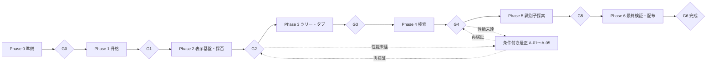

# codeView 実装計画・タスクリスト

| 項目 | 内容 |
| --- | --- |
| 作成日 | 2026-10-30 |
| 状態 | 実装進行中。実施内容・試験結果・環境制約は[実装記録](development-log.md)を参照 |
| 対象 | アプリ本体・単体テスト・文書更新・性能評価・Windows / macOS向け配布物の完成まで |
| 根拠 | [要件定義書](requirements.md)、[基本設計書](basic-design.md)、[アーキテクチャ設計書](architecture.md)、[詳細設計書の索引](detailed-design/README.md) |

## 1. 進め方と完了の定義

設計書のPhase 1〜6を維持し、その前に準備作業をPhase 0として置く。起動・UI応答・メモリを優先し、大容量表示の採否をPhase 2で判断してからツリー・検索を本格実装する。日程・工数は担当者、基準機、SDK・ライブラリ採用と試作結果が揃った時点で見積もる。

本書のチェックボックスは、各行の成果物と検証を満たした時点で完了にする。コードが書けたことだけでは完了にしない。完了日・コミット・試験結果の保存先・残課題はタスクIDに対応付けて記録する。未実施の実機試験や未定の性能予算は未完了とする。

コード変更タスクには共通で次を含める。

- 正常系・異常系・境界値の単体テストを同時に追加・更新する。テストID群は詳細設計08の台帳に従う。
- 対象機能の結合試験、関連ドキュメントの更新、依存方向・資源寿命・書込経路のレビューを行う。
- 性能影響がある場合はCPU・メモリ・起動・描画・検索の適用項目を測り、未対応は未測定として記録する。
- 不要なリファクタリングや機能追加を含めず、コミットメッセージは日本語で記載する。

実装完了は、F-01〜F-09、必須の品質シナリオ、両OSの受け入れ試験、自己完結型の配布物、利用・ビルド手順が揃い、最終ゲートG6を通過した状態とする。公開サイトへのアップロードや第三者への配信は本計画に含めない。

L1（5万ファイル・1 GiB）は必須性能評価、L2（20万・5 GiB）は拡張評価、L3（100万・20 GiB）は限界調査として実施・結果を記録する。L3の高速・全件完走を完了条件に追加しない。100 MiBは本文の拡張評価であり、1 GiB級本文の調査は代替方式の評価に必要な場合だけ行う。

## 2. 依存関係とゲート

「依存」は当該作業を開始するための前提タスクを示す。ゲートG0〜G6は、そのPhaseの通常タスク全件と、必要になった是正の完了を確認する。前Phaseのゲート未通過でも、性能データ準備や配布環境の手配など、判断に依存しない作業は進められる。

環境確保・別OS実測だけが未完了の場合は、共通実装・手元でのビルドと単体試験を先行できる。対象タスクとゲートのチェックは全完了条件を満たすまで外したままにし、未検証OSと先行理由を実装記録に残す。依存する仕様判断・安全条件・本文モデルの採否や性能予算の固定を省略するためには使わない。

P3-02のFiles内部の直下/深さ優先列挙は、本文モデル・ワークスペースの状態に依存しないため共通基盤として先行検証できる。利点はGUI環境待ちでもリンク・除外・I/O資源・L1規模の問題を早期に確認できること、不利点はWorkspace/UIへ接続した時の再検証が必要になることである。層・依存は変えず、Filesの単体試験→Workspaceでの世代/設定固定→ツリーUIと実機性能の順で接続する。先行実装だけでP3-01/P3-02/G2/G3を完了にせず、本文採否や長行是正の依存は維持する。

P3-01のルート状態・設定固定・世代取消と、P3-06の共通Openへのフォルダ入力接続も本文モデルから独立した範囲だけ先行する。目的は設定競合・旧ルート採用・終了時のI/O残存を単体試験で確認すること。利点は表示方式の判断待ちでも寿命管理を検証できること、不利点は実ツリー・検索・複数タブとの接続後に再検証が必要なこと。Operations/Files/Presentationの既存依存内に追加し、新しいレイヤやCoordinatorは設けない。ルート状態→パス/項目数表示→後続のツリー/検索接続の順に進め、G2・G3およびP3-01/P3-06の完了判定は維持する。

ゲート未達時は「未完了／理由／次の是正」を記録する。結果を見て合格予算を緩めたり、未測定を合格にしたりしない。本文モデル、モジュール、依存方向、公開API、データ構造の変更が必要なら、理由・メリット・デメリット・影響範囲・移行計画を提示し、承認後に実施する。

## 3. Phase 0：準備・試験条件の整備

参照：[詳細設計01](detailed-design/01-contracts.md)、[07](detailed-design/07-settings-distribution.md)、[08](detailed-design/08-validation.md)。

- [x] **P0-01：要件・品質・設計の実装対象と未決事項を台帳化する**
  依存：なし。完了条件：F-01〜F-09、Q-01〜Q-08、QS-01〜QS-12、D-01〜D-10を本計画と照合し、制限・仮定・対象外を共有できる。

- [ ] **P0-02：Windows / macOSの開発・基準機・別PC試験環境を確保する**
  依存：P0-01。完了条件：OS・CPU・RAM・ストレージ・60Hz等の表示条件・権限・オフライン環境・Gatekeeper確認手順を記録する。

- [ ] **P0-03：SDK・UIの採用候補と試験ランナーを確認する**
  依存：P0-01。完了条件：実装時点の.NET LTSとAvalonia候補の互換性、ライセンス、両OSビルド可否を確認する。本文・文法版はPhase 2の採否待ちと区別する（D-01）。

- [ ] **P0-04：試験結果の記録様式とローカル計測手順を準備する**
  依存：P0-02。完了条件：ビルド・データ・設定・機材・予算・結果・未実施理由を残せる。CPU、ヒープ、GC、LOH、フレーム、I/Oの取得可否と計測負荷を確認する。

- [ ] **P0-05：機能用の小さな固定データを用意する**
  依存：P0-01。完了条件：詳細設計08の期待値、文字コード、不正バイト、リンク、C#基本宣言、更新・権限失敗のデータを再現可能に作れる。

- [ ] **P0-06：大容量本文・規模別リポジトリの生成手順を用意する**
  依存：P0-02、P0-04。完了条件：10/50/100 MiB・50 MiB×5、L1/L2/L3、長行・多一致の生成seed・分布・期待件数を記録。生成と性能測定を別工程にする。

- [ ] **P0-07：設定保存の例外と初期提供範囲を確認する**
  依存：P0-01。完了条件：ソース書込禁止と専用JSON保存の解釈（D-07）、初期言語・固定テーマ・単一ルート等の前提を記録。未確認なら設定保存を有効にしない。

- [ ] **G0：準備完了** — P0-01〜P0-07の成果物があり、未決事項の決定時期と未確認の機能の扱いが明確である。

## 4. Phase 1：プロジェクト骨格・読み取り専用の単体表示

参照：[詳細設計01](detailed-design/01-contracts.md)、[02](detailed-design/02-runtime-ui.md)、[03](detailed-design/03-files-tree.md)、[04](detailed-design/04-documents-tabs.md)、[07](detailed-design/07-settings-distribution.md)。

このPhaseの本文表示は第一候補の最小構成を利用する。スレッド制約・大容量性能・最終採否はPhase 2へ残し、仮採用であることを記録する。

- [ ] **P1-01：製品1・試験1プロジェクトとビルド基盤を作る**
  依存：G0。完了条件：`src/codeView`、`tests/codeView.Tests`、SDK固定・依存固定・ビルド/テスト手順があり、両OSで骨格をビルドできる。

- [ ] **P1-02：共通値・エラー・位置・操作識別を実装する**
  依存：P1-01、P0-05。完了条件：UI非依存の型、UTF-16位置、改行、Epoch採用条件、結果区分をCT-01〜CT-04で確認する。

- [ ] **P1-03：最小ウィンドウとMVVMの操作入口を作る**
  依存：P1-01。完了条件：メニュー・本文領域・状態表示・空画面を表示し、初回描画を計測できる。重い初期化をコンストラクターに置かない。

- [ ] **P1-04：SettingsStoreの読込・検証・既定値を実装する**
  依存：P1-02、P0-07。完了条件：保存場所優先、JSON・版・サイズ・除外名、不正時の既定値をSD-01・SD-02で確認。保存処理はまだ接続しない。

- [ ] **P1-05：設定待ちOpenキューと起動状態を実装する**
  依存：P1-02、P1-03、P1-04。完了条件：CLI・メニュー・ドロップを同じ受付へ接続し、設定確定の一度性・FIFO・時間超過・上限・遅延完了をRT-01で確認（QS-10）。

- [ ] **P1-06：読取専用のSourceAccessと最小FileReaderを実装する**
  依存：P1-02。完了条件：通常パス・種別・存在・権限・読取前後情報を確認でき、UTF-8の小ファイルと空ファイルをUI外で読む。FT-01・FT-03の基礎ケースを通す。

- [ ] **P1-07：最小DocumentAdapterと単体ファイル表示を接続する**
  依存：P1-03、P1-05、P1-06。完了条件：読込中・表示・失敗を区別し、小ファイルを表示する。DT-01の基礎ケース、入力・貼付・Undo・ドロップ挿入による本文不変を確認。

- [ ] **P1-08：セッション・処理枠・Task観測・例外・終了境界を作る**
  依存：P1-02、P1-05、P1-07。完了条件：本文枠1件、旧結果拒否、取消・停止待ち、未知例外の異常終了、設定保存停止、終了待ち上限をRT-02・RT-05で確認。

- [ ] **P1-09：起動・安全性の初期評価と文書更新を行う**
  依存：P1-01〜P1-08。完了条件：両OSのRelease起動を10回以上測定し、初回描画・指定ファイル操作可能時刻を分離。ソースハッシュ不変・依存方向と最小起動を確認し、READMEの実装状況を更新。

- [ ] **G1：骨格完了** — P1-01〜P1-09が完了し、読み取り専用表示・共通Open・設定待ち・取消/例外境界が動作する。起動目標未達は原因を是正し、Phase 2で予算を固定・検証できる計測基盤が整っている。

## 5. Phase 2：本文・文字コード・大容量表示の採否

参照：[詳細設計03](detailed-design/03-files-tree.md)、[04](detailed-design/04-documents-tabs.md)、[08](detailed-design/08-validation.md)。性能面の最大の不確実性をこの段階で解消する。

- [ ] **P2-01：本文・割当・GC・描画の予算を測定前に固定する**
  依存：G1、P0-04、P0-06。完了条件：基準機、読込時間・メモリ上限・再読込ピーク・GC停止/割当・描画の合格値、文法キャッシュ評価条件を記録（D-03）。

- [ ] **P2-02：バイナリ判定・厳格な文字コード準備を実装する**
  依存：P2-01、P1-06。完了条件：BOM、UTF-8、CP932、UTF-16/32、手動指定、曖昧・不正入力、チャンク・改行境界、更新検出をFT-02・FT-03で確認。

- [ ] **P2-03：文書構築・所有移譲・借用チャンクを実装検証する**
  依存：P2-02、P1-07。完了条件：UI外で構築し、所有中のawaitによるスレッド移動を避け、UIへ安全に接続。全文重複・Undo履歴・未採用文書の残留をDT-01で確認（D-02）。

- [x] **P2-04：読取ビューと本文内検索の評価用走査を作る**
  依存：P2-03。完了条件：本文をUI外で安全に走査でき、毎回の全文複製がなく、読取中の閉鎖・入替でLease寿命が正しい。D-04の方式比較に必要な初期応答を測れる。
  完了：2026-10-31。候補モデルのReadLeaseとVisitChunksを、原文不変・取消・境界・AppOperationsによる走査中の閉鎖/入替・50 MiB走査の割当/初期応答で検証。[記録・証跡](development-log.md#2026-10-31本文readleaseの逐次走査)。P2-03のGUI/長行是正と本文モデル採用は引き続き未完了であり、本チェックでG2や実際の本文内検索を完了にしない。

- [ ] **P2-05：文法・テーマ同梱と遅延ハイライトを実装する**
  依存：P2-03。完了条件：C#、C（`.c`）、C++（`.cpp`）、ヘッダー（`.h`はC++文法）、JSON、XML、XAML、Markdownの文法同梱・拡張子対応、未知言語、文法失敗、文法停止・切離しをDT-04で確認。C/C++双方のヘッダーと大容量表示を評価し、オンライン取得・起動時全件初期化がない。

- [ ] **P2-06：明示再読込・手動文字コード変更を実装する**
  依存：P2-02、P2-03、P1-08。完了条件：新LoadEpoch、成功時だけ本文/版の入替、失敗時の旧本文維持、カーソル範囲補正をDT-03で確認。自動監視は追加しない。

- [ ] **P2-07：大容量・長行・複数文書の性能を測定する**
  依存：P2-01〜P2-06。完了条件：10/50/100 MiB、50 MiB×5文書、文法有無、スクロール、再読込ピーク、Gen0/1/2・LOH・GC停止を記録し予算と比較。タブUI前は評価用の文書ハーネスを利用可。

- [ ] **P2-08：厳格な事前検証の追加I/Oを評価する**
  依存：P2-02、P0-06、P0-04。完了条件：UTF-8・CP932の検証/消費パスを含む読込時間・物理I/O・CPUをCold/Warmで記録し、D-06の本文側の可否を判断。検索側はPhase 4で再判定。

- [ ] **P2-09：本文・文法の採否と無効化条件を確定する**
  依存：P2-04、P2-07、P2-08。完了条件：D-01の本文/文法版、D-02・D-03、色分け閾値・キャッシュ予算を記録。未達ならA-01〜A-05を必要範囲で実施し再測定。無条件に第一候補を確定しない。

- [ ] **G2：表示基盤の採否確定** — P2-01〜P2-09と必要な是正が完了し、数十MiBで本文表示・スクロール・メモリ・読取ビューが成立する。100 MiBの拡張結果と未対応限界も明記する。以降の検索・タブを未採用モデルへ固定しない。

## 6. Phase 3：ワークスペース・ツリー・タブ

参照：[詳細設計02](detailed-design/02-runtime-ui.md)、[03](detailed-design/03-files-tree.md)、[04](detailed-design/04-documents-tabs.md)。

- [ ] **P3-01：ワークスペースとルート切替を実装する**
  依存：G2。完了条件：単一ルート、設定スナップショット、旧列挙/検索の無効化、既存タブ維持をRT-03で確認。確定前ルートで検索しない。
  先行実装：2026-10-31、設定固定・ルート状態・世代/取消・直下列挙枠・単体ファイル保持・失敗状態と再読込を単体試験で確認。ツリー/検索/複数タブへの接続と実機確認は未完了。[実装記録](development-log.md#2026-10-31ルート選択切替と共通openへの接続)。

- [ ] **P3-02：DirectoryReaderの遅延列挙・対象判定を実装する**
  依存：P3-01。完了条件：直下だけの読込、共通除外、名前順、フォルダリンク非走査、ファイルリンクの明示Open、枝失敗をFT-01・FT-04で確認。

- [ ] **P3-03：ツリーUI・展開枠・キャッシュ破棄を実装する**
  依存：P3-02。完了条件：展開/折りたたみ/再読込、読込中・空・失敗の区別、仮想化、同ノード要求集約・待機上限・折りたたみ済み破棄を確認。
  先行実装：TreeSessionの論理ノード、要求集約、枠1/待機64、LRU上限10,000、子孫取消/遅着破棄、ルート切替時の終了待ちを単体検証。UIへ最大256行のバッチ反映・部分削除・選択維持を接続し、VirtualizingStackPanelを明示した。コンテナの実現数、ネイティブ入力、実機性能は未確認。

- [ ] **P3-04：複数タブとパス重複防止を実装する**
  依存：P3-01、P2-06。完了条件：表示済み/予約中の同パスを統合し、同名別パスは区別。タブ選択・閉鎖・ショートカット・0タブをDT-02で確認。

- [ ] **P3-05：タブごとの表示状態と本文寿命を実装する**
  依存：P3-04、P2-04。完了条件：カーソル・スクロール・検索条件を保持し、アクティブViewだけ接続。閉鎖・再読込中の旧通知、Lease・文法・購読解放をDT-01・DT-03・DT-06で確認。

- [ ] **P3-06：入力・パネル・ステータスの操作を仕上げる**
  依存：P3-03、P3-05。完了条件：メニュー・ドロップ・CLIのファイル/フォルダ指定、複数指定制限、ツリー表示切替、パス/行列/文字コード、コピー・フォーカス・タブ切替を両OSで確認。
  先行実装：メニュー/CLI/ツリーに加えてローカルファイル/フォルダのドロップを共通Openへ接続。設定待ち・混在指定・転送寿命・全体拒否・上限を単体/結合検証。本文のテキストドラッグ挿入は無効。Finder/Explorer、本文への各入力、コピー/フォーカス、タブ切替と両OSの受入は未完了。

- [ ] **P3-07：ツリー規模・タブ開閉の資源を評価する**
  依存：P3-02〜P3-06、P0-06。完了条件：L1の初期表示・直下展開各1秒以内の暫定目標を評価。L2/L3のツリー、深い階層・直下大量・反復開閉・取消後の解放を記録。

- [ ] **P3-08：構造レビューと回帰・文書更新を行う**
  依存：P3-01〜P3-07。完了条件：Operationsの変更波及、ContractsへのUI混入、DocumentAdapter結合度、読取/設定書込の分離を確認。分割の根拠がある場合だけ変更提案。起動・本文性能の回帰結果を残す。

- [ ] **G3：閲覧操作完了** — P3-01〜P3-08が完了し、F-01〜F-04・F-08の対象操作、ルート切替・リンク・除外・本文解放を確認できる。L3は限界点の記録をもって評価とし、完走を保証しない。

## 7. Phase 4：ファイル内検索・全文検索

参照：[詳細設計05](detailed-design/05-search.md)、[01](detailed-design/01-contracts.md)、[08](detailed-design/08-validation.md)。

- [ ] **P4-01：検索仕様・予算・キャッシュ準備条件を固定する**
  依存：G3、P2-04、P0-04。完了条件：D-04・D-05・D-10の判断条件を明記。行単位、上限、補助平面文字、Cold/Warm、L1時間/メモリ/GC予算、UIバッチ予算を試験前に固定する。

- [ ] **P4-02：通常・単語照合と共通位置計算を実装する**
  依存：P4-01。完了条件：大小文字、Unicode非正規化、単語境界、非重複一致、チャンク持越し・CRLF・EOF・長行の有界保持をSR-01・CT-01で確認。

- [ ] **P4-03：正規表現の検証・行照合を実装する**
  依存：P4-01、P4-02。完了条件：UI外での構築、不正式、有限タイムアウト、行上限、0文字一致、サロゲート内一致の扱いをSR-02で確認。制限を利用者向け説明へ記載。

- [ ] **P4-04：検索用の逐次走査と全文検索ワーカーを実装する**
  依存：P4-02、P4-03、P3-02。完了条件：深さ優先列挙・除外/リンク・厳格読取・エラー代表例・進捗集約を実装。全パス一覧や索引なしでFT-05・SR-03を通す。

- [ ] **P4-05：有界イベント・仮結果・終端処理を実装する**
  依存：P4-04、P1-08。完了条件：Hits/Committed/Invalidated、生成上限、取消可能な満杯待ち、未確定IDの終端処理、Task観測・枠解放をSR-03・SR-04で確認。

- [ ] **P4-06：共用検索パネル・逐次表示・結果移動を実装する**
  依存：P4-05、P3-06。完了条件：検索条件、件数・部分結果、仮結果の移動禁止、4ms等のUI予算、通知集約、隠す/クリア/取消の区別、タブ再利用・古い位置の検証をSR-04・DT-05で確認。

- [ ] **P4-07：ファイル内検索方式を比較し採用する**
  依存：P4-01、P4-02、P4-03、P2-04。完了条件：段階的・可視領域優先・必要時探索の初回ハイライト、次/前、CPU・割当・保持を50/100 MiBで比較し、D-04の採用根拠を残す。

- [ ] **P4-08：本文内検索UI・タブ別状態・次/前移動を実装する**
  依存：P4-07、P3-05。完了条件：Ctrl/Cmd+F、IME確定後の入力追従、可視ハイライト、上限後の追加走査、折返し、未確定件数、再読込・切替取消をSR-05・RT-04で確認。

- [ ] **P4-09：検索・ルート・タブ・終了の競合を検証する**
  依存：P4-06、P4-08。完了条件：旧世代の後着、検索A→B→C、キュー満杯、FileInvalidated前の失敗、閉鎖後Lease解放を制御可能な試験で再現し不正採用0件を確認（QS-04・QS-05）。

- [ ] **P4-10：L1のCold/Warm・追加I/O・GCを評価する**
  依存：P4-01〜P4-09。完了条件：通常語/正規表現、未一致完走・初回仮/確定結果・多一致・取消を分離して測定。検証パスを含むCPU/物理I/O、Gen0/1/2・LOH・停止を記録しD-05・D-06を判定。

- [ ] **P4-11：L2/L3・検索例外・回帰・文書更新を行う**
  依存：P4-10。完了条件：拡張/限界と未完了理由、UI応答・上限・解放を記録。両OSの起動/表示/ツリー回帰とF-05・F-09の利用説明を更新。未達は必要なAタスクで是正。

- [ ] **G4：検索完了** — P4-01〜P4-11が完了し、F-05・F-09、D-04〜D-06・D-10の関連判断、QS-03・QS-04・QS-05・QS-11・QS-12を満たす。完全結果と部分結果、Cold/Warmの未確認を混同しない。

## 8. Phase 5：簡易定義ジャンプ・参照検索

参照：[詳細設計06](detailed-design/06-navigation.md)、[05](detailed-design/05-search.md)。

- [ ] **P5-01：探索契約・対応構文・解析予算を固定する**
  依存：G4。完了条件：ISymbolNavigatorと簡易版、宣言/リテラル対応、トークン/窓/深さ上限、代表データ・既知の精度制限を記録。意味解析・常駐索引を導入しない。

- [ ] **P5-02：識別子抽出・名前比較を実装する**
  依存：P5-01。完了条件：選択/カーソル、Unicode、`@name`、予約語、語直後・空・複数語・エスケープ表記の扱いをNV-01で確認。

- [ ] **P5-03：C#の逐次字句走査を実装する**
  依存：P5-01、P2-02。完了条件：コメント・各リテラル・補間/raw対応・非対応を区別し、元位置を保持。有界トークン・文脈、未完了/上限時のファイル無効化をNV-02・NV-03で確認。

- [ ] **P5-04：宣言候補の検出を実装する**
  依存：P5-02、P5-03。完了条件：class/struct/interface/enum/record/delegate、基本メソッド/プロパティ/フィールド、複数行・ジェネリック・属性を検出。呼出し/ローカルの誤検出と同名候補を固定試験で確認。

- [ ] **P5-05：候補一覧と自動/明示移動を接続する**
  依存：P5-04、P4-06。完了条件：全件評価済み1件のみ自動移動、複数候補・0件・未評価あり・取消・上限の表示と明示選択をNV-04で確認。「簡易」「名前一致」を明記。

- [ ] **P5-06：参照検索を共通検索へ接続する**
  依存：P5-02、P4-06。完了条件：大小区別・単語一致・通常文字列の条件変換、コメント/文字列/宣言を含む全テキスト対象をNV-05で確認。Shift+F12から移動できる。

- [ ] **P5-07：精度・資源・統合回帰と文書更新を行う**
  依存：P5-01〜P5-06。完了条件：C#基本宣言でF-06・F-07を受け入れ、誤検出/見逃し・未対応構文を記録。検索共有枠・取消・旧候補拒否、起動/描画/メモリ回帰を確認。

- [ ] **G5：必須機能の実装完了** — P5-01〜P5-07が完了し、F-01〜F-09の結合操作が両OSで動作する。コンパイラ相当の精度やL3の完走を達成扱いにせず、配布・長時間試験はPhase 6へ残す。

## 9. Phase 6：最適化・配布・最終受け入れ

参照：[詳細設計07](detailed-design/07-settings-distribution.md)、[08](detailed-design/08-validation.md)、要件9章。

- [ ] **P6-01：提供CPU・配布形式・署名/公証・最終予算を確定する**
  依存：G5、P0-02、P0-07。完了条件：D-08・D-09を具体化し、8時間/反復試験の資源許容幅・別PCの一覧・オフライン初回条件を試験前に固定。

- [ ] **P6-02：専用設定の保存・保護を仕上げる**
  依存：G5、P0-07、P1-04。完了条件：D-07で許可された範囲のみ実装。保存場所・版・未知項目・リンク/ソース衝突・外部更新・一時書込/置換失敗で旧設定を守る（SD-02・SD-03）。未確認なら未完了とする。

- [ ] **P6-03：OS・CPU別の再現可能な発行手順を作る**
  依存：P6-01。完了条件：自己完結、文法・ネイティブ依存・ライセンス同梱、依存固定、成果物ハッシュと発行設定を記録。インストーラー・追加ランタイムを要求しない。

- [ ] **P6-04：発行形式と起動・資源使用量を比較し最適化する**
  依存：P6-03、P6-02。完了条件：単一ファイル/最小フォルダ・ReadyToRun有無の起動/容量/展開/メモリを比較。UI・メモリを悪化させず選定し、変更箇所の回帰試験を通す。

- [ ] **P6-05：全試験と最終性能回帰を両OSで実行する**
  依存：P6-04。完了条件：CT/RT/FT/DT/SR/NV/SDの全35群、L1、L2/L3記録、起動10回以上、本文/検索/CPU/GC予算を固定成果物で確認。未達の是正後は影響範囲を再検証。

- [ ] **P6-06：macOS固有の受け入れを実施する**
  依存：P6-04、P6-01。完了条件：Finderの単体/複数/日本語パス/リンクのドロップ、IME、Cmd/F12、Retina/トラックパッド、Gatekeeper有効・隔離属性・署名状態ごとの起動を確認（QS-08）。

- [ ] **P6-07：別PCのコピー起動・完全オフライン・ソース不変を確認する**
  依存：P6-04、P6-01。完了条件：Windows/macOSでSDK/追加ランタイムなしの起動、初回と通常、全必須機能・同梱文法、外部通信不要と対象ハッシュ不変を確認（SD-04・QS-06）。

- [ ] **P6-08：長時間・反復試験を両OSで実施する**
  依存：P6-01、P6-04。完了条件：10分以上のウォームアップ後8時間、タブ開閉1,000サイクル、検索1,000回を実施し、参照・購読・Task・Lease・ハンドル・CPU/メモリ・応答が予算内（QS-07）。

- [ ] **P6-09：不具合・性能未達を是正し必要な試験を再実行する**
  依存：P6-05〜P6-08。完了条件：各指摘に修正・再試験・結果を対応付け、対象の受け入れ条件を満たす。構造変更時はAタスクを経由。成果物変更後は旧版の試験で合格にしない。

- [ ] **P6-10：README・設計・制限・開発/配布手順を最終更新する**
  依存：P6-09。完了条件：実際のSDK/依存版・ビルド/テスト/発行/起動、CPU、署名手順、操作・ショートカット、文字コード/検索制限・簡易精度を記載。未実装表記を実態に合わせる。

- [ ] **P6-11：最終成果物と受け入れ証跡を整理する**
  依存：P6-10。完了条件：提供対象ごとの配布物・ハッシュ・ライセンス・試験結果・未対応制限・D台帳を揃え、要件9章の各項目を証跡付きで判定。第三者へ自動配信しない。

- [ ] **G6：完成** — P6-01〜P6-11が完了し、要件の受け入れ基準を満たす。必須項目の未測定・未確認・未是正は残さず、拡張/限界評価の範囲と製品制限を明記した成果物をレビュー可能な状態にする。

## 10. 条件付きの是正・設計変更

以下は通常タスクではなく、性能未達・ライブラリ制約・構造上の問題が確認された場合に発動する。不要ならチェックを付けず「適用不要・根拠」を記録し、通常タスク未完了と混同しない。適用時は対象ゲートへ戻って検証する。

- [ ] **A-01：未達原因と改善候補を切り分ける**
  依存：P2-07/P2-08/P4-10/P6-05等の未達。完了条件：I/O・デコード・本文・文法・照合・UI・割当を分離した測定結果。色分けなし/バッチ調整等の構造を変えない対策も評価。

- [ ] **A-02：必要な代替方式を比較試作する**
  依存：A-01で既存構造の対策では不足。完了条件：本文なら仮想テキストモデル・ストリーミング・MemoryMappedFileを必要範囲で比較。検索なら追加I/Oや逐次方式の代替を評価。Operations等の分割は変更波及・試験結合度で判断。

- [ ] **A-03：設計変更案と移行計画を提示し承認を得る**
  依存：A-02で構造変更が必要。完了条件：理由・利点・不利点・影響範囲・移行順・戻し方・受け入れ試験を明示。承認前に製品の層・依存・公開API・データ構造を変えない。

- [ ] **A-04：承認済みの変更だけを実装する**
  依存：A-03。完了条件：関連設計とコード・テストを更新。索引・汎用DI・イベントバス等を未承認で追加しない。

- [ ] **A-05：元の未達条件と影響範囲を再検証する**
  依存：A-04、またはA-01の構造変更不要な修正。完了条件：元データ・固定予算で是正を確認し、検索・位置・タブ・解放・起動を回帰検証。元のゲートへ結果を返す。

## 11. 未決事項の解消担当タスク

| 設計ID | 解消する内容 | 対応タスク |
| --- | --- | --- |
| D-01 | SDK・UI・本文・文法版 | P0-03、P1-01、P2-09、P6-03 |
| D-02 | 本文構築・読取ビュー・保持量 | P2-03、P2-04、P2-07、P2-09 |
| D-03 | 本文・文法・GC・描画予算と閾値 | P2-01、P2-05、P2-07、P2-09 |
| D-04 | ファイル内検索方式 | P2-04、P4-01、P4-07、P4-08 |
| D-05 | 検索予算・Cold/Warm | P4-01、P4-10、P4-11 |
| D-06 | 文字コード事前検証の追加I/O | P2-08、P4-10、必要時A-01〜A-05 |
| D-07 | 設定書込の例外 | P0-07、P6-02 |
| D-08 | 配布CPU・形式・署名/公証 | P6-01、P6-03、P6-04、P6-06、P6-07 |
| D-09 | 規模別・長時間試験の予算 | P0-06、P4-01、P6-01、P6-08 |
| D-10 | 検索上限・行単位・補助平面文字 | P4-01、P4-02、P4-03、P4-08 |

## 12. 要件・品質の確認先

| 対象 | 主なタスク・ゲート |
| --- | --- |
| F-01 ファイルを開く | P1-05〜P1-07、P2-02・P2-06、P3-06、G3 |
| F-02 フォルダ / F-03 ツリー | P3-01〜P3-03、P3-06・P3-07、G3 |
| F-04 ハイライト | P2-05・P2-07・P2-09、G2 |
| F-05 全文検索 | P4-01〜P4-06、P4-09〜P4-11、G4 |
| F-06 定義 / F-07 参照 | P5-01〜P5-07、G5 |
| F-08 タブ | P3-04〜P3-07、G3 |
| F-09 ファイル内検索 | P4-07・P4-08・P4-09、G4 |
| QS-01 起動 / QS-02 大容量 | P1-09、P2-07、P6-04・P6-05 |
| QS-03 応答 / QS-04 旧結果 / QS-05 障害 | P1-08、P3-05、P4-09・P4-10、P5-07 |
| QS-06 安全・オフライン | P1-07、P6-02・P6-07 |
| QS-07 長時間 / QS-08 OS操作 | P6-06〜P6-08 |
| QS-09 L3限界 | P3-07、P4-11、P6-05 |
| QS-10 設定競合 | P1-05、P1-08 |
| QS-11 GC / QS-12 Cold/Warm | P2-07・P2-08、P4-10、P6-05 |

詳細の期待値・正常/異常/境界は[試験設計](detailed-design/08-validation.md)を正とし、本計画で合格基準を増減しない。設計の未決事項が解消された場合は、当該設計書と本タスクリストの両方を更新する。

| 品質特性 | 主な実装・検証タスク |
| --- | --- |
| Q-01 起動性能 | P1-03・P1-09、P2-09、P6-04・P6-05 |
| Q-02 応答・描画 | P2-03〜P2-07、P3-03、P4-05〜P4-10 |
| Q-03 メモリ・資源 | P2-04・P2-07、P3-05・P3-07、P4-05・P4-10、P6-08 |
| Q-04 信頼性 | P1-05・P1-08、P2-06、P4-09、P6-05 |
| Q-05 安全・機密 | P0-07、P1-06・P1-07、P6-02・P6-07 |
| Q-06 使用性 | P3-06、P4-06・P4-08、P5-05・P5-06、P6-06 |
| Q-07 移植・配布 | P0-02・P0-03、P6-01・P6-03・P6-06・P6-07 |
| Q-08 保守・試験 | P1-01・P1-02、P3-08、P5-01、P6-05・P6-10 |
