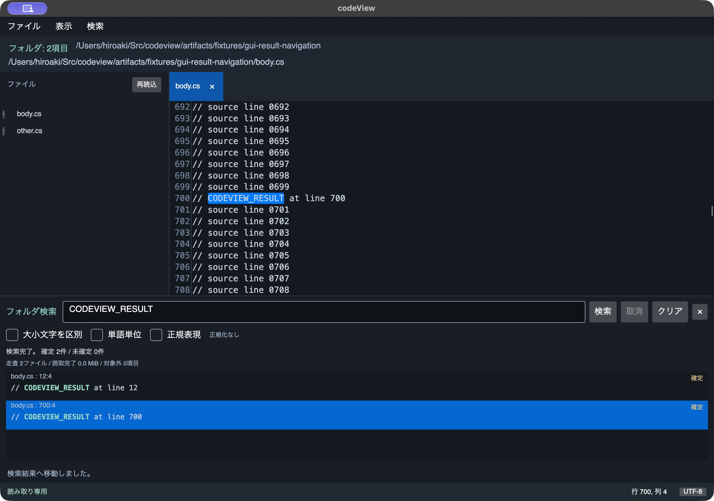
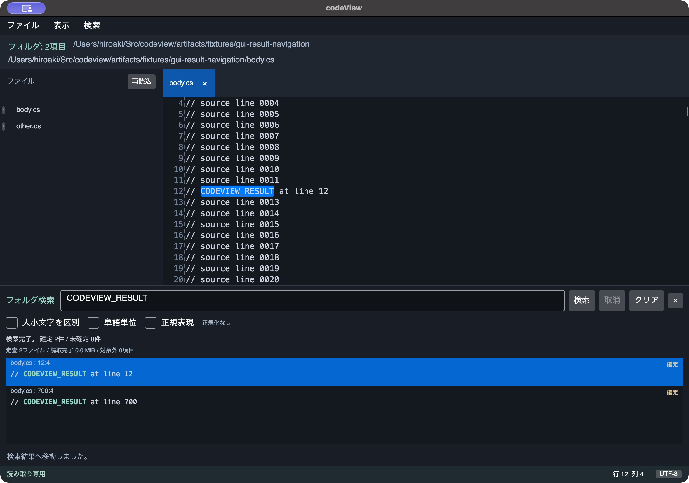
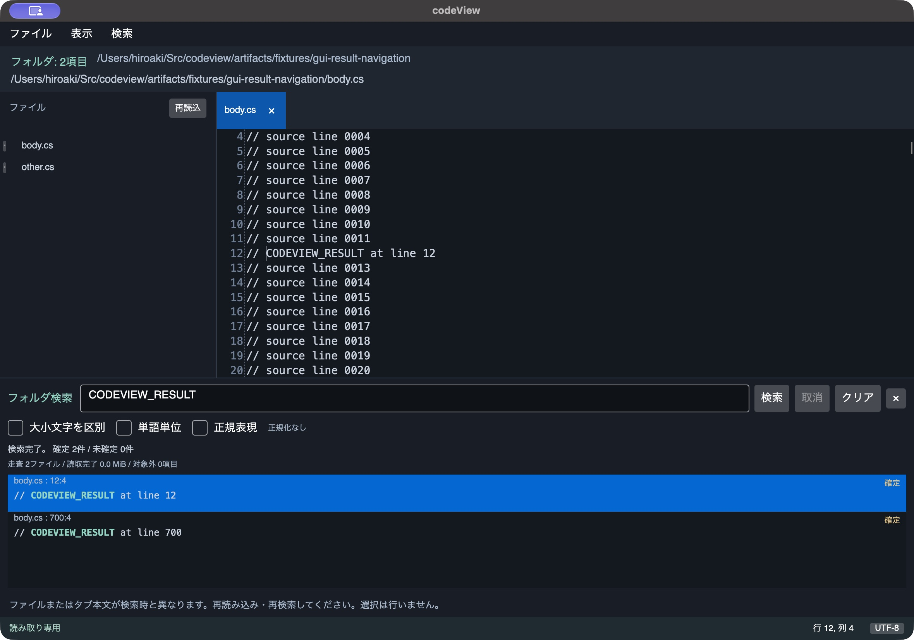

# macOSの検索結果移動確認

基準コミット`932af60`に結果移動の実装を加えたコミット前Releaseビルドを使用した。macOS 27.0.1 / arm64、.NET SDK 10.0.401、Avalonia 12.1.3 / AvaloniaEdit 12.0.0。検証用bundle IDは`local.codeview.resultverification`。製品コードと実行DLLのSHA-256は[source-sha256.json](source-sha256.json)へ保存した。実行物のコピーはartifacts/dev配下で、配布・署名済みのアプリではない。

入力は[input-manifest.json](input-manifest.json)の生成データ。body.csは1,200行分のコメントと末尾LFからなり、最終空行を含む本文モデルでは1,201行になる。通常行は`// source line NNNN`、12/700行目だけを`// CODEVIEW_RESULT at line N`へ置き換えたUTF-8。other.csは1行の別ファイル。既存の利用者のソースは試験用に変更していない。

| 確認 | 操作と観測 | 結果 |
| --- | --- | --- |
| フォルダ受付 | 初回はネイティブフォルダ選択、最終ビルドはCLI引数で同じ生成フォルダを指定 | 直下2項目を表示 |
| 検索とショートカット | Cmd+Shift+Fで検索欄へ移りCODEVIEW_RESULTを入力、検索ボタン | 確定2件・未確定0件、12:4と700:4 |
| 未開封本文への移動 | 700:4の結果を選びEnter | body.csを1タブで開き、700行4列、一致15文字を選択 |
| スクロールとフォーカス | 移動後の画面と、別の確認実行で下矢印を入力 | 700行が隠れず表示、本文の701行へ移る |
| 既存タブ再利用 | 12:4の抜粋テキストをダブルクリック | 1タブのまま12行4列へ移り同じ一致を選択。下矢印で13行へ移る |
| 外部更新 | テスト側で末尾にコメントを追記し、旧12:4をEnterで開く | 更新警告、本文の自動再読込なし、一致選択なし |
| 終了 | ウィンドウを1回閉じる | 最終CLI検証の実行セッションは終了コード0。検証プロセスを残さない |

更新確認後は、生成ファイルの本文/mtimeを復元して元のSHA-256と一致することを確認した。最後の警告/行列/フォーカスのAX状態は[stale-result.ax.txt](stale-result.ax.txt)に保存した。

通常単体試験は444件合格（`tests/codeView.Tests/TestResults/result-navigation-normal-final.trx`）。別の[表示モデル上の1,000回移動測定](model-performance.json)では合計約13.97ms/CPU28.53ms・最大1回3.34ms・割当4,867,896 bytes・GC停止2.81ms（1/0/0）、本文追加Open=0・Stamp確認=1,000・選択通知=1,000だった。事前の2秒/最大100ms/16 MiB/GC100ms予算内。これは直列テスト文脈の測定で、native Windowの描画性能値ではない。

最初の実操作では本文へのFocusが届かず結果一覧に残り、初回表示の移動先行が一部隠れた。Loaded優先度での選択/ScrollToとTextArea.Focusへ変更して再確認した。EnterもListBoxの通常のキー処理に遮られたため、結果一覧のトンネルで処理するよう変更した。行の読み上げ名に型名が出ていた点は相対パス/行列へ修正した。

終了処理の即時完了では元のClosingイベント内からCloseを呼び直す可能性があったため、Dispatcherへ閉じ直しを予約する形に整理した。初回の空画面化は操作ツールによる再起動と同一プロセス追跡を切り分けきれていないため、再現確定とは扱わない。改訂後は1回のCloseと実行セッションの終了コードで確認した。途中の別実行にはmacOSのIMKCFRunLoopWakeUpReliableのmach portメッセージが1行あったが、最終セッションでは出ていない。日本語IMEの変換/確定/取消はまだ受入確認していない。

メニューのポップアップは操作ツールでoffscreenとしてクリックできないことがあり、キーボード操作またはCLIフォルダ指定も併用した。この制約だけをアプリのメニュー表示不具合と断定しない。これは小さい生成入力の機能確認であり、起動1秒、100ms応答、L1検索性能、1万行の実仮想化、大容量/長行、配布物のGatekeeper、Windows/長時間利用の合格を示すものではない。
