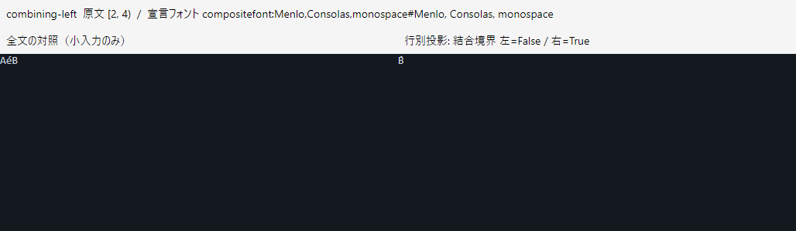
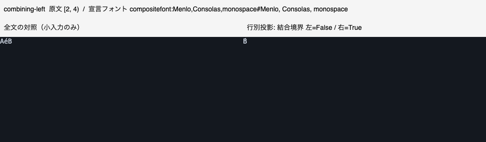

# 行別投影の文字幅・Unicode文脈比較（2026-11-06）

対象は`fef21f412acf0d68200c6e4b8206888d1e8f054d`。[事前固定した条件](../../row-visual-comparison.md)で小さな全文対照と投影を比較した。通常製品/本文/表示方式は変更していない。

[比較取得CI](https://github.com/m-hiroaki/codeView/actions/runs/42219651122)は両OS3独立プロセスずつで成功した。各OS36比較を取得し、原文位置/原文コピーは全件一致したが、各12ケース中8件が条件未達（各OS24比較が不合格）だった。**全6プロセスはAcquired=true / Accepted=false**であり、ワークフローの成功は視覚受入/G2の合格ではない。

## 固定ケースの結果

各数値は先頭プロセスの最大相対X/Y差（DIP）。3プロセスとも同じ採否だった。左右の境界は元の全文についてStringInfo.ParseCombiningCharactersで判定した。

| ケース | 原文の結合境界 | Windows差 | macOS差 | 固定条件の受入 |
| --- | --- | ---: | ---: | --- |
| ASCII途中切出し対照 | 両端を維持 | 0 | 0 | 可 |
| Unicode全文対照 | 両端を維持 | 0 | 0 | 可 |
| タブ位相 | 両端を維持 | 0 | 0 | 可 |
| 結合文字・左端 | 左端を分断 | 7.6973 | 8.4287 | 不可 |
| 結合文字・右端 | 右端を分断 | 7.6973 | 8.4287 | 不可 |
| ZWJ絵文字・左端 | 左端を分断 | 0 | 約0 | 不可 |
| ZWJ絵文字・右端 | 右端を分断 | 19.2227 | 14 | 不可 |
| 国旗RI・左端 | 左端を分断 | 4.1699 | 約0 | 不可 |
| Hangul Jamo・左端 | 左端を分断 | 14 | 12.1100 | 不可 |
| Indic・左端 | 左端を分断 | 0.9365 | 1.3160 | 不可 |
| Bidi埋込み | 両端を維持 | 0 | 0 | 可 |
| Arabic連結 | 両端を維持 | 11.6895 | 8.4014 | 不可 |

約0は浮動小数点誤差1.8e-15程度で、閾値0.1 DIP以内。それでもZWJ/RIの結合境界が切れているため不合格である。サロゲート対と原文位置の往復だけでは表示の正しさを証明できない。Arabicは結合境界だけ補正しても字形の連結文脈が残るため、境界分断とは別の未達として保持する。

タブ/Bidiの数値が一致したことは、今回の全文対照に対する固定ケースの結果だけである。字形輪郭の画素一致、全Bidi規則、別エディターのタブストップ仕様との一致、全フォントの完全対応を証明しない。

## PNGの確認

各プロセス4 PNG、計12 PNG/OSをControl.Renderで96 DPIへ出力し、収集時と再検証時に全ハッシュを照合した。最初のプロセスの4種類を両OSとも目視確認し、全文/投影の文字とラベルが描かれ、結合文字の切詰めで見え方が変わることを確認した。下は左が全文、右が先頭を結合列の途中へ置いた投影である。

PNGは物理画面のスクリーンショット/描画完了ではない。両ランナーのNativeRenderScalingは1で、Retina/別DPIは未評価。フォント宣言は両OSとも`compositefont:Menlo,Consolas,monospace#Menlo, Consolas, monospace`、14 DIP・LTR・タブ幅4である。実際の全フォールバック書体の同定や全グリフの外部基準との一致は未完了。

## 回帰と計測の範囲

[通常CI](https://github.com/m-hiroaki/codeView/actions/runs/42219651152)はmacOS .NET750/Python108、Windows .NET747+既存3スキップ/Python88+既存20スキップで成功。固定入力/原文対応の単体3ケースと、比較記録の収集/判定7ケースを含む。

[行別ライフサイクルCI](https://github.com/m-hiroaki/codeView/actions/runs/42219651126)は各OS9プロセス・1,668検証と9終了後記録が成功し、未解放Handle/Active Leaseは全件0。[通常GUI CI](https://github.com/m-hiroaki/codeView/actions/runs/42219651150)も各OS20起動・216読み取り専用操作が成功した。原文コピーと通常コピーのOS改行正規化はそれぞれの既存契約で再照合した。

CPU/割当/GC/10 msメモリサンプルはControl作成・描画・PNG保存を含む。CaseControlMillisecondsはPNGのFrame待ち/保存も含み、描画だけの速度比較には使わない。Windows PrivateMemorySize64とmacOS phys_footprintを同じ尺度で比較しない。小さな12段落の比較であり、大容量のCPU/メモリ/起動/検索/GC予算の代用ではない。

## 原記録

- `ci.json`：対象コミット、完了/成功した実行ID、Artifact ID、GitHub SHA-256。
- `row-visual-*.zip`：配布ZIPそのもの。全3プロセスの元JSON/ログ/12 PNG・環境・`runs.json`を含む。取得時にSHA-256を照合し、すべての原文/生位置/差/判定/PNGハッシュを再検証した。
- `summary.json`：全プロセスの境界/位置差/採否/CPU/割当/GC/メモリ。
- `row-gui-*.zip` / `native-gui-*.zip`：行別/通常回帰の原記録。全JSON/終了後記録を再検証済み。
- `job-*.log.gz` / `local-unit.*.gz`：通常CIとローカル.NET750/Python108の記録。
- `source-sha256.json` / `files-sha256.json`：対象ソースと、このREADME/指紋一覧自身以外の原記録の指紋。

次は原文とUTF-16位置を変えず、結合境界と前後の描画文脈を有界に扱う是正を検討する。巨大prefixのUI全走査や原文の正規化/全文複製で未達を隠さない。追加の永続索引や別レンダラーが必要なら、未承認で導入せず別提案/承認を先行する。比較タスクA-04-03-03だけを完了とし、是正・物理入力/視覚幅の包括受入・大規模/文法の固定予算・A-04/A-05/G2は未完了のまま維持する。
