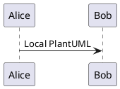

# Markdown AOT fixture

**Rendered bold text** and a [heading link](#original-source).

```csharp
public record Fixture(string Value);
```




## Original source

Switch to the source view to inspect the code fences.
